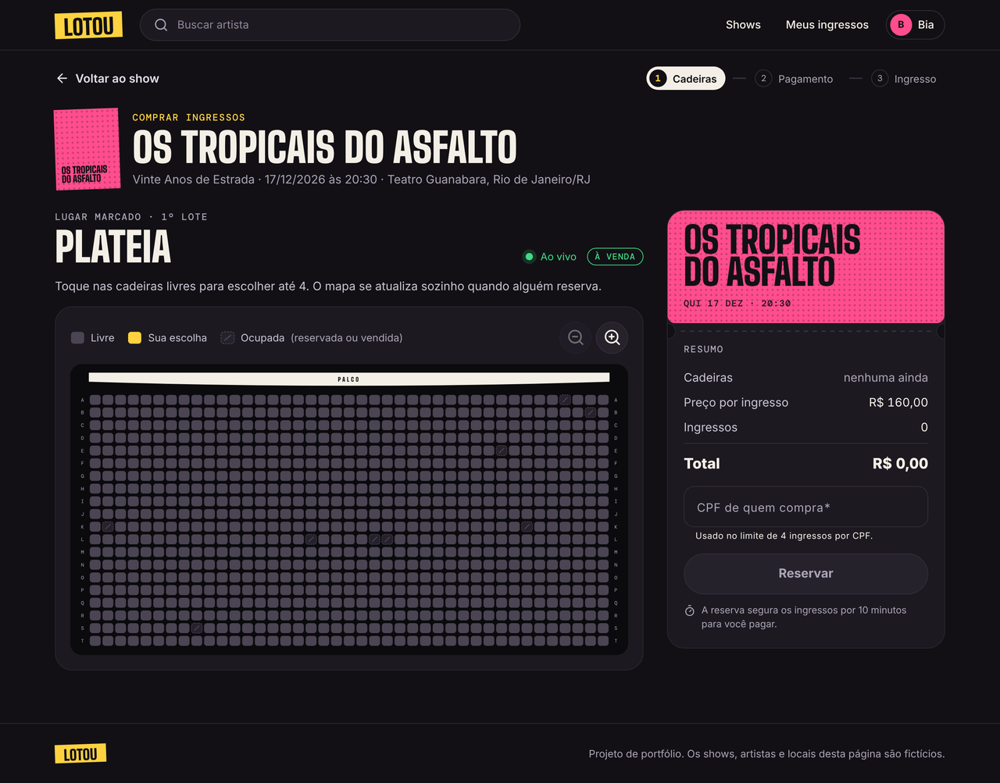
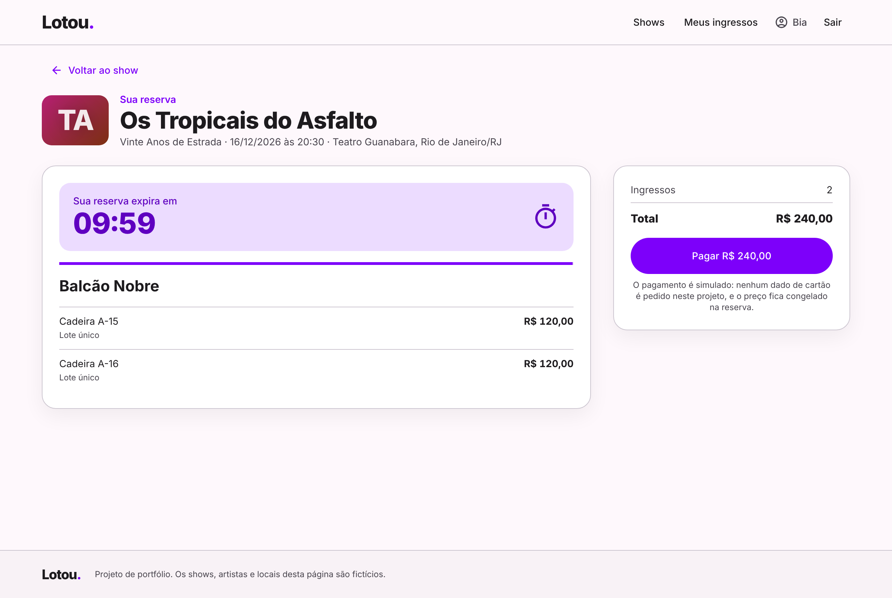
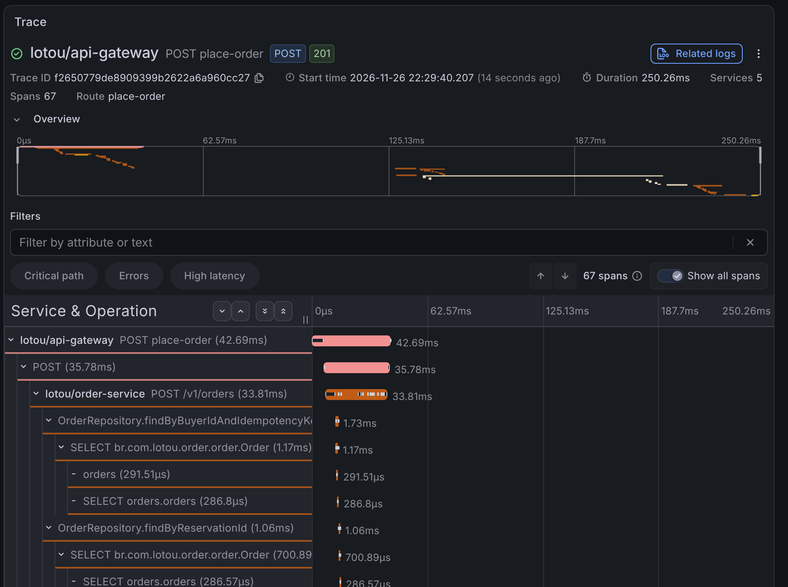
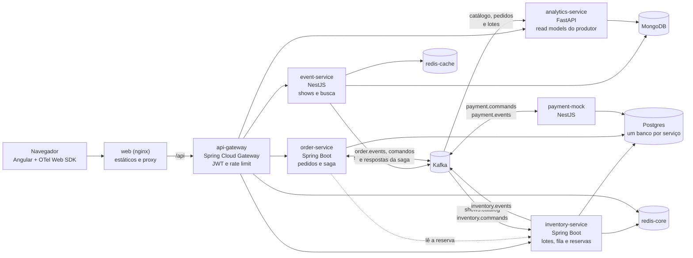

# Lotou.

Plataforma de venda de ingressos para shows: loja, painel do produtor e portaria. O produto é completo, mas o que o projeto quer mostrar é a engenharia por trás da abertura de vendas, quando dezenas de milhares de pessoas disputam poucos milhares de ingressos no mesmo minuto e o sistema não pode vender além da capacidade, vender o mesmo assento duas vezes nem cair.

É um projeto de portfólio, construído em fases. O documento de produto e arquitetura está em [`docs/projeto.md`](docs/projeto.md); as decisões, em [`docs/adr/`](docs/adr/).


## Onde o projeto está

**Fases 0 a 3 concluídas.** O que já funciona:

- o ambiente inteiro sobe com um comando;
- o produtor cadastra e publica shows pela API, e a loja busca e exibe;
- **a compra funciona de ponta a ponta na loja:** login, escolha das cadeiras num mapa que se atualiza sozinho, reserva de 10 minutos, pagamento simulado e ingresso emitido;
- **a abertura de vendas aguenta disputa:** reserva atômica num script Lua no Redis, fila virtual com sorteio nos shows de alta demanda, rate limit no gateway e cache da página do show, tudo medido com k6;
- a autenticação é de verdade (Keycloak, OAuth 2.0 e JWT validado no gateway e em cada serviço);
- **o pagamento é uma saga pelo Kafka:** pedido, pagamento e confirmação da reserva trocam comandos e eventos com outbox, e um pagamento recusado ou uma reserva expirada são compensados sem deixar ingresso preso;
- o produtor vê as vendas e o relatório de cada show em read models que se reconstroem do zero, sem parar, a partir do Kafka;
- cada requisição gera um trace que atravessa os serviços, o Kafka, o banco e o Redis.

| Fase | Entrega | Estado |
| --- | --- | --- |
| 0. Fundação | Compose, CI, OpenTelemetry, gateway, shows e loja Angular | concluída |
| 1. Pedidos e estoque | inventory e order no Postgres, reserva com lock no banco | concluída |
| 2. Redis e abertura de vendas | cache, fila virtual, reserva em Lua e mapa de assentos | concluída |
| 3. Kafka e saga | outbox, saga com pagamento simulado e read models | concluída |
| 4. RabbitMQ e tempo real | ingresso com QR code, DLQ e painel ao vivo | próxima |
| 5. Agente de IA | assistente do produtor com LangGraph | |
| 6. Produto completo | check-in, cancelamento, cupons e relatório financeiro | |
| 7. Vitrine | testes de carga e caos, SLOs e vídeo | |

A fase 1 reservou com lock no Postgres de propósito: ela é a linha de base que a reserva no Redis superou na fase 2. Os dois motores continuam no código, e o teste de carga compara um com o outro.

## Como rodar

Você precisa de Docker (com Compose) e `make`. O ambiente usa cerca de 5 GB de memória.

```bash
make up     # sobe tudo e espera ficar saudável (a primeira vez constrói as imagens)
make seed   # cria cinco locais e cinco shows fictícios
make smoke  # compra um ingresso de ponta a ponta e confere os traces
```

| O quê | Onde |
| --- | --- |
| Loja | http://localhost:4200 |
| API (pelo gateway) | http://localhost:8080/api/v1/shows |
| Grafana (Tempo, Prometheus e Loki) | http://localhost:3000 |
| Keycloak | http://localhost:8180 (`admin` / `admin`) |
| Kafka UI (tópicos, mensagens e lag) | http://localhost:8090 |

O realm do Keycloak já vem com três usuários de teste, um por papel: `comprador`, `produtor` e `portaria`, todos com a senha `lotou123`.

Outros comandos: `make test` roda os testes de todos os serviços, `make down` derruba o ambiente e `make clean` apaga também os dados. `make help` lista tudo.

Se você já tinha o ambiente de uma versão anterior, rode `make clean` antes do `make up`: o realm do Keycloak e os bancos do Postgres só são criados com o volume vazio.

## A compra na loja

Entre na loja com `comprador` / `lotou123`, abra um show em venda e escolha o setor. Nas cadeiras numeradas, o mapa mostra o que está livre e muda sozinho quando outra pessoa reserva (SSE). A reserva segura os ingressos por 10 minutos, e o pagamento é simulado.





Num show de alta demanda (no seed, "Nação Coral"), a compra passa antes pela fila virtual: a sala de espera abre 30 minutos antes das vendas, as posições de quem estava na sala são sorteadas na abertura e o checkout admite um número fixo de pessoas por segundo.

## Abertura de vendas sob carga

A reserva tem dois motores, escolhidos por implantação: o script Lua no `redis-core` (padrão) e o lock no Postgres da fase 1, mantido como linha de base. Os testes de carga rodam com k6 dentro do Compose e, no fim, conferem no Postgres que nada foi vendido além da capacidade.

```bash
make load-opening ENGINE=redis      # 2.000 usuários disputando 2.500 ingressos por 40 s
make load-contention ENGINE=redis   # 1.000 compradores pelas mesmas 50 cadeiras
make load-show-page                 # página do show com o cache ligado e desligado
```

Troque `ENGINE=redis` por `ENGINE=postgres` para o motor da fase 1, e rode `make clean up seed` antes de trocar de motor.

| Cenário | Redis + Lua | Postgres + lock |
| --- | --- | --- |
| Abertura: tentativas de reserva respondidas em 40 s | 78.621 | 19.415 |
| Abertura: ingressos vendidos | 2.500 de 2.500 | 2.481 de 2.500 |
| Abertura: latência p99 | 2,98 s | 20,5 s, com 18 timeouts |
| Disputa por cadeira: latência p99 | 283 ms | 1,95 s |
| Venda além da capacidade ou cadeira vendida duas vezes | 0 | 0 |

Com o cache da página do show, o event-service atendeu 2,5 vezes mais leituras (2.475 contra 996 por segundo), com p95 de 117 ms contra 273 ms.

Os números vêm de uma máquina só, de 4 CPUs, com os doze containers e o k6 disputando os mesmos núcleos: o que importa é a comparação, não o valor absoluto. A análise, com o que ficou abaixo da meta, está no [ADR 3](docs/adr/0003-reserva-com-lua-no-redis.md).

## A compra pela API

`make smoke` faz uma compra como um comprador faria, passando pelo gateway:

1. consulta a disponibilidade de um show em venda (`GET /api/v1/availability/{showId}`);
2. reserva um ingresso de pista (`POST /api/v1/reservations`), que fica segurado por 10 minutos;
3. fecha a compra (`POST /api/v1/orders`): o pedido nasce PENDING, e a saga segue pelo Kafka: o payment-mock autoriza o pagamento, o inventory confirma a reserva e o order-service emite o ingresso;
4. acompanha o pedido até CONFIRMED, confere que o estoque baixou e que os traces chegaram completos ao Tempo.

O trace do pedido atravessa o Kafka: do gateway ao order-service, dele ao payment-mock e ao inventory pelos comandos da saga, e ao analytics pelos eventos do pedido. São 5 serviços e 67 spans em 250 ms, do clique em pagar ao pedido confirmado:



O que garante que a compra é correta sob disputa está nos testes, que rodam contra bancos reais:

| Cenário | Resultado |
| --- | --- |
| 200 compradores reservam ao mesmo tempo 50 ingressos de pista | exatamente 50 reservas; o banco nunca fica com contador negativo |
| 100 compradores disputam as mesmas 4 cadeiras | uma reserva leva as quatro; as outras 99 não seguram nenhuma |
| 30 reservas simultâneas do mesmo CPF | exatamente 4 ingressos, o limite por CPF |
| 40 compradores reservam e fecham a compra de 15 ingressos | 15 pedidos confirmados e 15 ingressos emitidos |
| 20 cliques simultâneos em "comprar" para a mesma reserva | um pedido só, cobrado uma vez |
| inventory fora do ar no meio do checkout | o pedido fica pendente e é concluído depois, sem cobrar de novo |

## O trace de ponta a ponta

Um clique na loja gera um trace que atravessa o gateway e o event-service até o MongoDB, visível no Tempo (foi o critério de pronto da fase 0).

Abra a loja, clique num show e depois abra o Grafana em **Explore > Tempo > Search**. O trace começa no navegador (`lotou-web`), passa pelo `api-gateway`, chega ao `event-service` e termina na consulta ao MongoDB:


Como funciona:

- o **Angular** usa o OpenTelemetry Web SDK: cada chamada à API ganha um span e leva o cabeçalho `traceparent`;
- os **serviços Java** (api-gateway, inventory-service e order-service) rodam com o Java agent do OpenTelemetry, que continua o trace sem código de instrumentação e cobre HTTP, JDBC e Hibernate;
- o **event-service** usa a auto-instrumentação do Node, que cobre o HTTP e o driver do MongoDB;
- todos exportam por OTLP para o **OTel Collector**, que mascara CPF e e-mail antes de repassar ao Tempo, ao Prometheus e ao Loki. Os logs saem em JSON com `trace_id`, então dá para ir do log ao trace.

`make smoke` confere os traces pela linha de comando, e o CI repete a conferência a cada push.

## Arquitetura

O que existe hoje:



Todos os serviços validam o JWT com as chaves públicas do Keycloak e exportam traces, métricas e logs por OTLP para o OTel Collector, que mascara CPF e e-mail antes de repassar ao Tempo, ao Prometheus e ao Loki.

Fora o caminho do usuário, os serviços se falam pelo Kafka: **fatos de domínio** (`OrderConfirmed`, `LotSoldOut`) e **comandos da saga** (`AuthorizePayment`, `ConfirmReservation`), sempre gravados num outbox na mesma transação da mudança ([ADR 1](docs/adr/0001-kafka-para-eventos-de-dominio.md), [ADR 8](docs/adr/0008-outbox-transacional.md)). Os contratos de todas as mensagens estão em JSON Schema em [`contracts/`](contracts/). A única chamada síncrona entre serviços (pontilhada) é a leitura da reserva ao criar o pedido: o comprador precisa saber na hora se ela ainda vale ([ADR 6](docs/adr/0006-reserva-sincrona-pagamento-assincrono.md)).

Durante a venda, o `redis-core` decide a reserva, e o Postgres recebe o resultado por um Redis Stream escrito no mesmo script ([ADR 26](docs/adr/0026-redis-como-fonte-da-verdade-durante-a-venda.md)). Os dois Redis têm políticas de memória opostas: o cache pode descartar chaves, o estoque não ([ADR 10](docs/adr/0010-duas-instancias-de-redis.md)). A arquitetura completa, com os nove serviços, Kafka e RabbitMQ, está em [`docs/projeto.md`](docs/projeto.md#arquitetura).

### Serviços

| Pasta | Stack | Responsabilidade |
| --- | --- | --- |
| [`apps/web`](apps/web) | Angular 22 | loja: busca, página do show, login, fila, checkout com mapa de cadeiras e meus ingressos |
| [`services/api-gateway`](services/api-gateway) | Java 21, Spring Cloud Gateway, Redis | roteamento, validação do JWT e rate limit da compra |
| [`services/event-service`](services/event-service) | Node, NestJS 12, MongoDB, Redis, Kafka | shows, locais, setores e busca, com cache e rate limit; publica o catálogo |
| [`services/inventory-service`](services/inventory-service) | Java 21, Spring Boot 4, Redis, Kafka, Postgres | lotes, disponibilidade, reservas, fila virtual e mapa de assentos ao vivo |
| [`services/order-service`](services/order-service) | Java 21, Spring Boot 4, Kafka, Postgres | pedidos, ingressos e a saga de compra |
| [`services/payment-mock`](services/payment-mock) | Node, NestJS 12, Kafka, Postgres | gateway de pagamento simulado: recusa, estorno e latência configuráveis |
| [`services/analytics-service`](services/analytics-service) | Python 3.13, FastAPI, Kafka, MongoDB | vendas, relatório e pedidos de cada show para o produtor, com replay |

Cada pasta tem seu README, com a API, a estrutura e os comandos.

### Estrutura do repositório

```
lotou/
├── apps/web/                # Angular (loja)
├── services/
│   ├── api-gateway/         # Java
│   ├── event-service/       # Node
│   ├── inventory-service/   # Java
│   ├── order-service/       # Java
│   ├── payment-mock/        # Node
│   └── analytics-service/   # Python
├── contracts/               # JSON Schema de cada mensagem do Kafka, com exemplos
├── infra/
│   ├── docker-compose.yml   # o ambiente inteiro
│   ├── otel-collector.yaml  # pipeline de telemetria e máscara de dados pessoais
│   ├── keycloak/            # realm importado na subida
│   └── postgres/            # criação dos bancos
├── seed/                    # locais e shows fictícios
├── load-tests/              # testes de carga com k6 e conferência das invariantes
├── scripts/                 # verificação do ambiente
├── docs/
│   ├── projeto.md           # produto, regras de negócio e arquitetura
│   └── adr/                 # decisões de arquitetura
├── .github/workflows/       # CI com filtro de caminho por serviço
├── compose.yaml             # ponto de entrada do Docker Compose
└── Makefile
```

É um monorepo com pastas simples: cada serviço usa a ferramenta nativa da sua linguagem e pode ser construído sozinho ([ADR 20](docs/adr/0020-monorepo-com-pastas-simples.md)).

## O que já dá para ver no código

- **Reserva atômica em Lua.** Um script confere idempotência, fila, cota do CPF, lote e estoque, e só então segura tudo, grava o stream para o Postgres e avisa o mapa ao vivo; ou segura tudo, ou nada ([`reserve.lua`](services/inventory-service/src/main/resources/redis/reserve.lua)). O motor com lock no Postgres da fase 1 passa pelos mesmos testes ([`PostgresReservationEngine`](services/inventory-service/src/main/java/br/com/lotou/inventory/reservation/PostgresReservationEngine.java)).
- **Postgres alimentado por stream, sem perder nem duplicar.** Cada entrada leva o estado final e a posição no stream; reaplicar não muda nada, e entradas de uma instância que caiu são assumidas por outra ([`ReservationProjection`](services/inventory-service/src/main/java/br/com/lotou/inventory/redis/ReservationProjection.java)). Se o Redis perder os dados, o estoque é recarregado do Postgres.
- **Fila virtual justa.** Quem entra na sala de espera recebe uma posição sorteada na abertura, e o checkout admite N pessoas por segundo ([ADR 13](docs/adr/0013-fila-virtual-so-em-shows-de-alta-demanda.md)).
- **Cache que não derruba a leitura.** Dois níveis, proteção contra stampede, cache negativo e jitter; se o Redis cair, a leitura vai ao MongoDB.
- **Regras de negócio isoladas e testadas sem banco.** Virada de lote por esgotamento ou por data, devolução ao lote em venda e pausa ([`SectorLots`](services/inventory-service/src/main/java/br/com/lotou/inventory/lot/SectorLots.java)); capacidade e publicação de show ([`show-rules.ts`](services/event-service/src/shows/show-rules.ts)).
- **Transições de estado numa tabela única por entidade.** Show, lote, reserva, pedido e ingresso: o que não está na tabela é recusado e registrado em log.
- **Saga com compensação.** O order-service guarda o passo de cada pedido e reage às respostas e aos fatos do inventory em qualquer ordem; pagamento recusado devolve os ingressos, reserva expirada depois do pagamento estorna, e um passo sem resposta é repetido ou conferido no inventory ([`PurchaseSaga`](services/order-service/src/main/java/br/com/lotou/order/saga/PurchaseSaga.java)).
- **Outbox em três bancos.** No Postgres do order-service e do payment-mock, gravado com a mudança; no inventory, por trigger, para nenhum dos dois motores de reserva esquecer de publicar; no MongoDB do event-service, com transações Kafka para um relay atrasado não publicar uma versão velha ([ADR 8](docs/adr/0008-outbox-transacional.md), [ADR 29](docs/adr/0029-outbox-do-event-service-no-mongodb.md)).
- **Read models que se reconstroem sem parar.** O replay monta uma geração nova a partir do começo dos tópicos e troca o ponteiro de uma vez; o painel responde o tempo todo ([ADR 30](docs/adr/0030-replay-dos-read-models.md)).
- **Última defesa no banco.** Um `CHECK` impede contador de estoque negativo, e um índice único parcial impede dois ingressos ativos para a mesma cadeira ([ADR 4](docs/adr/0004-constraint-unica-de-show-e-assento.md)).
- **Idempotência.** Todo POST que cria recurso exige `Idempotency-Key`; requisições simultâneas com a mesma chave criam um único recurso.
- **Defesa em profundidade.** O gateway valida o JWT e cada serviço valida de novo; as rotas são fechadas por padrão, e as chamadas entre serviços usam contas de serviço ([ADR 21](docs/adr/0021-servicos-revalidam-o-jwt.md)).
- **Jobs seguros em várias instâncias.** Expiração de reservas e retomada de pedidos travam a linha no banco e conferem a condição de novo; carga do estoque, sorteio e admissão da fila usam lock no Redis com token e liberação em Lua, e o script confere a condição de novo.
- **Contrato de API previsível.** Erros em Problem Details (RFC 9457) com o `traceId` da requisição, paginação por cursor, IDs em UUID v7 e dinheiro em centavos.
- **Dados pessoais protegidos.** O CPF só é gravado como HMAC com chave secreta ([ADR 24](docs/adr/0024-cpf-como-hmac-e-limite-por-cpf-no-banco.md)), e o Collector mascara CPF e e-mail em traces, métricas e logs.
- **Datas corretas.** Tudo é gravado em UTC e exibido no fuso do local; o filtro por data usa o dia no fuso do show.

## Testes

```bash
make test
```

| Onde | O que roda |
| --- | --- |
| event-service | testes unitários das regras de domínio e testes de integração da aplicação inteira contra MongoDB e Redis reais (Testcontainers) |
| api-gateway | regras de acesso e roteamento, rate limit num Redis real e um teste com um Keycloak real (Testcontainers) usando o mesmo realm do Compose |
| inventory-service | regras de lote sem banco; testes de concorrência, de ciclo das vendas, de API, da fila e da reconstrução do Redis num Postgres e num Redis reais (Testcontainers), cada cenário contra os dois motores de reserva |
| order-service | a saga passo a passo com Kafka e Postgres reais e dublês dos outros participantes, e o checkout de ponta a ponta com o inventory-service de verdade (a imagem Docker dele), incluindo 30% de pagamentos recusados |
| payment-mock | decisões, estornos, idempotência e DLT, contra Postgres e Kafka reais |
| analytics-service | read models, idempotência, chegada fora de ordem e o replay comparando a geração nova com a anterior, contra MongoDB e Kafka reais |
| contratos | cada mensagem publicada é conferida contra o JSON Schema de `contracts/`, e o CI confere os exemplos |
| web | testes unitários de estado, componentes, login, leitor de SSE e mapa de cadeiras |
| ambiente | `make smoke`: Compose de pé, seed, uma compra de ponta a ponta pela saga e os traces no Tempo |

Os testes de integração usam as dependências reais, não mocks de banco. No GitHub Actions cada serviço tem seu workflow, que só roda quando a pasta dele muda; um workflow à parte sobe o ambiente inteiro numa máquina limpa.

## Decisões de arquitetura

As decisões ficam em [`docs/adr/`](docs/adr/), escritas no momento em que entram no código. Todas as decisões previstas estão resumidas em [`docs/projeto.md`](docs/projeto.md#decisões-de-arquitetura-adrs).
