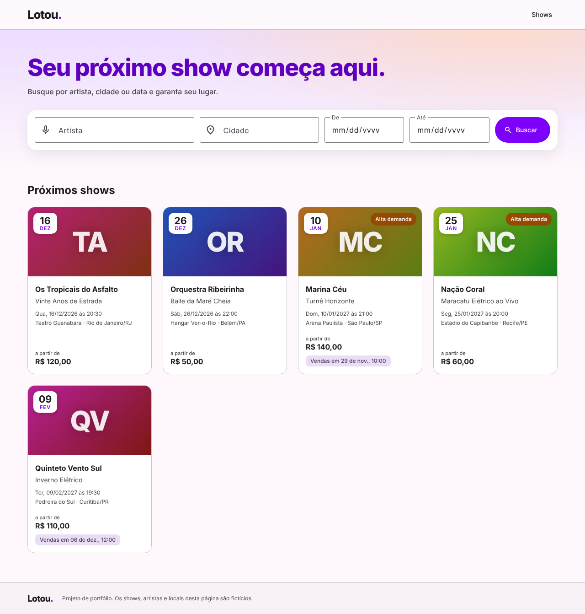
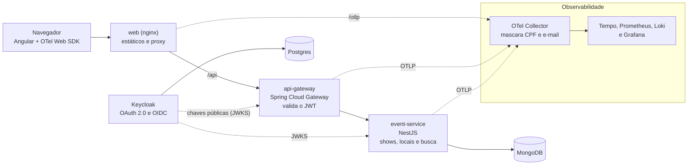

# Lotou.

Plataforma de venda de ingressos para shows: loja, painel do produtor e portaria. O produto é completo, mas o que o projeto quer mostrar é a engenharia por trás da abertura de vendas, quando dezenas de milhares de pessoas disputam poucos milhares de ingressos no mesmo minuto e o sistema não pode vender além da capacidade, vender o mesmo assento duas vezes nem cair.

É um projeto de portfólio, construído em fases. O documento de produto e arquitetura está em [`docs/projeto.md`](docs/projeto.md); as decisões, em [`docs/adr/`](docs/adr/).



## Onde o projeto está

**Fase 0 (Fundação) concluída.** Ela entrega a base em que as próximas fases se apoiam:

- o ambiente inteiro sobe com um comando;
- o catálogo de shows funciona de ponta a ponta: o produtor cadastra e publica pela API, e a loja busca e exibe;
- a autenticação é de verdade (Keycloak, OAuth 2.0 e JWT validado no gateway e no serviço);
- cada requisição gera um trace do navegador até o banco.

| Fase | Entrega | Estado |
| --- | --- | --- |
| 0. Fundação | Compose, CI, OpenTelemetry, gateway, shows e loja Angular | concluída |
| 1. Pedidos e estoque | inventory e order no Postgres, reserva com lock no banco | próxima |
| 2. Redis e abertura de vendas | cache, fila virtual, reserva em Lua e mapa de assentos | |
| 3. Kafka e saga | outbox, saga com pagamento simulado e read models | |
| 4. RabbitMQ e tempo real | ingresso com QR code, DLQ e painel ao vivo | |
| 5. Agente de IA | assistente do produtor com LangGraph | |
| 6. Produto completo | check-in, cancelamento, cupons e relatório financeiro | |
| 7. Vitrine | testes de carga e caos, SLOs e vídeo | |

## Como rodar

Você precisa de Docker (com Compose) e `make`. O ambiente usa cerca de 2,2 GB de memória.

```bash
make up     # sobe tudo e espera ficar saudável (a primeira vez constrói as imagens)
make seed   # cria cinco locais e cinco shows fictícios
```

| O quê | Onde |
| --- | --- |
| Loja | http://localhost:4200 |
| API (pelo gateway) | http://localhost:8080/api/v1/shows |
| Grafana (Tempo, Prometheus e Loki) | http://localhost:3000 |
| Keycloak | http://localhost:8180 (`admin` / `admin`) |

O realm do Keycloak já vem com três usuários de teste, um por papel: `comprador`, `produtor` e `portaria`, todos com a senha `lotou123`.

Outros comandos: `make smoke` confere o ambiente no ar, `make test` roda os testes de todos os serviços, `make down` derruba o ambiente e `make clean` apaga também os dados. `make help` lista tudo.

## O trace de ponta a ponta

O critério de pronto da fase 0 é este: um clique na loja gera um trace que atravessa o gateway e o event-service até o MongoDB, visível no Tempo.

Abra a loja, clique num show e depois abra o Grafana em **Explore > Tempo > Search**. O trace começa no navegador (`lotou-web`), passa pelo `api-gateway`, chega ao `event-service` e termina na consulta ao MongoDB:


Como funciona:

- o **Angular** usa o OpenTelemetry Web SDK: cada chamada à API ganha um span e leva o cabeçalho `traceparent`;
- o **api-gateway** roda com o Java agent do OpenTelemetry, que continua o trace sem código de instrumentação;
- o **event-service** usa a auto-instrumentação do Node, que cobre o HTTP e o driver do MongoDB;
- todos exportam por OTLP para o **OTel Collector**, que mascara CPF e e-mail antes de repassar ao Tempo, ao Prometheus e ao Loki. Os logs saem em JSON com `trace_id`, então dá para ir do log ao trace.

`make smoke` faz essa conferência pela linha de comando, e o CI a repete a cada push.

## Arquitetura

O que existe hoje:



O `redis-cache` e o `redis-core` já sobem no Compose, com políticas de memória opostas, e passam a ser usados na fase 2. A arquitetura completa, com os nove serviços, Kafka e RabbitMQ, está em [`docs/projeto.md`](docs/projeto.md#arquitetura).

### Serviços

| Pasta | Stack | Responsabilidade |
| --- | --- | --- |
| [`apps/web`](apps/web) | Angular 22 | loja: busca de shows e página do show |
| [`services/api-gateway`](services/api-gateway) | Java 21, Spring Cloud Gateway | roteamento e validação do JWT |
| [`services/event-service`](services/event-service) | Node, NestJS 12, MongoDB | shows, locais, setores e busca |

Cada pasta tem seu README, com a API, a estrutura e os comandos.

### Estrutura do repositório

```
lotou/
├── apps/web/                # Angular (loja)
├── services/
│   ├── api-gateway/         # Java
│   └── event-service/       # Node
├── infra/
│   ├── docker-compose.yml   # o ambiente inteiro
│   ├── otel-collector.yaml  # pipeline de telemetria e máscara de dados pessoais
│   ├── keycloak/            # realm importado na subida
│   └── postgres/            # criação dos bancos
├── seed/                    # locais e shows fictícios
├── scripts/                 # verificação do ambiente
├── docs/
│   ├── projeto.md           # produto, regras de negócio e arquitetura
│   └── adr/                 # decisões de arquitetura
├── .github/workflows/       # CI com filtro de caminho por serviço
├── compose.yaml             # ponto de entrada do Docker Compose
└── Makefile
```

É um monorepo com pastas simples: cada serviço usa a ferramenta nativa da sua linguagem e pode ser construído sozinho ([ADR 20](docs/adr/0020-monorepo-com-pastas-simples.md)).

## O que já dá para ver no código

- **Regras de negócio validadas e testadas.** A soma dos lotes nunca passa da capacidade do setor, e um show só é publicado com local, setor e lote ([`show-rules.ts`](services/event-service/src/shows/show-rules.ts)).
- **Transições de estado numa tabela única.** O que não está na tabela é recusado e registrado em log ([`show-status.ts`](services/event-service/src/shows/show-status.ts)).
- **Concorrência tratada no banco, não na aplicação.** Publicar e editar são operações condicionais por versão: de dez publicações simultâneas, uma passa e nove recebem 409.
- **Idempotência.** Todo POST que cria recurso exige `Idempotency-Key`; vinte requisições simultâneas com a mesma chave criam um único recurso ([ADR 22](docs/adr/0022-idempotency-key-do-event-service-no-mongodb.md)).
- **Defesa em profundidade.** O gateway valida o JWT e o serviço valida de novo; as rotas são fechadas por padrão ([ADR 21](docs/adr/0021-servicos-revalidam-o-jwt.md)).
- **Contrato de API previsível.** Erros em Problem Details (RFC 9457) com o `traceId` da requisição, paginação por cursor, IDs em UUID v7 e dinheiro em centavos.
- **Datas corretas.** Tudo é gravado em UTC e exibido no fuso do local; o filtro por data usa o dia no fuso do show.
- **Dados pessoais fora da observabilidade.** O Collector mascara CPF e e-mail em traces, métricas e logs.

## Testes

```bash
make test
```

| Onde | O que roda |
| --- | --- |
| event-service | testes unitários das regras de domínio e testes de integração da aplicação inteira contra um MongoDB real (Testcontainers) |
| api-gateway | regras de acesso e roteamento, e um teste com um Keycloak real (Testcontainers) usando o mesmo realm do Compose |
| web | testes unitários de estado, componentes e formatação |
| ambiente | `make smoke`: Compose de pé, seed e trace até o MongoDB |

Os testes de integração usam as dependências reais, não mocks de banco. No GitHub Actions cada serviço tem seu workflow, que só roda quando a pasta dele muda; um workflow à parte sobe o ambiente inteiro numa máquina limpa.

## Decisões de arquitetura

As decisões ficam em [`docs/adr/`](docs/adr/), escritas no momento em que são tomadas. As vinte e duas decisões previstas até aqui estão resumidas em [`docs/projeto.md`](docs/projeto.md#decisões-de-arquitetura-adrs).
