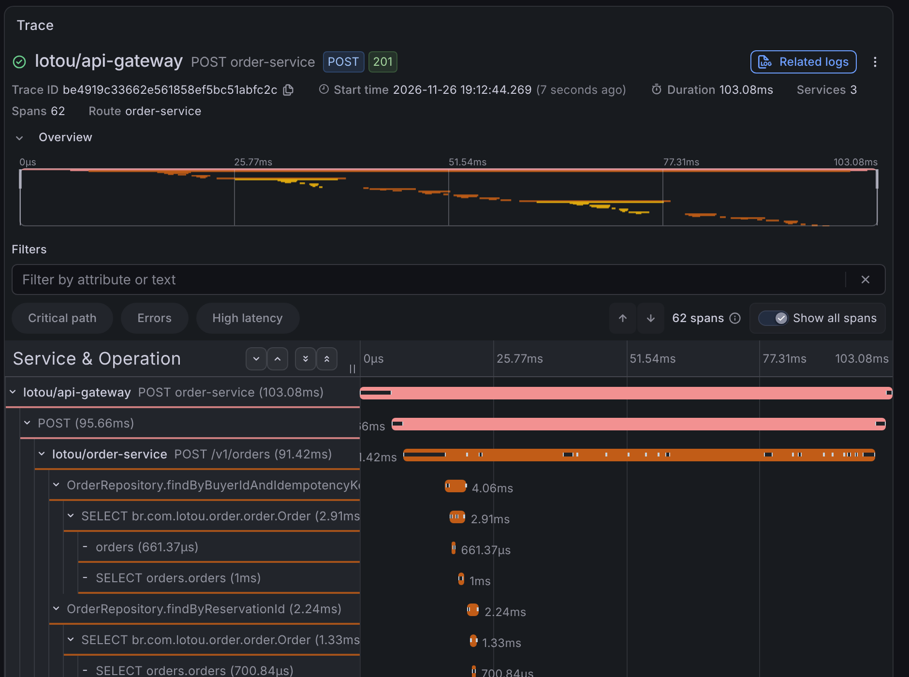
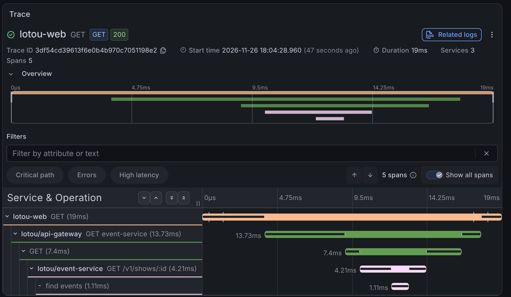
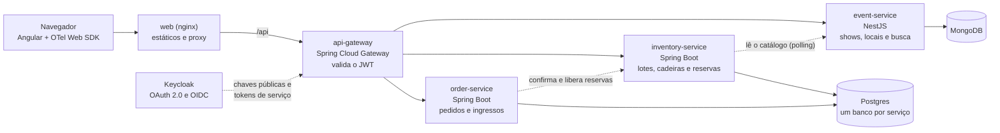

# Lotou.

Plataforma de venda de ingressos para shows: loja, painel do produtor e portaria. O produto é completo, mas o que o projeto quer mostrar é a engenharia por trás da abertura de vendas, quando dezenas de milhares de pessoas disputam poucos milhares de ingressos no mesmo minuto e o sistema não pode vender além da capacidade, vender o mesmo assento duas vezes nem cair.

É um projeto de portfólio, construído em fases. O documento de produto e arquitetura está em [`docs/projeto.md`](docs/projeto.md); as decisões, em [`docs/adr/`](docs/adr/).


## Onde o projeto está

**Fases 0 e 1 concluídas.** O que já funciona:

- o ambiente inteiro sobe com um comando;
- o produtor cadastra e publica shows pela API, e a loja busca e exibe;
- **a compra funciona de ponta a ponta pela API:** reserva de pista ou de cadeira numerada, pedido, pagamento simulado e ingresso emitido, com o estoque protegido contra venda além da capacidade;
- a autenticação é de verdade (Keycloak, OAuth 2.0 e JWT validado no gateway e em cada serviço);
- cada requisição gera um trace que atravessa os serviços até o banco.

| Fase | Entrega | Estado |
| --- | --- | --- |
| 0. Fundação | Compose, CI, OpenTelemetry, gateway, shows e loja Angular | concluída |
| 1. Pedidos e estoque | inventory e order no Postgres, reserva com lock no banco | concluída |
| 2. Redis e abertura de vendas | cache, fila virtual, reserva em Lua e mapa de assentos | próxima |
| 3. Kafka e saga | outbox, saga com pagamento simulado e read models | |
| 4. RabbitMQ e tempo real | ingresso com QR code, DLQ e painel ao vivo | |
| 5. Agente de IA | assistente do produtor com LangGraph | |
| 6. Produto completo | check-in, cancelamento, cupons e relatório financeiro | |
| 7. Vitrine | testes de carga e caos, SLOs e vídeo | |

A fase 1 usa lock no Postgres de propósito: ela é a linha de base que a reserva no Redis precisa superar na fase 2. A tela de checkout da loja ainda não existe; a compra é feita pela API.

## Como rodar

Você precisa de Docker (com Compose) e `make`. O ambiente usa cerca de 3,5 GB de memória.

```bash
make up     # sobe tudo e espera ficar saudável (a primeira vez constrói as imagens)
make seed   # cria cinco locais e cinco shows fictícios
make smoke  # compra um ingresso de ponta a ponta e confere os traces
```

| O quê | Onde |
| --- | --- |
| Loja | http://localhost:4200 |
| API (pelo gateway) | http://localhost:8080/api/v1/shows |
| Grafana (Tempo, Prometheus e Loki) | http://localhost:3000 |
| Keycloak | http://localhost:8180 (`admin` / `admin`) |

O realm do Keycloak já vem com três usuários de teste, um por papel: `comprador`, `produtor` e `portaria`, todos com a senha `lotou123`.

Outros comandos: `make test` roda os testes de todos os serviços, `make down` derruba o ambiente e `make clean` apaga também os dados. `make help` lista tudo.

Se você já tinha o ambiente de uma versão anterior, rode `make clean` antes do `make up`: o realm do Keycloak e os bancos do Postgres só são criados com o volume vazio.

## A compra de ponta a ponta

`make smoke` faz uma compra como um comprador faria, passando pelo gateway:

1. consulta a disponibilidade de um show em venda (`GET /api/v1/availability/{showId}`);
2. reserva um ingresso de pista (`POST /api/v1/reservations`), que fica segurado por 10 minutos;
3. fecha a compra (`POST /api/v1/orders`): o order-service autoriza o pagamento, confirma a reserva no inventory-service e emite o ingresso;
4. confere que o estoque baixou e que os traces chegaram completos ao Tempo.

O trace do pedido atravessa três serviços e termina no Postgres de cada um:



O que garante que a compra é correta sob disputa está nos testes, que rodam contra bancos reais:

| Cenário | Resultado |
| --- | --- |
| 200 compradores reservam ao mesmo tempo 50 ingressos de pista | exatamente 50 reservas; o banco nunca fica com contador negativo |
| 100 compradores disputam as mesmas 4 cadeiras | uma reserva leva as quatro; as outras 99 não seguram nenhuma |
| 30 reservas simultâneas do mesmo CPF | exatamente 4 ingressos, o limite por CPF |
| 40 compradores reservam e fecham a compra de 15 ingressos | 15 pedidos confirmados e 15 ingressos emitidos |
| 20 cliques simultâneos em "comprar" para a mesma reserva | um pedido só, cobrado uma vez |
| inventory fora do ar no meio do checkout | o pedido fica pendente e é concluído depois, sem cobrar de novo |

## O trace de ponta a ponta

Um clique na loja gera um trace que atravessa o gateway e o event-service até o MongoDB, visível no Tempo (foi o critério de pronto da fase 0).

Abra a loja, clique num show e depois abra o Grafana em **Explore > Tempo > Search**. O trace começa no navegador (`lotou-web`), passa pelo `api-gateway`, chega ao `event-service` e termina na consulta ao MongoDB:



Como funciona:

- o **Angular** usa o OpenTelemetry Web SDK: cada chamada à API ganha um span e leva o cabeçalho `traceparent`;
- os **serviços Java** (api-gateway, inventory-service e order-service) rodam com o Java agent do OpenTelemetry, que continua o trace sem código de instrumentação e cobre HTTP, JDBC e Hibernate;
- o **event-service** usa a auto-instrumentação do Node, que cobre o HTTP e o driver do MongoDB;
- todos exportam por OTLP para o **OTel Collector**, que mascara CPF e e-mail antes de repassar ao Tempo, ao Prometheus e ao Loki. Os logs saem em JSON com `trace_id`, então dá para ir do log ao trace.

`make smoke` confere os traces pela linha de comando, e o CI repete a conferência a cada push.

## Arquitetura

O que existe hoje:



Todos os serviços validam o JWT com as chaves públicas do Keycloak e exportam traces, métricas e logs por OTLP para o OTel Collector, que mascara CPF e e-mail antes de repassar ao Tempo, ao Prometheus e ao Loki.

As linhas pontilhadas entre serviços são HTTP síncrono, com token de conta de serviço. Elas são provisórias: na fase 3 viram eventos e comandos no Kafka ([ADR 23](docs/adr/0023-fase-1-sem-broker-integracao-sincrona.md)). O `redis-cache` e o `redis-core` já sobem no Compose e passam a ser usados na fase 2. A arquitetura completa, com os nove serviços, Kafka e RabbitMQ, está em [`docs/projeto.md`](docs/projeto.md#arquitetura).

### Serviços

| Pasta | Stack | Responsabilidade |
| --- | --- | --- |
| [`apps/web`](apps/web) | Angular 22 | loja: busca de shows e página do show |
| [`services/api-gateway`](services/api-gateway) | Java 21, Spring Cloud Gateway | roteamento e validação do JWT |
| [`services/event-service`](services/event-service) | Node, NestJS 12, MongoDB | shows, locais, setores e busca |
| [`services/inventory-service`](services/inventory-service) | Java 21, Spring Boot 4, Postgres | lotes, disponibilidade e reservas de pista e de cadeira |
| [`services/order-service`](services/order-service) | Java 21, Spring Boot 4, Postgres | pedidos, ingressos e orquestração do checkout |

Cada pasta tem seu README, com a API, a estrutura e os comandos.

### Estrutura do repositório

```
lotou/
├── apps/web/                # Angular (loja)
├── services/
│   ├── api-gateway/         # Java
│   ├── event-service/       # Node
│   ├── inventory-service/   # Java
│   └── order-service/       # Java
├── infra/
│   ├── docker-compose.yml   # o ambiente inteiro
│   ├── otel-collector.yaml  # pipeline de telemetria e máscara de dados pessoais
│   ├── keycloak/            # realm importado na subida
│   └── postgres/            # criação dos bancos
├── seed/                    # locais e shows fictícios
├── scripts/                 # verificação do ambiente
├── docs/
│   ├── projeto.md           # produto, regras de negócio e arquitetura
│   └── adr/                 # decisões de arquitetura
├── .github/workflows/       # CI com filtro de caminho por serviço
├── compose.yaml             # ponto de entrada do Docker Compose
└── Makefile
```

É um monorepo com pastas simples: cada serviço usa a ferramenta nativa da sua linguagem e pode ser construído sozinho ([ADR 20](docs/adr/0020-monorepo-com-pastas-simples.md)).

## O que já dá para ver no código

- **Reserva atômica com lock no banco.** Uma transação trava, sempre na mesma ordem, a cota do CPF, os lotes do setor e as cadeiras; ou segura tudo, ou nada ([`ReservationService`](services/inventory-service/src/main/java/br/com/lotou/inventory/reservation/ReservationService.java)).
- **Regras de negócio isoladas e testadas sem banco.** Virada de lote por esgotamento ou por data, devolução ao lote em venda e pausa ([`SectorLots`](services/inventory-service/src/main/java/br/com/lotou/inventory/lot/SectorLots.java)); capacidade e publicação de show ([`show-rules.ts`](services/event-service/src/shows/show-rules.ts)).
- **Transições de estado numa tabela única por entidade.** Show, lote, reserva, pedido e ingresso: o que não está na tabela é recusado e registrado em log.
- **Checkout que aguenta falha no meio.** Cada passo grava o que decidiu e é idempotente; um pedido que ficou pendente é retomado por um job, sem cobrar de novo ([`CheckoutService`](services/order-service/src/main/java/br/com/lotou/order/order/CheckoutService.java)).
- **Última defesa no banco.** Um `CHECK` impede contador de estoque negativo, e um índice único parcial impede dois ingressos ativos para a mesma cadeira ([ADR 4](docs/adr/0004-constraint-unica-de-show-e-assento.md)).
- **Idempotência.** Todo POST que cria recurso exige `Idempotency-Key`; requisições simultâneas com a mesma chave criam um único recurso.
- **Defesa em profundidade.** O gateway valida o JWT e cada serviço valida de novo; as rotas são fechadas por padrão, e as chamadas entre serviços usam contas de serviço ([ADR 21](docs/adr/0021-servicos-revalidam-o-jwt.md)).
- **Jobs sem lock distribuído.** Abertura de vendas, expiração de reservas e retomada de pedidos travam a linha no banco e conferem a condição de novo, então rodam em várias instâncias sem coordenação.
- **Contrato de API previsível.** Erros em Problem Details (RFC 9457) com o `traceId` da requisição, paginação por cursor, IDs em UUID v7 e dinheiro em centavos.
- **Dados pessoais protegidos.** O CPF só é gravado como HMAC com chave secreta ([ADR 24](docs/adr/0024-cpf-como-hmac-e-limite-por-cpf-no-banco.md)), e o Collector mascara CPF e e-mail em traces, métricas e logs.
- **Datas corretas.** Tudo é gravado em UTC e exibido no fuso do local; o filtro por data usa o dia no fuso do show.

## Testes

```bash
make test
```

| Onde | O que roda |
| --- | --- |
| event-service | testes unitários das regras de domínio e testes de integração da aplicação inteira contra um MongoDB real (Testcontainers) |
| api-gateway | regras de acesso e roteamento, e um teste com um Keycloak real (Testcontainers) usando o mesmo realm do Compose |
| inventory-service | regras de lote sem banco e testes de concorrência, de ciclo das vendas e de API num Postgres real (Testcontainers) |
| order-service | checkout de ponta a ponta com o inventory-service de verdade (a imagem Docker dele) e Postgres real; falhas no meio do checkout provocadas com um inventory de teste |
| web | testes unitários de estado, componentes e formatação |
| ambiente | `make smoke`: Compose de pé, seed, uma compra de ponta a ponta e os traces no Tempo |

Os testes de integração usam as dependências reais, não mocks de banco. No GitHub Actions cada serviço tem seu workflow, que só roda quando a pasta dele muda; um workflow à parte sobe o ambiente inteiro numa máquina limpa.

## Decisões de arquitetura

As decisões ficam em [`docs/adr/`](docs/adr/), escritas no momento em que entram no código. Todas as decisões previstas estão resumidas em [`docs/projeto.md`](docs/projeto.md#decisões-de-arquitetura-adrs).
