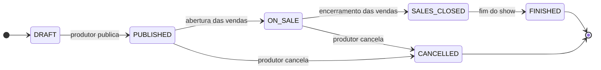
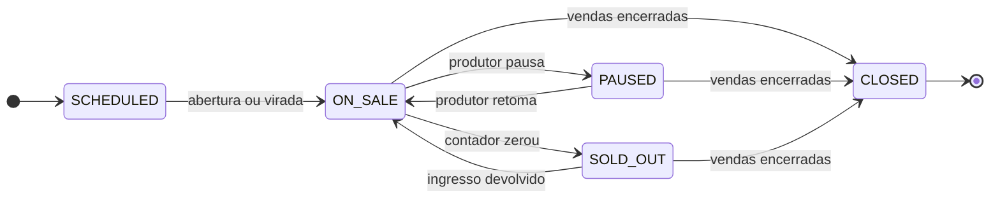
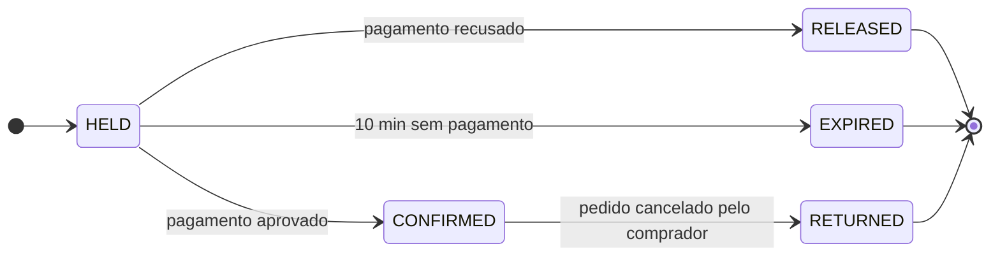
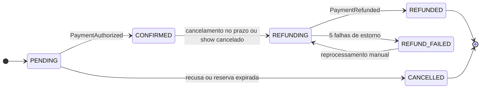
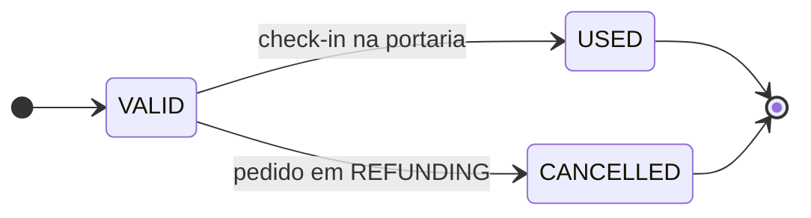
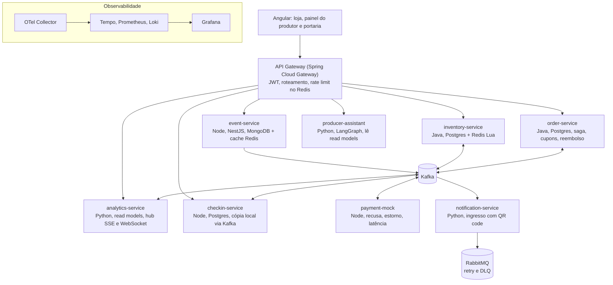
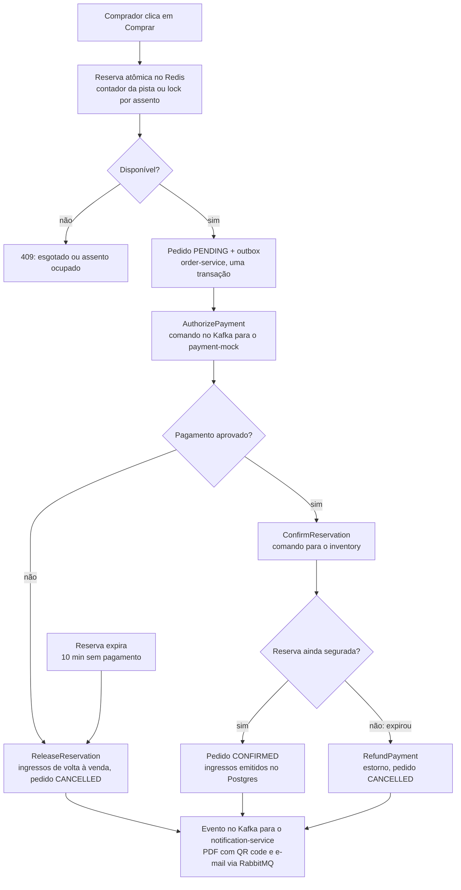

# Lotou: plataforma de venda de ingressos (projeto de portfólio)

Documento de produto e arquitetura. Atualizado em 26/11/2026.

## Visão geral

**Lotou.** É uma plataforma de venda de ingressos para shows, pensada como um produto completo. O produtor cria o show e acompanha as vendas; o comprador compra, recebe o ingresso e entra pela portaria com o QR code; a plataforma cuida de cupons, cancelamentos, reembolsos e do repasse ao produtor.

No dia a dia a venda é direta. Em shows marcados como **alta demanda**, a plataforma ativa a fila virtual, porque na abertura de vendas dezenas de milhares de pessoas disputam poucos milhares de ingressos no mesmo minuto. Nessa hora ela não pode vender além da capacidade, vender o mesmo assento duas vezes nem cair. A engenharia para isso é uma qualidade do produto, não o produto em si.

O projeto existe para provar, com evidência, que eu sei:

- desenhar um sistema distribuído orientado a eventos e justificar cada peça;
- lidar com concorrência e consistência: reserva atômica, saga, outbox e idempotência;
- aplicar padrões de cache e usar o Redis além do cache;
- operar o sistema com rastreamento ponta a ponta, métricas, logs, SLOs e alertas;
- integrar IA de forma útil e segura num produto.

**Público:** recrutadores e tech leads de startups e empresas de tecnologia brasileiras em crescimento. Eles dão poucos minutos ao README, então o projeto precisa se explicar com um diagrama, um vídeo curto e números de teste de carga.

**Por que esse domínio:** venda de ingressos é o exemplo clássico de pico de concorrência, e filas longas e sites fora do ar em vendas de grandes shows são um problema que qualquer recrutador conhece. A escala que a arquitetura assume é a escala real do domínio, então cada peça se justifica. O domínio ainda traz dois tipos de estoque, cada um com sua estratégia de reserva: **pista** (uma quantidade) e **cadeira numerada** (um item único).

## Escopo

O escopo cobre a jornada inteira do ingresso: o produtor cria o show, o comprador compra, recebe e usa o ingresso na portaria, e o produtor recebe o relatório financeiro. Pagamento real, meia-entrada e revenda ficam de fora.

### Requisitos funcionais

**Loja (comprador)**

- Buscar shows por artista, cidade e data
- Ver setores, lotes e preços de um show
- Comprar direto em shows comuns; em shows de alta demanda, entrar na fila virtual e acompanhar a posição em tempo real
- Escolher a quantidade na pista, ou os assentos no mapa nas cadeiras numeradas
- Aplicar cupom de desconto no checkout
- Comprar no máximo 4 ingressos por CPF em cada show
- Acompanhar o status do pedido ao vivo
- Receber o ingresso com QR code por e-mail e vê-lo em "Meus ingressos"
- Cancelar a compra dentro do prazo da política e receber o reembolso

**Painel (produtor)**

- Criar o show de ponta a ponta: rascunho, local, setores, mapa de assentos, lotes e publicação
- Marcar o show como alta demanda, o que liga a fila virtual na abertura de vendas
- Agendar a abertura de vendas e a virada de lotes
- Criar cupons com desconto, limite de uso e validade
- Acompanhar vendas e entradas na portaria num painel ao vivo
- Ver o relatório financeiro: vendas, cancelamentos, reembolsos, taxa da plataforma e valor a receber
- Conversar com o assistente de IA sobre vendas, ocupação e lotes

**Portaria (equipe do show)**

- Ler o QR code pela câmera do celular, direto no navegador
- Ver na hora se o ingresso é válido, já foi usado (quando e em qual portão) ou foi cancelado
- Funcionar com vários portões lendo ao mesmo tempo, sem liberar a mesma entrada duas vezes

### Requisitos não funcionais

Metas iniciais, a calibrar depois do primeiro teste de carga:

| Indicador | Meta inicial |
| --- | --- |
| Venda além da capacidade ou assento vendido duas vezes | zero, em qualquer teste |
| Mesmo ingresso liberando duas entradas | zero, em qualquer teste |
| Reserva de ingresso (p99) | < 50 ms |
| POST /orders (p99) | < 300 ms |
| Leitura do QR na portaria (p99) | < 200 ms |
| Leitura de show com cache (p95) | < 30 ms |
| Assento reservado aparece ocupado para os outros compradores | < 1 s |
| Evento até aparecer no painel do produtor | < 2 s |
| E-mail com ingresso após confirmação (p95) | < 60 s |
| Cenário de pico | 20 mil usuários virtuais disputando 2 mil ingressos de pista e 500 cadeiras |

Além disso: tudo sobe com um `docker compose up`, roda localmente e cada requisição gera um trace do navegador até o banco.

**Dados e demo:** um script de seed cria shows, locais, setores e compradores fictícios mas críveis, para o produto parecer vivo desde o primeiro acesso. Se possível, uma demo fica no ar.

### Fora de escopo

- Pagamento real: um `payment-mock` simula aprovação, recusa, estorno e latência
- Meia-entrada: obrigatória por lei num uso real (Lei 12.933/2013), fica de fora por ser regra legal e não técnica
- Revenda e transferência de ingresso entre pessoas, e festivais de vários dias (passaporte e áreas internas)
- App mobile nativo (a portaria e a loja funcionam no navegador do celular)
- Repasse real de dinheiro ao produtor (o relatório mostra o valor, sem transferência)
- Deploy em Kubernetes (extensão futura)

## Regras de negócio

As regras abaixo valem para o produto inteiro e viram validações no código. Os números são valores de referência, plausíveis para o mercado, e podem ser ajustados.

### Show e capacidade

- A capacidade pertence ao **setor**. O lote só define preço e quantidade à venda dentro do setor, e a soma dos lotes nunca passa da capacidade do setor.
- Um show só pode ser publicado com local, ao menos um setor e ao menos um lote em cada setor: um setor sem lote não teria o que vender.
- Depois que as vendas abrem, o produtor não pode reduzir a capacidade de um setor abaixo do que já foi vendido.
- O produtor define o horário de abertura dos portões; o check-in só é aceito a partir dele.
- Num setor de cadeira numerada, o local define as fileiras e as cadeiras, e o show vende o setor inteiro: a capacidade do setor no show é a do local.
- Sem data de abertura agendada, as vendas abrem na publicação; sem data de encerramento, fecham no início do show.

### Compra

- Um pedido contém ingressos de um único show.
- Máximo de 4 ingressos por CPF em cada show, somando todos os pedidos. Pedidos cancelados ou reembolsados liberam a cota.
- Na cadeira numerada, o comprador escolhe até 4 assentos e a reserva é tudo ou nada.
- A reserva dura 10 minutos, não é renovável e o cronômetro aparece no checkout.
- O preço é o do lote no momento da reserva e fica congelado no pedido, mesmo que o lote vire durante o pagamento.
- Uma reserva é de um único setor e sai de um lote só. Se o lote em venda tem menos ingressos que o pedido, a reserva é recusada e o comprador vê quantos restam (ADR 25).
- O comprador informa o CPF ao reservar. O CPF é validado pelos dígitos verificadores e gravado só como HMAC (ADR 24).

### Lotes

- Cada setor tem uma ordem de lotes. O próximo lote abre quando o atual esgota ou na data definida pelo produtor, o que vier primeiro.
- Ingressos devolvidos (reserva expirada, pagamento recusado ou reembolso) voltam para o **lote em venda** no setor, ao preço dele. Reabrir um lote mais barato confundiria o comprador.
- O produtor pode pausar e retomar um lote; um lote pausado não aceita reservas.
- Se um ingresso é devolvido e o setor não tem lote em venda (todos esgotaram), o último lote reabre com ele (ADR 25).
- Na virada por data, o que sobrou do lote anterior passa para o lote novo, ao preço novo. Um lote pausado não vira sozinho.

### Taxa de serviço

- A plataforma cobra 10% sobre o valor de cada ingresso (antes do desconto), valor inspirado no que o mercado pratica. A taxa é calculada ingresso a ingresso e arredondada para o centavo mais próximo.
- O produtor escolhe, por show, se repassa a taxa ao comprador ou se a absorve.
- Quando repassada, a taxa aparece separada no checkout, antes do pagamento (`POST /orders/quote`). O total cobrado é subtotal − desconto + taxa (se repassada). A escolha não muda depois que as vendas abrem.

### Cupons

- Desconto percentual ou em valor fixo, aplicado sobre o valor dos ingressos, nunca sobre a taxa.
- Um cupom por pedido. Cada cupom tem limite total de usos, validade e um show; pode ser restrito a setores.
- O desconto nunca deixa o ingresso abaixo de zero, e os centavos são arredondados para baixo, a favor do comprador.
- Cancelamento ou reembolso devolve o uso do cupom.

### Cancelamento e reembolso

- O comprador pode cancelar até 7 dias depois da compra, desde que faltem mais de 48 horas para o show.
- O cancelamento é sempre do pedido inteiro, e o reembolso é integral, incluindo a taxa de serviço.
- Ingresso já usado na portaria não pode ser cancelado.
- Se o produtor cancelar o show, todos os pedidos confirmados entram em reembolso automático. O reembolso em massa roda com controle de vazão, para não sobrecarregar o gateway de pagamento.

### Portaria

- Cada ingresso libera uma única entrada; não existe saída e reentrada.
- O leitor mostra três resultados: liberado (verde), já utilizado com horário e portão (amarelo) e inválido ou cancelado (vermelho).

### Fila virtual

- Só existe em shows marcados como alta demanda, e vale durante toda a venda deles (ADR 13).
- A sala de espera abre 30 minutos antes das vendas. Na abertura, quem estava na sala recebe uma posição sorteada; quem chega depois entra no fim da fila. Assim, chegar 30 minutos antes não dá vantagem sobre quem chegou 1 minuto antes, e robôs que entram cedo perdem a vantagem.
- A cada segundo, os próximos N da fila são admitidos (N configurável por implantação, 100 por padrão).
- O token de admissão vale 5 minutos; quem não reserva nesse tempo perde a vez e, se entrar de novo, vai para o fim da fila.

### Financeiro

- Valor a receber = vendas brutas − descontos de cupom − reembolsos − taxa de serviço (quando absorvida pelo produtor).
- Um pedido reembolsado continua nas vendas brutas e nos descontos e entra inteiro nos reembolsos (ingressos menos desconto); a taxa absorvida dele sai da conta, porque o comprador recebe tudo de volta. Assim um pedido reembolsado soma exatamente zero no valor a receber.
- A taxa paga pelos compradores aparece no relatório como informação: ela fica com a plataforma e não entra no valor a receber.
- O relatório é parcial durante as vendas e vira final quando o show termina.

## Estados

Cada entidade tem um conjunto fechado de estados e só passa de um para outro pelos gatilhos da tabela abaixo. Os nomes são os que vão para o código.


*Show*


*Lote*


*Reserva*


*Pedido*


*Ingresso*

Estados destacados são finais: nada sai deles. O pedido em REFUND\_FAILED não é final, porque pode ser reprocessado pelo painel. O lote em SOLD\_OUT também não é: ele reabre se um ingresso for devolvido e o setor não tiver outro lote em venda.

### Transições

| Entidade | De | Para | Gatilho | Quem dispara |
| --- | --- | --- | --- | --- |
| Show | DRAFT | PUBLISHED | produtor publica (exige local, setor e um lote em cada setor) | produtor |
| Show | PUBLISHED | ON\_SALE | chega o horário de abertura das vendas | job de abertura |
| Show | ON\_SALE | SALES\_CLOSED | chega o horário de encerramento das vendas | job |
| Show | SALES\_CLOSED | FINISHED | fim do show; o relatório financeiro fica final | job |
| Show | PUBLISHED ou ON\_SALE | CANCELLED | produtor cancela; todos os pedidos confirmados vão para reembolso | produtor |
| Lote | SCHEDULED | ON\_SALE | abertura das vendas, virada do lote anterior ou data do lote | inventory |
| Lote | ON\_SALE | SOLD\_OUT | contador chega a zero (`LotSoldOut`), ou virada por data | inventory |
| Lote | SOLD\_OUT | ON\_SALE | ingresso devolvido e o setor sem lote em venda: reabre o último lote | inventory |
| Lote | ON\_SALE | PAUSED | produtor pausa | produtor |
| Lote | PAUSED | ON\_SALE | produtor retoma | produtor |
| Lote | ON\_SALE ou PAUSED | CLOSED | vendas do show encerradas | inventory |
| Lote | SOLD\_OUT | CLOSED | vendas encerradas: só o último lote esgotado de cada setor, que ainda podia reabrir; os outros já viraram e ficam em SOLD\_OUT | inventory |
| Reserva | HELD | CONFIRMED | pagamento aprovado (`ConfirmReservation`) | order |
| Reserva | HELD | RELEASED | pagamento recusado (`ReleaseReservation`) | order |
| Reserva | HELD | EXPIRED | 10 minutos sem pagamento | job de expiração |
| Reserva | CONFIRMED | RETURNED | pedido cancelado pelo comprador (`ReturnTickets`): os ingressos voltam à venda | order |
| Pedido | PENDING | CONFIRMED | `PaymentAuthorized` | payment-mock |
| Pedido | PENDING | CANCELLED | `PaymentDeclined` ou reserva expirada | payment-mock ou inventory |
| Pedido | CONFIRMED | REFUNDING | comprador cancela no prazo, ou show cancelado | comprador ou produtor |
| Pedido | REFUNDING | REFUNDED | `PaymentRefunded` | payment-mock |
| Pedido | REFUNDING | REFUND\_FAILED | 5 falhas seguidas de estorno | order |
| Pedido | REFUND\_FAILED | REFUNDING | reprocessamento manual | produtor ou suporte |
| Ingresso | VALID | USED | check-in na portaria | checkin |
| Ingresso | VALID | CANCELLED | pedido entra em REFUNDING | order |

Ingresso em USED não volta a VALID nem vai para CANCELLED: por isso um pedido com algum ingresso já usado não pode ser cancelado.

## Convenções

Decisões pequenas que valem para todos os serviços e são caras de mudar depois do código escrito.

| Tema | Regra | Por quê |
| --- | --- | --- |
| Dinheiro | valores em centavos como inteiro (`BIGINT` no banco, `long` no Java, inteiro no JSON); moeda BRL | `float` acumula erro de arredondamento |
| Arredondamento | percentuais calculados em centavos e arredondados para baixo, numa única função por serviço, coberta por testes | cada serviço arredondando de um jeito gera diferenças no financeiro |
| Datas | gravar em UTC (`timestamptz`); cada local guarda seu fuso IANA (ex.: `America/Sao_Paulo`) e a tela exibe no fuso do show | abertura de vendas, virada de lote e prazo de cancelamento dependem do horário certo |
| IDs | UUID v7 em todas as entidades | ordenável por tempo (bom para índice) e não revela quantos pedidos existem |
| Dados pessoais (LGPD) | CPF e e-mail nunca aparecem em logs, traces ou chaves do Redis; o Collector mascara atributos sensíveis e as chaves usam um hash do CPF | evita vazamento pela própria observabilidade |
| Eventos | nomes no passado (`OrderConfirmed`), comandos no imperativo (`AuthorizePayment`), versão no envelope; mudança incompatível gera nova versão | consumidores antigos não quebram |
| API | REST, erros no formato Problem Details (RFC 9457), paginação por cursor e `Idempotency-Key` em todo POST que cria recurso | contrato previsível para o Angular e para os testes |
| Estados | transições validadas por uma tabela única por entidade; transição fora da tabela é recusada e registrada em log | evita estados impossíveis no meio de uma saga |
| Commits e ADRs | Conventional Commits; cada ADR escrito no momento da decisão | histórico legível e decisões com contexto |

## Arquitetura

Nove serviços em três linguagens, ligados por HTTP síncrono só no caminho do usuário e por eventos no resto. Java fica onde há concorrência e transação, Node no catálogo de shows, no mock e na portaria, e Python em dados, tempo real e IA.



Todos os serviços exportam traces, métricas e logs via OTLP para o OTel Collector.

O gateway também leva o WebSocket do painel até o analytics-service, que é o hub de tempo real do produtor, e as leituras de QR até o checkin-service. A posição na fila e o mapa de assentos da loja ficam no inventory, que é o dono desses dados (ADR 31). O producer-assistant não usa o Kafka: só lê os read models.

**Até a fase 3 não há broker.** Nas fases 1 e 2 os serviços se falam por HTTP: o inventory lê o catálogo do event-service por polling, o order-service confirma e libera reservas por uma API interna do inventory, e o pagamento é simulado dentro do order-service. Essas ligações são provisórias e viram eventos e comandos no Kafka na fase 3 (ADR 23). As APIs internas (`/internal/**`) não têm rota no gateway e exigem o token de uma conta de serviço.

### Serviços

| Serviço | Stack | Responsabilidade | Dados |
| --- | --- | --- | --- |
| api-gateway | Java · Spring Cloud Gateway | roteamento, validação de JWT e rate limit | redis-core |
| event-service | Node · NestJS | shows, locais, setores, mapas de assentos, busca e cache | MongoDB, redis-cache |
| inventory-service | Java · Spring Boot | lotes, disponibilidade, fila virtual e reservas de pista e de assento | Postgres, redis-core |
| order-service | Java · Spring Boot | pedidos, cupons, emissão de ingressos, cancelamento, reembolso, saga e outbox | Postgres, redis-core |
| payment-mock | Node | simula um gateway de pagamento com recusa, estorno e latência configuráveis | Postgres |
| analytics-service | Python · FastAPI | métricas ao vivo, read models, relatório financeiro e hub de tempo real (SSE e WebSocket) | MongoDB, redis-core |
| notification-service | Python · FastAPI + workers | gera o PDF do ingresso com QR code e envia os e-mails (Mailpit em desenvolvimento) | RabbitMQ, redis-core (deduplicação) |
| checkin-service | Node · NestJS | valida o QR na portaria com uma cópia local dos ingressos válidos | Postgres, redis-core |
| producer-assistant | Python · FastAPI + LangGraph | agente de IA do produtor | MongoDB (leitura) |

**Infraestrutura no Compose:** Postgres, MongoDB, `redis-cache`, `redis-core`, Kafka em modo KRaft com Kafka UI, RabbitMQ com painel de management, Keycloak (configuração importada ao subir), Mailpit, OTel Collector, `grafana/otel-lgtm` e Toxiproxy para os testes de caos.

### Estrutura do repositório

```
lotou/
├── apps/web/                  # Angular (loja, painel e portaria)
├── services/
│   ├── api-gateway/           # Java
│   ├── event-service/         # Node
│   ├── inventory-service/     # Java
│   ├── order-service/         # Java
│   ├── payment-mock/          # Node
│   ├── analytics-service/     # Python
│   ├── notification-service/  # Python
│   ├── checkin-service/       # Node
│   └── producer-assistant/    # Python
├── contracts/                 # JSON Schema dos eventos
├── infra/
│   ├── docker-compose.yml
│   ├── otel-collector.yaml
│   └── grafana/dashboards/
├── seed/                      # shows, locais e compradores fictícios
├── scripts/                   # verificação do ambiente (smoke)
├── e2e/                       # Playwright: a loja no navegador, contra o ambiente no ar
├── load-tests/                # k6
├── chaos/                     # roteiros dos experimentos
├── docs/
│   ├── adr/
│   └── projeto.md
├── compose.yaml               # ponto de entrada: inclui infra/docker-compose.yml
└── Makefile
```

## Modelo de dados

O Postgres guarda o que precisa de transação, o MongoDB guarda documentos de formato variável e visões de leitura, e o Redis guarda o que é quente e efêmero. Cada serviço tem seu próprio banco e nenhum serviço lê o banco de outro.

### Postgres (um banco por serviço, mesma instância)

| Serviço | Tabela | Para quê |
| --- | --- | --- |
| inventory | `shows`, `sectors` | cópia local do catálogo: janela de vendas, estado do show e capacidade de cada setor |
| inventory | `lots` | lotes por setor: preço, quantidade, contador de ingressos restantes, ordem de virada e status |
| inventory | `seats` | uma linha por cadeira numerada, com status e a reserva que a segura |
| inventory | `reservations`, `reservation_items` | reserva com status e `expires_at`; um item por ingresso, com o preço congelado. Na fase 1 é gravada direto; na fase 2 passa a vir do Redis Stream |
| inventory | `purchase_limits` | ingressos por CPF em cada show; a chave usa o HMAC do CPF |
| inventory | `outbox` | fatos de reservas e lotes a publicar em `inventory.events`, gravados por trigger na mesma transação de cada mudança de status (ADR 8) |
| order | `orders`, `order_items` | pedido, status, resultado do pagamento e `idempotency_key` única; subtotal, desconto, taxa, quem paga a taxa, cupom aplicado e valor reembolsado |
| order | `tickets` | ingresso emitido, status (VALID, USED ou CANCELLED) e o código do QR assinado com HMAC (ADR 15); índice único parcial em (show, setor, cadeira) como última defesa contra venda dupla |
| order | `coupons`, `coupon_redemptions` | código, desconto, limite de uso, usos (com `CHECK uses <= max_uses`), validade, setores e show; um uso por pedido, marcado como devolvido no cancelamento ou reembolso (ADR 33) |
| order | `refunds` | saga de reembolso de cada pedido: motivo, status (QUEUED, REFUNDING, COMPLETED, FAILED), valor, falhas e prazo da resposta |
| order | `shows` | cópia local do catálogo: produtor, data, status e quem paga a taxa |
| order | `outbox` | eventos e comandos a publicar no Kafka, gravados na mesma transação do pedido e da saga |
| order | `saga_state` | passo atual da saga de compra de cada pedido, para retomar após falha |
| checkin | `valid_tickets` | cópia local dos ingressos, alimentada por `TicketsIssued` e `TicketsCancelled`; o cancelado fica, com status, para o leitor dizer "cancelado" |
| checkin | `shows` | cópia local do catálogo: abertura dos portões, data e fuso, para a regra de horário |
| checkin | `checkins` | entrada registrada, com portão e horário; constraint única em `ticket_id` |
| checkin | `checkin_rejections` | leituras recusadas (código inválido, cancelado, já usado), gravadas em lote fora da requisição; alimentam o resumo da portaria |
| todos os consumidores | `processed_events` | `event_id` já processado, para idempotência |
| payment-mock | `payments` | tentativas e estornos por pedido, para responder igual a comandos repetidos |

### MongoDB

| Coleção | Conteúdo | Por que documento |
| --- | --- | --- |
| `events` | show, artista, data, local, setores, lotes, descrição e flag de alta demanda | campos variam por tipo de show e de local |
| `venues` | layout do local: setores e fileiras com a quantidade de cadeiras; as coordenadas para desenhar o mapa entram na fase 2 | um estádio e um teatro têm estruturas bem diferentes |
| `sales_by_sector` | vendas, receita e ocupação por show, setor e hora | read model desnormalizado, montado a partir de eventos |
| `producer_statements` | por show: vendas brutas, descontos, cancelamentos, reembolsos, taxa da plataforma e valor a receber | read model financeiro, recalculável por replay |
| `order_view` | pedido completo para o painel e o agente | evita joins entre serviços na leitura |
| `checkins_by_gate` | entradas por show e portão | contador do painel e do resumo da portaria |
| `shows`, `lot_timeline` | cópia do catálogo que o analytics usa e a linha do tempo dos lotes (abertura e esgotamento) | apoio dos read models acima |
| `agent_conversations` | histórico do chat e chamadas de ferramenta | estrutura aninhada e variável |
| `idempotency_keys` | `Idempotency-Key` já vista nos POSTs do event-service, com a resposta original; TTL de 24 h | o índice único do `_id` decide a corrida entre requisições iguais (ADR 22) |

Os read models do analytics ficam no banco `analytics`, em coleções por geração (`order_view_g3`); uma view com o nome simples (`order_view`) aponta sempre para a geração ativa, e é ela que leitores de fora, como o producer-assistant, usam. Cada geração tem o próprio consumer group (`analytics-service.gen-<N>`), o que permite o replay sem parada (ADR 30).

### Redis

Duas instâncias com políticas diferentes: `redis-cache` pode perder dados (`allkeys-lru`, sem persistência) e `redis-core` não pode (`noeviction`, AOF a cada segundo) (ADR 10).

Durante a venda, o `redis-core` é a fonte da verdade do estoque, das cadeiras, das cotas e das reservas ativas; o Postgres é a cópia durável, alimentada por `stream:reservations` (ADR 26). Por isso nada do estado da venda expira sozinho: a reserva e as cadeiras dela saem juntas, pelo script que devolve tudo, e não por TTL.

| Chave | Tipo | TTL | Instância | Uso |
| --- | --- | --- | --- | --- |
| `cache:event:{id}` | string (JSON) | 10 min + jitter (30 s se o show não existe) | cache | detalhe do show, já serializado |
| `cache:lock:event:{id}` | string | 2 s | cache | só uma requisição recarrega o show quando a chave esfria |
| `cache:events:{hash da consulta}` | string (JSON) | 60 s | cache | busca e listagens |
| `show:{showId}` | hash | fim das vendas | core | marca de estoque carregado (gravada por último) e se o show é de alta demanda |
| `sector:{showId}:{sectorId}` | hash | fim das vendas | core | lote em venda e status dele (`ON_SALE`, `PAUSED`, `SOLD_OUT`, `CLOSED`) e tipo do setor |
| `sector:{showId}:{sectorId}:next` | lista | fim das vendas | core | lotes seguintes do setor, na ordem, para a virada por esgotamento |
| `lot:{lotId}:stock` | inteiro | fim das vendas | core | ingressos restantes do lote |
| `seat:{showId}:{seatId}` | string | nenhum | core | cadeira segurada ou vendida; o valor é o id da reserva |
| `seatmap:{showId}:{sectorId}` | bitmap | fim das vendas | core | um bit por cadeira (livre ou ocupada), para desenhar o mapa sem ir ao banco (ADR 5) |
| `res:{resId}` | hash | nenhum enquanto ativa; 24 h depois de concluída | core | reserva, com comprador, lote, cadeiras, prazo e CPF (em hash) |
| `limit:{showId}:{cpfHash}` | inteiro | fim das vendas | core | ingressos por CPF (máximo 4); a chave usa um hash do CPF, nunca o CPF |
| `idem:reservation:{hash}` | string | 24 h | core | Idempotency-Key da reserva; o hash junta comprador e chave |
| `queue:{showId}` | sorted set | fim das vendas | core | fila virtual (só em shows de alta demanda); score = posição sorteada para quem estava na sala, hora de chegada para quem veio depois |
| `queue:{showId}:room` | set | fim das vendas | core | sala de espera, antes do sorteio |
| `queue:{showId}:drawn` | string | fim das vendas | core | marca de sorteio feito |
| `admitted:{showId}:{userId}` | string | 5 min | core | token de admissão ao checkout |
| `checkin:{ticketId}` | string | até o fim do show | core | entrada já registrada; o valor guarda portão e horário |
| `idem:{chave}` | string | 24 h | core | Idempotency-Key do POST /orders |
| `rl:{sub}` ou `rl:ip:{hash do IP}` | sorted set | janela | core | rate limit por janela deslizante do event-service |
| `request_rate_limiter.{operação:user:sub}.tokens` e `.timestamp` | string | segundos | core | balde do token bucket do gateway, por operação de compra e usuário (sem token, `ip:{hash do IP}`) |
| `lock:{nome}` | string | segundos | core | lock distribuído de jobs |
| `stream:reservations` | stream | aparado até a entrada mais antiga ainda não gravada (`XTRIM MINID`) | core | reservas a persistir no Postgres |
| `stream:activity:{showId}` | stream | MAXLEN \~1000 | core | feed de atividade do painel, por show |
| `dashboard:watched` | sorted set | membros vencem em 5 s sem renovação | core | shows com alguém no painel, em qualquer instância do analytics; score = até quando (ADR 32) |
| `dashboard:metrics-tick:{showId}` | string | 5 s | core | último segundo em que as métricas do show foram calculadas: só uma instância calcula por segundo (ADR 32) |

## Mensageria

A regra que guia tudo: **Kafka carrega fatos de domínio, RabbitMQ carrega tarefas e o Redis carrega tempo real efêmero.** Cada mensagem tem um dono claro, e o README explica essa divisão.

### Kafka (fatos de domínio e comandos da saga)

Todo evento usa o mesmo envelope: `eventId`, `type`, `version`, `occurredAt` e `payload`. O contexto de trace vai no header `traceparent`, os contratos ficam em JSON Schema na pasta `contracts/`, com um exemplo de cada mensagem (ADR 28). A retenção depende do papel do tópico (ADR 1): o catálogo é compactado, `order.events` e `inventory.events` não têm prazo, porque são a fonte do replay dos read models, e os comandos e respostas da saga ficam 7 dias.

| Tópico | Chave | Mensagens | Produz | Consome |
| --- | --- | --- | --- | --- |
| `shows.catalog` (compactado) | showId | ShowPublished, ShowUpdated (o show inteiro, com versão; uma mudança de preço de lote é um ShowUpdated) | event | inventory, analytics |
| `order.events` | orderId | OrderCreated, OrderConfirmed, OrderCancelled, OrderRefunded, OrderRefundFailed, TicketsIssued, TicketsCancelled | order (via outbox) | analytics, notification, checkin |
| `payment.commands` | orderId | AuthorizePayment, RefundPayment | order | payment-mock |
| `payment.events` | orderId | PaymentAuthorized, PaymentDeclined, PaymentRefunded, RefundFailed | payment-mock | order |
| `inventory.commands` | orderId | ConfirmReservation, ReleaseReservation (ReturnTickets na fase 6) | order | inventory |
| `inventory.events` | showId | ReservationConfirmed, ReservationReleased, LotSoldOut, LotOpened: fatos de cada mudança de status, não respostas a comandos | inventory | order, analytics, event-service (apaga o cache do show) |
| `checkin.events` | showId | TicketCheckedIn, CheckinRejected | checkin (via outbox) | analytics, order |
| `*.dlt` | igual à origem | mensagens que falharam após os retries | consumidores | inspeção manual |

A chave define a partição: todos os eventos de um mesmo pedido ou show chegam em ordem ao consumidor, então `LotSoldOut` sempre vem antes do `LotOpened` do lote seguinte. O preço disso é a **partição quente**: um show grande concentra seus eventos numa partição só. Medir no teste de carga e, se virar gargalo, trocar a chave para show + setor; a decisão vira um ADR.

### RabbitMQ (tarefas com retry)

| Exchange | Tipo | Routing key | Fila | Comportamento |
| --- | --- | --- | --- | --- |
| `tickets` | direct | `render` | `tickets.render` | gera o PDF com QR code; tarefa pesada de CPU, vários workers, prefetch 1 |
| `notifications` | topic | `email.ticket.issued`, `email.order.cancelled`, `email.refund.completed` | `notifications.email` | prioridade (ingresso antes de marketing), prefetch 10, ack manual |
| `notifications.retry` | direct | `10s`, `1m`, `5m` | `notifications.retry.*` | TTL por fila + dead-letter de volta à fila principal |
| `notifications.dlx` | fanout | — | `notifications.email.dlq` | destino final após 4 tentativas |
| `tickets.dlx` | fanout | — | `tickets.render.dlq` | PDF que não dá para gerar (show inexistente, tarefa ilegível) sai da fila em vez de voltar para sempre |
| `reports` | direct | `statement.pdf` | `reports.generate` | gera o PDF do relatório financeiro do produtor sob demanda e o envia por e-mail; prefetch 1 |
| `reports.dlx` | fanout | — | `reports.generate.dlq` | relatório que não dá para gerar sai da fila; volta com `make requeue-notifications` |

O `notification-service` consome `order.events` do Kafka. Ao ver um `TicketsIssued`, enfileira a geração do PDF com os ingressos; quando o PDF fica pronto, enfileira o e-mail, com prioridade alta. Um `OrderCancelled` vira o e-mail de pedido cancelado, e um `OrderRefunded`, o de reembolso concluído. O relatório financeiro em PDF é pedido pelo produtor (`POST /reports/statements`), lido do analytics pela conta de serviço e enviado ao e-mail dele. O e-mail do comprador vem do Keycloak, pelo `sub`, na hora de enviar: nenhum evento carrega e-mail. Assim o retry com backoff, a prioridade, a divisão de carga entre workers e a DLQ ficam onde o RabbitMQ é melhor (ADR 2).

### Redis Streams e pub/sub

| Canal | Tipo | Quem escreve | Quem lê | Por que esse tipo |
| --- | --- | --- | --- | --- |
| `stream:reservations` | Stream + consumer group | script Lua da reserva (na mesma operação atômica) | inventory, que grava no Postgres | não pode perder: usa `XACK`, `XPENDING` e `XCLAIM` para reprocessar |
| `seatmap.{showId}` | pub/sub | script Lua, a cada assento segurado, liberado ou vendido | inventory, que repassa por SSE a quem está no mapa (ADR 31) | quem conecta lê o bitmap atual e depois só recebe as mudanças; perder uma mensagem se corrige na próxima leitura do bitmap |
| `stream:activity:{showId}` | Stream | analytics | WebSocket do painel | um painel que conecta lê os últimos 50 eventos com `XREVRANGE` |
| `dashboard.metrics:{showId}` | pub/sub | analytics, 1 vez por segundo | WebSocket do painel | perder um tick não importa; o próximo chega em 1 s |

A comparação entre pub/sub (fire-and-forget), Streams (persistente, com consumer groups) e Kafka está no ADR 11.

Cada entrada de `stream:reservations` leva o estado final do que o script mudou (contador do lote, status das cadeiras, cota do CPF e a reserva inteira) e a posição no stream. O consumidor grava essa posição em cada linha (`redis_seq`) e nunca aplica uma entrada mais antiga por cima de uma mais nova, então reprocessar não estraga nada (ADR 26).

## Fluxos críticos

Seis fluxos concentram a dificuldade do projeto: abrir as vendas, comprar sem vender além da capacidade, virar de lote, manter o cache coerente, validar a entrada na portaria e cancelar com reembolso.

### Fluxo A: abertura de vendas e fila virtual

A fila só é ativada em shows que o produtor marcou como alta demanda. Nos demais, o comprador vai direto ao checkout, sem token de admissão.

1. Na abertura, um job protegido por lock distribuído abre o show no Postgres e carrega no `redis-core` os setores, o estoque de cada lote e o bitmap de assentos de cada setor. A marca `show:{id}` é gravada por último: sem ela, a reserva responde 503 e o job carrega de novo.
2. Meia hora antes, o comprador entra na sala de espera. Na abertura, um script sorteia a ordem da sala e a passa para a fila; quem chega depois entra no fim com `ZADD NX` e a hora de chegada.
3. A cada segundo, `ZPOPMIN` admite N compradores; cada um recebe um token de admissão com TTL de 5 min. O N controla a carga no checkout.
4. O Angular recebe posição e admissão por SSE.
5. O rate limit do gateway (token bucket no `redis-core`, por usuário e por operação) barra robôs e cliques em excesso antes de chegarem ao serviço.

### Fluxo B: checkout e saga



A reserva é síncrona porque o comprador precisa saber na hora se garantiu o ingresso; o pagamento segue assíncrono pela saga.

- **Idempotência na entrada:** o POST /orders exige `Idempotency-Key`; a chave única (comprador, chave) e a reserva única por pedido no Postgres fazem um clique duplo devolver o mesmo pedido.
- **Pista:** o script Lua confere o token (em shows de alta demanda), o limite do CPF, o status do lote e o estoque, decrementa, cria a reserva e faz `XADD` em `stream:reservations`. Um consumer group do inventory grava a reserva no Postgres.
- **Cadeira numerada:** o comprador escolhe até 4 assentos e o script Lua tenta `SET NX` em todos de uma vez: segura todos ou nenhum. Em seguida marca os bits no bitmap e publica a mudança em `seatmap.{showId}`, e os outros compradores veem os assentos ficarem ocupados.
- **Cupom:** o order-service valida código, show, setor e validade, e conta o uso com um update condicional no Postgres, na mesma transação que cria o pedido; acima do limite, o pedido é recusado. Se o pedido for cancelado ou reembolsado, o uso volta (ADR 33).
- **Última defesa:** a constraint única de (show, assento) na tabela `tickets` impede a venda dupla mesmo se o Redis falhar.
- **Outbox:** pedido, passo da saga e mensagens são gravados na mesma transação; um relay publica no Kafka em ordem, com advisory lock, e marca como publicado (ADR 8).
- **Saga orquestrada:** o order-service guarda o passo de cada pedido em `saga_state`, envia os comandos e reage às respostas e aos fatos da reserva; se uma resposta não chega no prazo, repete o comando ou consulta a reserva (ADR 7).
- **Consumidores idempotentes:** cada efeito é gravado junto com o `event_id` em `processed_events`; um evento repetido é ignorado.
- **Expiração confiável:** um job no inventory varre reservas vencidas no Postgres e dispara a compensação. Notificações de expiração de chave do Redis não têm garantia de entrega, então não são usadas como gatilho.

### Fluxo C: virada de lote

1. Quando o contador de um lote chega a zero, o mesmo script da reserva que o zerou marca o lote como esgotado e abre o próximo da lista do setor (o estoque dele já está no Redis desde a abertura). A virada por data é outro script, chamado pelo job.
2. A partir da fase 3, o inventory publica `LotSoldOut` e `LotOpened` no Kafka.
3. Com esses eventos, o event-service apaga o cache do show, porque o preço exibido mudou, e o analytics atualiza o painel do produtor. Até lá, o documento do show no cache pode mostrar o lote antigo por até 10 minutos. A loja não depende disso: lote, preço e ingressos restantes vêm da disponibilidade do inventory, consultada a cada 5 s, e o preço cobrado também.

### Fluxo D: atualização de show

1. O produtor edita o show; o event-service grava no MongoDB.
2. O serviço apaga `cache:event:{id}` e publica `ShowUpdated` em `shows.catalog`.
3. O inventory atualiza os dados de referência e o analytics atualiza os read models.
4. A próxima leitura recarrega o cache (cache-aside).

### Fluxo E: check-in na portaria

1. Quando o pedido é confirmado, o order-service publica `TicketsIssued` e o checkin-service grava os ingressos em `valid_tickets`. Um `TicketsCancelled` os marca como cancelados.
2. O QR code carrega o id do ingresso e uma assinatura HMAC, então um QR falsificado é recusado sem consultar o banco.
3. No dia do show, o leitor da portaria envia o código, e o checkin-service confere a assinatura e se o ingresso está em `valid_tickets`.
4. Um `SET NX` em `checkin:{ticketId}` decide quem chega primeiro: o primeiro portão libera, e o segundo recebe "já utilizado às 20h31 no portão B".
5. A entrada é gravada em `checkins` (constraint única, a palavra final se o Redis falhar) e publicada como `TicketCheckedIn` pelo outbox. O painel mostra as entradas por portão ao vivo, e o order-service marca o ingresso como USED, o que impede o cancelamento.

Como a portaria tem sua própria cópia dos ingressos, ela continua funcionando mesmo com o order-service fora do ar.

### Fluxo F: cancelamento e reembolso

1. O comprador pede o cancelamento em "Meus ingressos", e o order-service confere a política (7 dias, 48 h antes do show, nenhum ingresso usado).
2. Numa transação: pedido REFUNDING, ingressos CANCELLED, passo da saga de reembolso em `refunds`, e no outbox `TicketsCancelled` (a portaria deixa de aceitá-los), `RefundPayment` e `ReturnTickets`.
3. O inventory devolve os ingressos à venda e a reserva vira RETURNED: o contador da pista sobe ou o assento é liberado no bitmap.
4. Com `PaymentRefunded`, o pedido fica REFUNDED, o uso do cupom volta e sai `OrderRefunded`.
5. O notification-service envia o e-mail de reembolso concluído, e o relatório financeiro desconta o pedido.

Se o estorno falhar, a saga tenta de novo com backoff; sem resposta no prazo, o comando é repetido. Depois de 5 falhas o pedido vai para REFUND\_FAILED (`OrderRefundFailed`) e o produtor o reprocessa pela API.

Quando o produtor cancela o show, o `ShowUpdated` com CANCELLED põe todos os pedidos confirmados numa fila em `refunds`. Um job começa os reembolsos no ritmo configurado (20 por segundo, por padrão), para não despejar milhares de estornos no gateway de pagamento de uma vez, e a cada rodada confere se algum pedido confirmado depois do cancelamento ficou de fora. Os ingressos de show cancelado não voltam à venda.

## Estratégia de cache e Redis

Cada dado tem um padrão de cache escolhido pela tolerância a dado velho. Preço, ingressos restantes e status de assento nunca vêm de cache.

| Dado | Padrão | TTL | Invalidação |
| --- | --- | --- | --- |
| Detalhe do show | cache-aside | 10 min + jitter de 0 a 60 s | `DEL` na escrita, na virada de lote e via evento em `shows.catalog` |
| Busca e listagens | cache-aside | 60 s | só TTL; aceita até 1 min de atraso |
| Show inexistente | cache negativo | 30 s | só TTL |
| Show em abertura de vendas (hot key) | dois níveis: L1 em memória + L2 no Redis, para todo show | L1 de 2 s | L1 expira sozinho; L2 como acima |
| Layout do local (mapa sem status) | cache-aside | 1 h | `DEL` quando o produtor edita o local |
| Status dos assentos | sem cache | — | bitmap no `redis-core` + mudanças via pub/sub |
| Ingressos restantes do lote | sem cache | — | lê o contador `lot:{lotId}:stock` direto |
| Preço no checkout | sem cache | — | sempre do inventory |

### Proteções a implementar

- **Stampede:** na abertura de vendas, milhares de pedidos chegam para o mesmo show. Quando a chave expira, só uma requisição recarrega (lock com `SET NX PX`); as outras esperam um instante e releem ou recebem o valor anterior.
- **Jitter no TTL:** evita que milhares de chaves expirem no mesmo segundo.
- **Apagar, não atualizar:** na escrita o cache é apagado, não reescrito, para evitar a corrida em que um valor velho sobrescreve um novo. Testar também o *delayed double delete*.
- **Instâncias separadas:** o `redis-cache` pode descartar chaves por LRU; o `redis-core` usa `noeviction`, porque descartar estoque, assento ou fila seria um bug.

### Outros usos do Redis

- **Rate limit:** o gateway usa o `RedisRateLimiter` do Spring Cloud Gateway (token bucket). No event-service, implementar uma janela deslizante própria com sorted set, para comparar os dois algoritmos.
- **Reserva atômica:** na pista, um contador; na cadeira numerada, `SET NX` em vários assentos com tudo ou nada. Os dois em script Lua, junto com a checagem do token, do limite do CPF e o `XADD` no stream.
- **Bitmap de assentos:** `SETBIT` e `GETRANGE` guardam o mapa de um setor com 5 mil cadeiras em cerca de 625 bytes, e o mapa inteiro sai numa leitura só.
- **Fila virtual:** sorted set com hora de chegada; `ZRANK` dá a posição e `ZPOPMIN` admite o próximo lote.
- **Cupons:** contados no Postgres do order-service, na transação do pedido, e não no Redis (ADR 33).
- **Check-in:** `SET NX` em `checkin:{ticketId}` garante que só o primeiro portão libera a entrada, mesmo com leituras simultâneas.
- **Idempotência:** `SET NX` da Idempotency-Key antes de criar o pedido; um clique duplo devolve o mesmo pedido.
- **Lock distribuído:** `SET NX PX` com token único e liberação via Lua, para que só uma instância rode jobs como a abertura de vendas. Documentar o limite: para correção forte, a garantia final fica numa constraint do Postgres.
- **Painel ao vivo:** as vendas por setor saem dos read models do analytics, publicadas a cada segundo em `dashboard.metrics:{showId}`, com um único cálculo por show por segundo entre as instâncias (ADR 32).

### Métricas que provam que o cache funciona

Taxa de acerto por prefixo de chave, latência com e sem cache, evictions e memória usada. O teste de carga da página do show roda com o cache ligado e desligado e vira um gráfico no README.

## Observabilidade

O OpenTelemetry entra na fase 0, e a meta é um único trace do clique no Angular até o banco, atravessando o Kafka e o RabbitMQ. Os dados vão para a stack Grafana (Tempo, Prometheus e Loki); em desenvolvimento a imagem `grafana/otel-lgtm` sobe tudo num container.

### Instrumentação por componente

| Componente | Como instrumentar |
| --- | --- |
| Angular | OTel Web SDK (fetch, XHR, carregamento de página); propaga `traceparent` ao gateway |
| Serviços Spring | Java agent sem código + spans manuais na reserva e em cada passo da saga |
| Serviços Node | `@opentelemetry/auto-instrumentations-node` |
| Serviços Python | `opentelemetry-instrument` + spans GenAI no agente |
| Kafka e RabbitMQ | contexto nos headers; onde a biblioteca não propaga sozinha, injetar e extrair manualmente |
| Redis, Postgres, MongoDB | clientes auto-instrumentados; métricas lidas pelo Collector (receivers postgresql, redis, mongodb, kafka_metrics e rabbitmq) |

**Pipeline:** serviços → OTel Collector (batch + tail sampling: 100% dos traces com erro ou acima de 500 ms, 10% do resto) → Tempo, Prometheus (com exemplars ligando métrica a trace) e Loki → Grafana. Logs em JSON com `trace_id` e `span_id`, para pular do log ao trace com um clique.

Na fase 0 o Collector guardava 100% dos traces. Desde a fase 7 vale o tail sampling acima, com duas exceções: os traces do `make smoke` e dos testes ponta a ponta (identificados pelo `User-Agent`), que conferem o trace no Tempo, ficam sempre; e `TRACE_SAMPLE_PERCENT=100` guarda tudo, para depurar uma requisição que não deu erro. Spans que chegam depois da decisão (um consumidor do Kafka atrasado) seguem o destino do trace.

As métricas da infraestrutura são lidas pelo próprio Collector (receivers do OpenTelemetry Collector Contrib), sem um exporter por banco: Postgres, os dois Redis, MongoDB, lag de cada consumer group no Kafka e a profundidade de cada fila do RabbitMQ, com as DLQs.

### Métricas de negócio

- `orders_total{status}` e `saga_duration_seconds{saga}` (compra ou cancelamento)
- `ticket_reservations_total{type, result}`: pista ou cadeira; reservado, esgotado, assento ocupado ou limite do CPF
- `seat_hold_conflicts_total`: duas pessoas tentando o mesmo assento
- `queue_length`, `queue_admitted_total` e `queue_wait_seconds`
- `coupon_redemptions_total{result}`
- `checkins_total{gate, result}`: liberado, já utilizado, cancelado ou inválido
- `refunds_total{status}`
- `cache_requests_total{prefix, result}`
- `ticket_render_duration_seconds` e `notifications_dlq_depth`
- `llm_tokens_total` e `llm_request_duration_seconds`

### Dashboards

Provisionados no Grafana do Compose (pasta Lotou), gerados por `infra/grafana/dashboards.py`. Os painéis das invariantes e das tabelas por show consultam os bancos com um usuário só de leitura.

1. **Abertura de vendas ao vivo:** fila, admissões, reservas por segundo, ingressos restantes por lote e setor, e conflitos de assento
2. **Portaria ao vivo:** entradas por minuto e por portão, ocupação do local e leituras recusadas
3. **Negócio:** vendas, cupons usados, cancelamentos e reembolsos por show
4. **RED por serviço:** taxa, erros e duração de cada endpoint
5. **Mensageria:** lag por consumer group, profundidade das filas, DLQ e DLT
6. **Redis e cache:** taxa de acerto, latência, memória e evictions
7. **IA:** tokens, custo estimado, latência por ferramenta e erros do agente

### Alertas

Regras do Grafana provisionadas em `infra/grafana/provisioning/alerting/lotou.yaml`, avaliadas a cada minuto, com e-mail para o Mailpit (ADR 35). Os SLOs do checkout são 99,5% das reservas e dos pedidos sem erro 5xx e 99% deles respondidos em menos de 1 s, em 30 dias.

| Alerta | Condição | Por quê |
| --- | --- | --- |
| Venda além da capacidade | ingressos emitidos acima da capacidade de um setor, ou um assento com dois ingressos | é a invariante do sistema |
| Entrada dupla | dois check-ins para o mesmo ingresso | a outra invariante, agora na portaria |
| Burn rate do checkout | orçamento de erro ou de latência consumido 14,4× mais rápido em 1 h e em 5 min, ou 6× em 6 h e em 30 min | alerta sobre o SLO, não sobre ruído |
| Portaria lenta | p99 do check-in acima de 200 ms por 5 min | fila na porta do show |
| Consumer lag | lag de `order.events` acima de 1.000 por 2 min | consumidor não acompanha; na portaria, ingresso recém-comprado ainda não seria aceito |
| DLQ | qualquer mensagem em `notifications.email.dlq` | ingresso que não chegou ao comprador |
| Saga presa | pedido em PENDING há mais de 15 min | compensação falhou |
| Reembolso falhou | qualquer pedido em REFUND\_FAILED | dinheiro do comprador parado |
| DLT | mensagem nova num tópico `.dlt` nos últimos 15 min | um consumidor desistiu de uma mensagem |

### E o Datadog?

Como a instrumentação é OpenTelemetry, trocar de backend é mudar o exporter do Collector. Na fase final, usar o trial de 14 dias do Datadog para mandar os mesmos dados para lá e registrar a comparação num ADR. Isso mostra a vantagem de ser vendor-neutral sem prender o projeto a um serviço pago.

## Agente de IA do produtor

O `producer-assistant` responde perguntas sobre vendas, ocupação e lotes usando ferramentas que leem dados reais, e prepara rascunhos de lote extra. Ele nunca executa uma ação sozinho. Stack: Python, FastAPI e LangGraph, com respostas em streaming via SSE.

### Ferramentas

| Ferramenta | O que faz | Fonte |
| --- | --- | --- |
| `get_sales_summary(showId, período)` | ingressos vendidos, receita e ocupação | `sales_by_sector` |
| `get_sector_performance(showId)` | ocupação e ritmo de venda por setor | `sales_by_sector` |
| `get_sellout_forecast(showId, setor)` | quando o setor esgota no ritmo atual | read models |
| `get_opening_report(showId)` | tamanho da fila, tempo de espera, conversão, desistências e reservas expiradas | analytics |
| `get_financial_statement(showId)` | vendas brutas, descontos, reembolsos, taxa da plataforma e valor a receber | `producer_statements` |
| `get_coupon_performance(showId)` | usos e receita gerada por cupom | read models |
| `get_checkin_status(showId)` | entradas por portão, ocupação e leituras recusadas | analytics |
| `compare_shows(showIds)` | compara aberturas de vendas de shows diferentes | read models |
| `draft_lot(showId, setor, preço, quantidade)` | cria um **rascunho** de lote extra | API do inventory |
| `draft_coupon(showId, desconto, limite, validade)` | cria um **rascunho** de cupom | API do order |

### Perguntas que ele deve responder

- "Qual setor está vendendo mais devagar?"
- "No ritmo atual, a pista esgota antes do dia do show?"
- "Como foi a abertura de vendas? Quantas pessoas desistiram na fila?"
- "Quanto vou receber deste show depois de taxas e reembolsos?"
- "O cupom de lançamento trouxe vendas ou só deu desconto para quem já ia comprar?"
- "Quantas pessoas já entraram e qual portão está com mais fila?"
- "Monte um lote extra para a cadeira superior com preço 10% menor."

### Segurança e qualidade

- Ferramentas são só de leitura, exceto `draft_lot` e `draft_coupon`, que pausam o grafo (interrupt do LangGraph) até o produtor aprovar no painel.
- Todo número da resposta vem de uma chamada de ferramenta; o prompt proíbe estimar valores.
- Nomes e descrições de show entram como dados, nunca como instruções, para mitigar prompt injection.
- Limite de tokens e de chamadas de ferramenta por conversa.

### Observabilidade e avaliação

- Spans seguindo as convenções GenAI do OpenTelemetry (`gen_ai.*`): modelo, tokens, latência e ferramenta chamada, no mesmo trace da requisição.
- Um conjunto de 20 a 30 perguntas com resposta esperada, calculada a partir dos dados de seed, roda no CI e falha se a taxa de acerto cair.

## Frontend Angular

Um único app Angular com duas áreas carregadas sob demanda: a loja e o painel do produtor. Usar o Angular moderno: standalone components, signals para estado, o novo control flow (`@if`, `@for`) e RxJS onde o dado é um fluxo (SSE e WebSocket).

| Área | Tela | O que mostra | Tempo real |
| --- | --- | --- | --- |
| Loja | Busca de shows | shows por artista, cidade e data | — |
| Loja | Página do show | setores, lotes, preços e contagem regressiva para a abertura | — |
| Loja | Fila virtual | posição, tempo estimado e aviso de admissão (só em alta demanda) | SSE |
| Loja | Mapa de assentos | cadeiras desenhadas em SVG, mudando de cor quando alguém segura ou compra | SSE |
| Loja | Checkout | reserva com cronômetro de 10 min e campo de cupom | — |
| Loja | Meus ingressos | status do pedido, QR code e botão de cancelar dentro do prazo | SSE |
| Produtor | Painel ao vivo | fila, vendas por setor, ingressos restantes, entradas na portaria e feed de atividade | WebSocket |
| Produtor | Shows e lotes | criar show, local, mapa e lotes; marcar alta demanda; agendar abertura; aprovar rascunhos do agente | — |
| Produtor | Cupons | criar, pausar e acompanhar cupons | — |
| Produtor | Financeiro | vendas, descontos, reembolsos, taxa da plataforma, valor a receber e PDF do relatório | — |
| Produtor | Assistente | chat com resposta em streaming | SSE |
| Portaria | Leitor de QR | câmera do celular no navegador; tela verde, vermelha ou amarela com o motivo | — |

**Mapa de assentos:** é a tela mais rica do projeto. Ela desenha o layout do local a partir do MongoDB, pinta o status a partir do bitmap e aplica as mudanças que chegam por SSE sem redesenhar tudo, um bom exercício de signals e performance de renderização.

**SSE ou WebSocket:** SSE onde o servidor só empurra dados ao cliente (fila, assentos, pedido, chat), porque é mais simples e passa pelo gateway como HTTP comum. A loja lê o SSE com `fetch`, e não com `EventSource`, para mandar o token no cabeçalho e nunca na URL (ADR 27). WebSocket no painel, onde o cliente também envia mensagens (trocar filtros e assinaturas). Usar os dois é proposital e vira um ADR.

**Visual (fase 8, ADR 36):** o show é um cartaz de lambe-lambe, com o nome do artista em letras altas (Big Shoulders Display), duas cores escolhidas pelo nome dele e um carimbo com a data. A loja e a portaria usam o tema noite (fundo escuro, ação em amarelo); o painel do produtor, o tema dia. Verde, amarelo e vermelho só indicam estado. Os tokens ficam em `apps/web/src/styles.scss`, e as peças comuns (cartaz, carimbo da data e marca) em `apps/web/src/app/shared/ui`.

**Bibliotecas e testes:** Angular Material para componentes (restilizado pelos tokens do Lotou), ícones Lucide com o `@ng-icons`, fontes servidas pelo próprio site com o Fontsource, `angular-auth-oidc-client` para o login (ADR 27), `qrcode` para desenhar o QR dos ingressos (carregado só na página do pedido), o `BarcodeDetector` do navegador para ler o QR na portaria, com o `jsqr` como alternativa nos navegadores sem ele (carregado só nesse caso), barras em CSS no painel (ngx-echarts só se um gráfico pedir mais que isso), OTel Web SDK para tracing, testes unitários com o runner padrão da versão (Vitest) e Playwright para o fluxo de compra ponta a ponta.

## Decisões de arquitetura (ADRs)

Cada linha vira um arquivo em `docs/adr/` no formato contexto, decisão e consequências. É a parte que mais conversa com entrevista técnica, porque mostra o *porquê*.

| # | Decisão | Alternativa descartada | Motivo |
| --- | --- | --- | --- |
| 1 | Kafka para eventos de domínio | RabbitMQ para tudo | replay, vários consumidores independentes e ordem por chave |
| 2 | RabbitMQ para gerar ingressos e enviar e-mails | retry dentro do consumidor Kafka | divisão de carga entre workers, retry com backoff via TTL + DLX, prioridade e ack por mensagem |
| 3 | Reserva com script Lua no Redis: contador na pista, `SET NX` por assento na cadeira | `SELECT FOR UPDATE` no Postgres | linha quente vira gargalo sob disputa; os dois são implementados e medidos com k6 |
| 4 | Constraint única de (show, assento) no Postgres | confiar só no Redis | última defesa contra venda dupla se o Redis falhar ou perder dados |
| 5 | Bitmap no Redis para o status dos assentos | consultar o Postgres a cada abertura do mapa | um setor inteiro numa leitura de poucos bytes, sem carga no banco |
| 6 | Reserva síncrona, pagamento assíncrono | tudo síncrono ou tudo assíncrono | o comprador precisa saber na hora se garantiu o ingresso; o pagamento pode demorar |
| 7 | Sagas orquestradas pelo order-service (compra e cancelamento) | sagas coreografadas | estado de cada pedido num lugar só, fácil de rastrear e de explicar |
| 8 | Outbox transacional | gravar no banco e publicar no Kafka separadamente | sem outbox, uma queda entre as duas operações perde ou duplica eventos |
| 9 | MongoDB para shows, locais e read models | JSONB no Postgres | layouts de locais variam muito; JSONB resolveria, e o ADR admite que a escolha também é objetivo de aprendizado |
| 10 | Duas instâncias de Redis | uma instância só | cache pode ser descartado, estoque, assento e fila não; as políticas de memória são opostas |
| 11 | pub/sub para mapa e métricas, Streams para reservas e feed | Kafka para tudo que é tempo real | dado efêmero não precisa de log durável; reservas precisam de ack e reprocessamento |
| 12 | Chave de partição por show em `inventory.events` | chave por show + setor | garante a ordem da virada de lote; revisar se a partição quente virar gargalo |
| 13 | Fila virtual só em shows de alta demanda | fila sempre ligada | no dia a dia a compra direta é melhor; a fila é uma decisão de produto, não só técnica |
| 14 | checkin-service com cópia local dos ingressos | consultar o order-service a cada leitura | a portaria não pode parar se outro serviço cair no dia do show |
| 15 | QR code assinado com HMAC | QR só com o id do ingresso | um QR falsificado é recusado sem ir ao banco |
| 16 | OpenTelemetry + stack Grafana | SDK proprietário do Datadog | vendor-neutral, gratuito e trocável por configuração |
| 17 | SSE na loja, WebSocket no painel | WebSocket em tudo | SSE basta onde o fluxo é de mão única |
| 18 | Um banco por serviço | banco compartilhado | serviços só se acoplam por contratos de API e de eventos |
| 19 | Keycloak como provedor de identidade (OAuth2 e OpenID Connect), com papéis comprador, produtor e portaria | login e JWT feitos à mão | autenticação própria é código arriscado e fora do foco; o gateway só valida o JWT pela chave pública, e o Angular usa o fluxo com PKCE |
| 20 | Monorepo com pastas simples: ferramenta nativa por serviço, Makefile na raiz e filtros de caminho no CI | Nx | com três linguagens, o Nx acrescenta uma camada sem relação com os objetivos; cada serviço fica como seria numa empresa |
| 21 | Cada serviço revalida o JWT que o gateway já validou | confiar em cabeçalhos de identidade montados pelo gateway | defesa em profundidade: um serviço alcançado pela rede interna não aceita requisição sem token válido |
| 22 | `Idempotency-Key` do event-service guardada no MongoDB, com índice único e TTL de 24 h | `redis-core` (dependência nova só para isso) ou `redis-cache` (pode descartar a chave) | a idempotência fica na mesma base dos dados que protege; o `POST /orders` continua no Redis |
| 23 | Fase 1 sem broker: catálogo por polling, reserva por API interna e pagamento simulado no order-service | antecipar o Kafka e o payment-mock | a fase 1 entrega o checkout completo como linha de base; a fase 3 troca as ligações por eventos e mostra a diferença |
| 24 | CPF gravado como HMAC-SHA-256 com chave secreta; limite por CPF conferido num único comando no banco | SHA puro do CPF; ler o total e somar na aplicação | só existem 10^11 CPFs, então um hash sem chave se reverte por força bruta; o comando único evita a corrida entre reservas do mesmo CPF |
| 25 | Devolução de ingresso reabre o último lote esgotado; uma reserva sai de um lote só | `SOLD_OUT` final; dividir a reserva entre dois lotes | sem isso, ingressos de reservas expiradas no último lote sairiam de venda para sempre; um lote por reserva mantém um preço só |
| 26 | Redis como fonte da verdade durante a venda; Postgres alimentado por stream escrito no mesmo script, com estado final e posição em cada entrada; nada do estado da venda expira por TTL | gravar no Redis e no Postgres na mesma requisição; Redis só como cache | duas escritas sem transação divergem e devolvem o gargalo ao banco; o stream atômico com o script não perde nada e pode ser reaplicado; a reconciliação recarrega do Postgres |
| 27 | Login na loja com `angular-auth-oidc-client`; SSE lido com `fetch` e o token no cabeçalho | `keycloak-js`; `EventSource` com o token na URL | biblioteca certificada e independente do provedor; token na URL vaza em logs, histórico e traces |
| 28 | Contratos dos eventos em JSON Schema autocontido, com um exemplo por mensagem conferido no CI | Avro com Schema Registry | mensagens legíveis no Kafka UI e nos logs, sem serviço a mais nem geração de código em três linguagens; o Schema Registry é o passo seguinte |
| 29 | Outbox do event-service no MongoDB, na mesma transação do show (replica set), publicado em transações Kafka com um `transactional.id` só | gravar e publicar separadamente; change streams | sem escrita dupla; o broker corta um relay que perdeu a vez, então uma versão antiga do show nunca sai depois de uma nova |
| 30 | Replay dos read models em gerações: cada geração tem coleções e consumer group próprios, e uma troca atômica de ponteiro a torna ativa | apagar e reconstruir no lugar | o painel segue respondendo durante o replay; se ele falha, a geração anterior continua ativa |
| 31 | O analytics é o hub de tempo real só do painel; a fila e o mapa de assentos seguem no SSE do inventory | passar todo o tempo real pelo analytics | o analytics teria de ler o estado interno do inventory; cada fluxo sai de quem tem o dado |
| 32 | Painel com várias instâncias: interesse num ZSET com prazo, o segundo de cada show disputado num script Lua e o feed registrado uma vez por `eventId`, fora das gerações | líder eleito calculando tudo; calcular em toda instância | sem failover nem trabalho repetido; o replay não repete linhas no feed |
| 33 | Uso do cupom contado no Postgres, na mesma transação que cria o pedido | contador num script Lua no Redis | pedido e uso no mesmo banco, sem reconciliação; o update condicional garante o limite exato |
| 35 | SLOs do checkout (99,5% sem 5xx e 99% abaixo de 1 s, em 30 dias) com alerta de burn rate em janelas múltiplas; alertas no Grafana, com as invariantes consultadas nos bancos | regras no Prometheus com Alertmanager; métrica de invariante emitida pelo serviço | menos componentes, e a invariante é conferida na fonte da verdade, não pelo serviço que poderia ter errado |
| 34 | Reembolso em massa com fila em `refunds` e um job que começa N por segundo | mandar todos os estornos de uma vez; fila no RabbitMQ | o gateway de pagamento não recebe milhares de estornos de uma vez; o estado do reembolso fica junto do pedido |
| 36 | Visual de cartaz de show: cada show é um cartaz tipográfico com a cor do artista; tema noite na loja e na portaria e dia no painel; Angular Material restilizado por tokens, ícones Lucide e fontes servidas pelo site | trocar o Material por outra biblioteca de componentes; fotos de banco de imagem; um tema só | o problema era o tema, não os componentes; o cartaz identifica o show sem depender de imagem; cada público usa o sistema numa situação diferente |

## Testes, carga e caos

Os testes de carga e caos são a vitrine: cada um gera um print do Grafana e um parágrafo no README.

### Testes automatizados

- **Unitários:** regras de domínio, script Lua (com Redis real) e passos da saga.
- **Integração com Testcontainers:** Kafka, Redis, Postgres, MongoDB e RabbitMQ reais em cada serviço.
- **Contratos de eventos:** produtor e consumidor validam contra o mesmo JSON Schema no CI.
- **Ponta a ponta:** Playwright faz a compra completa na loja Angular, contra o ambiente do Compose no ar e com o login real no Keycloak (`make e2e`, em `e2e/`): pista com cupom, cadeira escolhida no mapa, cancelamento até o reembolso, cupom e financeiro no painel do produtor e a portaria no celular (verde, amarelo e vermelho). O CI roda a suíte depois do `make smoke`.
- **CI:** GitHub Actions roda tudo a cada push.

### Carga (k6)

Os cenários ficam em `load-tests/`, com o passo a passo e os detalhes de cada medida no [README](../load-tests/README.md). Os resultados são de uma máquina de 4 CPUs com o ambiente inteiro e o k6 juntos.

| Cenário | O que prova | Resultado medido |
| --- | --- | --- |
| Abertura de vendas: 20 mil usuários virtuais, 2 mil ingressos de pista e 500 cadeiras | zero venda além da capacidade, p99 da reserva e fila estável | 2.000 usuários por 40 s: estoque esgotado, nenhuma venda além da capacidade, p99 de 2,98 s (`make load-opening`, fase 2) |
| Disputa por assento: mil usuários tentando os mesmos 50 assentos | nenhum assento vendido duas vezes; conflitos contados na métrica | nenhuma cadeira duplicada, p99 de 283 ms (`make load-contention`, fase 2) |
| Mesma abertura com reserva no Postgres | comparação de throughput e p99 entre Lua e lock no banco (ADR 3) | 19.415 tentativas contra 78.621 no Redis, p99 de 20,5 s (fase 2) |
| Portaria: 30 mil check-ins em 10 portões, com 5% de leituras repetidas de propósito | nenhuma entrada dupla e p99 do check-in abaixo da meta | 30.000 liberadas e 1.500 repetidas barradas como já utilizadas, nenhuma entrada dupla no banco; p99 de 145 ms a 150 leituras/s; o checkin-service satura perto de 265/s (`make load-gate-prepare load-gate`) |
| Cupom com limite de 100 usos disputado por mil compradores | exatamente 100 usos aceitos | 100 pedidos com o cupom, 900 recusados com `EXHAUSTED`, `uses = 100` no banco (`make load-coupon`) |
| Página do show com cache ligado e desligado | ganho real de latência e taxa de acerto | 2.475 contra 996 leituras/s, p95 de 117 ms contra 273 ms (`make load-show-page`, fase 2) |
| Pico de pedidos com consumidor lento | lag cresce e volta a zero sem perder eventos | 9.285 pedidos em 60 s com o analytics parado: lag de até 18.039, de volta à linha de base 292 s depois de ele voltar; relatório igual ao order-service e ao banco (`make load-consumer-lag`) |
| Geração de ingressos com 1, 2 e 4 workers | a vazão da fila `tickets.render` cresce com os workers | 16,1, 26,8 e 40,6 PDFs por segundo (`make load-render`) |

### Caos

Cada experimento roda com `make chaos EXP=<nome>` (ou `EXP=todos`): o script (`scripts/chaos.mjs`) provoca a falha no ambiente do Compose, confere sozinho o resultado esperado e devolve o ambiente ao que era. Os resultados são de uma máquina de 4 CPUs com o ambiente inteiro no ar.

| Experimento | Como provocar | Resultado esperado | Resultado medido |
| --- | --- | --- | --- |
| notification-service fora do ar por 5 min | `docker stop` (`notificacao-fora`) | fila acumula, nenhum ingresso se perde, tudo sai ao voltar | 5 compras confirmadas com ele fora; lag de 15 em `order.events`; ao voltar, os 5 e-mails chegaram, nenhum repetido |
| payment-mock recusando 30% | variável de ambiente (`pagamento-recusando`) | sagas compensam e os ingressos voltam à venda | 30 pedidos: 23 confirmados e 7 compensados; o estoque baixou só 23; zero violações das invariantes no Postgres |
| payment-mock falhando estornos | variável de ambiente (`estorno-falhando`) | a saga tenta de novo; após 5 falhas o pedido vai para REFUND\_FAILED e o alerta dispara | REFUND\_FAILED depois de 344 s (cinco falhas, com espera crescente); e-mail do alerta "Reembolso falhou" no Mailpit; o produtor reprocessou e o pedido foi reembolsado |
| order-service fora do ar no dia do show | `docker stop` (`pedidos-fora`) | a portaria segue validando com a cópia local | "Meus ingressos" respondeu 503, e a portaria liberou a primeira leitura e barrou a segunda; de volta, o order-service leu o `TicketCheckedIn` e o ingresso aparece como usado |
| Consumidor de `order.events` derrubado | `docker stop` no checkin-service (`portaria-sem-consumir`) | lag sobe; ao voltar processa sem duplicar efeitos | 3 compras com ele fora, lag de 9; ao voltar, lag zerado e os 3 ingressos na portaria, sem cópia nem entrada duplicada |
| `redis-core` reiniciado no meio da abertura de vendas | `docker restart` (`redis-core-reiniciado`) | AOF recupera o estado; a reconciliação confere estoque e assentos com o Postgres | 300 compradores por 40 s, reinício aos 35 s: 2.500 ingressos reservados (o estoque esgotou), 301 reservas com erro durante o reinício e zero violações das invariantes no Postgres |
| Postgres com 500 ms de latência | Toxiproxy entre o order-service e o banco (`postgres-lento`) | alerta de burn rate dispara e o trace aponta o gargalo | 274 pedidos em 4 min, p50 de 7,6 s e nenhum erro 5xx; o trace mostra o tempo nas consultas ao Postgres; o alerta de burn rate de latência disparou. O SLO de latência nasceu deste experimento: só com o de disponibilidade, nada dispararia (ADR 35) |
| Mensagem malformada | publicar evento inválido (`mensagem-malformada`) | vai para a DLT e o consumidor segue | foi para `order.events.dlt` uma vez por consumidor (analytics, checkin e notification); a compra seguinte confirmou e entrou na portaria; o alerta de DLT chegou por e-mail |

O que os experimentos e os testes de carga mostraram além do esperado:

- **Postgres reiniciado derrubava serviços Node.** Uma conexão emprestada do pool que caía no meio da transação emitia um erro sem tratamento, e o payment-mock e o checkin-service encerravam o processo. Corrigido, com teste, e os containers agora voltam sozinhos (`restart: unless-stopped`).
- **Repetições acumulam numa queda longa.** Com o payment-mock parado por 15 minutos e 3 mil sagas esperando, cada saga repetiu o `AuthorizePayment` a cada prazo vencido (até 2 minutos), e a fila chegou a 13 mil comandos repetidos. Tudo terminou certo (o payment-mock responde igual a comando repetido e as reservas expiradas foram estornadas), mas a recuperação levou uns 20 minutos. Um teto maior de espera, ou um disjuntor que pare de repetir com o serviço fora, encurtaria isso.

## Roadmap

São nove fases, e cada uma termina com algo demonstrável. Parar no meio ainda deixa um projeto sólido no GitHub.

**Ordem de execução:** depois da fase 4 vêm a 6, a 7 e a 8, e a fase 5 (agente de IA) fica para o fim, como complemento. O produto (portaria, cancelamento, cupons e financeiro), a vitrine e o polimento da interface vêm antes; o agente só lê dados que essas fases produzem, então ganha ferramentas mais úteis chegando por último. A numeração foi mantida porque o resto da documentação se refere às fases pelo número.

A fase 7 deixa o sistema inteiro funcionando e pronto, sem o vídeo. A fase 8 revisa o visual e a experiência de todo o sistema, e o vídeo de apresentação é gravado no fim dela, já com a interface nova.

| Fase | Entregas | Pronta quando |
| --- | --- | --- |
| 0. Fundação | Compose, CI, OTel, gateway, shows e loja Angular | trace do clique no Angular até o MongoDB aparece no Tempo |
| 1. Pedidos e estoque | inventory e order no Postgres, reserva com lock no banco | checkout ponta a ponta coberto por testes com Testcontainers |
| 2. Redis e abertura de vendas | cache-aside, fila virtual, reserva Lua e mapa de assentos | k6: zero venda dupla; reserva Lua comparada ao lock no Postgres |
| 3. Kafka e saga | outbox, saga com payment-mock, analytics e read models | replay reconstrói os read models; saga compensa com 30% de recusa |
| 4. RabbitMQ e tempo real | ingresso com QR code, DLQ, painel ao vivo e Streams | DLQ demonstrada; evento chega ao painel em menos de 2 s |
| 5. Agente de IA (por último) | producer-assistant com LangGraph e ferramentas de leitura | conjunto de avaliação passa no CI; traces do LLM aparecem no Tempo |
| 6. Produto completo | check-in, cancelamento, cupons e relatório financeiro | portaria barra entrada dupla; reembolso devolve ingresso e cupom |
| 7. Vitrine | seed realista, carga, caos, SLOs, alertas, ADRs e README | docker compose up funciona numa máquina limpa |
| 8. Interface e vídeo | revisão de UI e UX do sistema inteiro (loja, painel e portaria): visual, interações, efeitos e fluxos; depois, o vídeo de apresentação | telas revisadas e conferidas no navegador; vídeo gravado |

As fases 0 a 3 são o núcleo técnico e já sustentam uma boa conversa de entrevista. A fase 6 fecha o ciclo do ingresso e dá ao projeto cara de produto. A fase 1 começa com a reserva no Postgres de propósito: ela vira a linha de base que a reserva no Redis precisa superar na fase 2.

### Primeiros passos (fase 0)

Fase concluída em 26/11/2026.

- [x] Escrever os ADRs já decididos: Keycloak (19) e monorepo com pastas simples (20)
- [x] Estrutura de pastas, README inicial e Makefile com `up`, `down`, `test` e `seed`
- [x] Docker Compose com Postgres, MongoDB, `redis-cache`, `redis-core` e `grafana/otel-lgtm`
- [x] OTel Collector configurado, já mascarando CPF e e-mail
- [x] Keycloak com os papéis comprador, produtor e portaria (`buyer`, `producer` e `gate-staff` no código), com a configuração importada automaticamente ao subir o Compose
- [x] api-gateway roteando para o event-service e validando o JWT
- [x] event-service com cadastro de shows e locais no MongoDB
- [x] Seed com 3 a 5 shows e locais fictícios
- [x] Angular com busca e página do show consumindo o gateway, instrumentado com o OTel Web SDK
- [x] GitHub Actions rodando build e testes só das pastas alteradas
- [x] Critério de pronto: um clique no Angular gera um trace que atravessa gateway e event-service até o MongoDB, visível no Tempo

Duas decisões saíram da fase e viraram ADR: os serviços revalidam o JWT que o gateway já validou (21) e a `Idempotency-Key` do event-service fica no MongoDB (22).

Na fase 0 os lotes ficam no documento do show só como configuração exibida na loja. O inventory-service assume preço e estoque na fase 1.

### Fase 1 (pedidos e estoque)

Fase concluída em 26/11/2026. Critério de pronto atingido: o checkout de ponta a ponta está coberto por testes com Testcontainers, com o order-service conversando com o inventory-service de verdade num Postgres real.

- [x] inventory-service: cópia do catálogo, lotes com tabela de estados, cadeiras numeradas e reserva com lock no Postgres (`SELECT ... FOR UPDATE`)
- [x] Limite de 4 ingressos por CPF, reserva de 10 minutos com expiração por varredura no banco e virada de lote por esgotamento e por data
- [x] order-service: pedido, pagamento simulado, confirmação da reserva, emissão de ingressos e compensação quando o pagamento é recusado
- [x] Retomada de pedidos pendentes, `Idempotency-Key` em reservas e pedidos e índice único de (show, setor, cadeira) nos ingressos
- [x] event-service: fileiras de cadeiras nos locais, abertura e encerramento das vendas pelo horário e API interna de catálogo
- [x] Rotas no gateway, os dois serviços no Compose, contas de serviço no Keycloak e CI
- [x] Testes de concorrência: 200 compradores para 50 ingressos, 100 compradores para as mesmas cadeiras e 40 compradores fechando a compra de 15 ingressos

Decisões da fase que viraram ADR: constraint única nos ingressos (4), um banco por serviço (18), integração síncrona provisória (23), CPF como HMAC (24) e regras de devolução e virada de lote (25).

O que ficou para as fases seguintes, de propósito:

- A tela de checkout na loja, que entrou na fase 2 junto com o login.
- A taxa de serviço de 10% e os cupons, que entram com o lado financeiro na fase 6. Hoje o total do pedido é a soma dos ingressos.
- O cancelamento pelo comprador e o reembolso (fase 6). As tabelas de estado do pedido e do ingresso já têm essas transições.

### Fase 2 (Redis e abertura de vendas)

Fase concluída em 26/11/2026. Critério de pronto atingido: no k6, nenhuma venda além da capacidade e nenhuma cadeira vendida duas vezes, com os dois motores de reserva; e a reserva em Lua foi comparada ao lock no Postgres (ADR 3).

- [x] Reserva atômica em Lua no `redis-core`: contador na pista e tudo ou nada nas cadeiras, com idempotência, cota por CPF, token da fila, virada de lote por esgotamento, pausa, encerramento e devolução, todos em script (ADR 3)
- [x] Redis como fonte da verdade durante a venda e o Postgres alimentado por `stream:reservations` com consumer group, reentrega e reaplicação segura; reconstrução do Redis a partir do Postgres se ele perder os dados (ADR 26)
- [x] Motor de reserva escolhido por implantação (`RESERVATION_ENGINE=redis|postgres`), com os mesmos testes de concorrência, ciclo de vida, API e virada de lote rodando contra os dois
- [x] Fila virtual nos shows de alta demanda: sala de espera, sorteio na abertura, admissão de N por segundo e token de 5 minutos conferido no script da reserva (ADR 13)
- [x] Mapa de assentos com bitmap no Redis e mudanças por pub/sub; posição na fila e mapa ao vivo por SSE, servidos pelo inventory nesta fase (ADR 5 e 11)
- [x] event-service: cache-aside da página do show em dois níveis (L1 de 2 s e `redis-cache`), cache negativo, jitter, proteção contra stampede e cache da busca; rate limit por janela deslizante no `redis-core`
- [x] api-gateway: rate limit por token bucket no `redis-core` para reservar, entrar na fila e criar pedido, por usuário; rotas da fila e dos fluxos SSE, sem timeout
- [x] Loja: login com Keycloak, disponibilidade ao vivo na página do show, fila, checkout com mapa de cadeiras em SVG, reserva com cronômetro, pagamento, pedido e "Meus ingressos" (ADR 27)
- [x] Testes de carga com k6 dentro do Compose (`make load-opening`, `load-contention` e `load-show-page`) e conferência das invariantes no Postgres depois de cada rodada (`make load-check`)

Resultados, numa máquina de 4 CPUs com o ambiente inteiro e o k6 juntos (detalhes no ADR 3):

| Cenário | Redis + Lua | Postgres + lock |
| --- | --- | --- |
| Abertura: 2.000 usuários por 40 s, 2.500 ingressos | 78.621 tentativas, estoque esgotado, p99 2,98 s | 19.415 tentativas, 19 ingressos sem vender, p99 20,5 s, 18 timeouts |
| Disputa: 1.000 compradores pelas mesmas 50 cadeiras | p99 283 ms | p99 1,95 s |
| Venda além da capacidade ou cadeira duplicada | 0 | 0 |

| Página do show, 200 usuários por 30 s | Com cache | Sem cache |
| --- | --- | --- |
| Requisições por segundo | 2.475 | 996 |
| Latência p95 / p99 | 117 ms / 146 ms | 273 ms / 391 ms |

As metas de latência do documento (reserva com p99 abaixo de 50 ms e página do show com p95 abaixo de 30 ms) não foram atingidas nesta máquina: com 2.000 usuários disparando sem pausa, o tempo é fila de CPU entre o k6 e os serviços. A comparação entre os motores e entre com e sem cache é o que os testes provam.

Decisões da fase que viraram ADR: reserva em Lua (3), bitmap de assentos (5), duas instâncias de Redis (10), pub/sub, Streams e Kafka (11), fila só em alta demanda (13), Redis como fonte da verdade durante a venda (26) e login e SSE na loja (27).

O que ficou para as fases seguintes, de propósito:

- `LotSoldOut` e `LotOpened` no Kafka, e o event-service apagando o cache do show na virada de lote (fase 3). Até lá, o documento do show no cache pode ficar até 10 minutos atrás na virada; a loja mostra lote e preço a partir da disponibilidade do inventory.
- Os fluxos SSE passam ao analytics-service, o hub de tempo real, na fase 4.
- O cache do layout do local e o `POST /orders` com a `Idempotency-Key` no Redis: a idempotência do pedido continua no Postgres do order-service, que já resolve a corrida.
- Trocar de motor de reserva com vendas abertas não é suportado (ADR 26).

### Fase 3 (Kafka e saga)

Fase concluída em 26/11/2026. Critérios de pronto atingidos: o replay reconstrói os read models (o teste compara a geração nova com a anterior, documento a documento, com o painel respondendo durante a reconstrução) e a saga compensa com 30% de recusa (teste de ponta a ponta com o inventory de verdade e, no ambiente do Compose, 30 compras com o payment-mock recusando 30%: 19 pagas, 11 compensadas, estoque devolvido exatamente).

- [x] Kafka 4.2 em KRaft no Compose, com Kafka UI e tópicos criados por um job, com retenção por papel do tópico (ADR 1)
- [x] Contratos dos 18 tipos de mensagem em JSON Schema, com exemplos conferidos no CI e nos testes dos produtores e consumidores (ADR 28)
- [x] order-service: saga de compra orquestrada, com `saga_state`, outbox, `processed_events`, DLT e prazos que repetem o comando ou consultam a reserva (ADRs 6, 7 e 8); `POST /orders` responde PENDING
- [x] payment-mock: NestJS e Postgres, com recusa, falha de estorno e latência configuráveis, resposta igual a comando repetido e outbox
- [x] inventory: catálogo lido de `shows.catalog` (sai o polling), comandos da saga e fatos de reservas e lotes gravados por trigger no outbox
- [x] event-service: catálogo publicado por outbox no MongoDB (replica set) em transações Kafka, e cache do show apagado quando um lote esgota ou abre (ADR 29)
- [x] analytics-service: FastAPI, read models no MongoDB (vendas por setor e hora, relatório do produtor, pedidos, linha do tempo dos lotes) e replay sem parada (ADR 30); rota no gateway só para o produtor dono do show
- [x] Trace atravessando o Kafka: o trace de um pedido vai do gateway ao order-service, ao payment-mock e ao inventory

Decisões da fase que viraram ADR: Kafka para fatos de domínio e comandos (1), reserva síncrona e pagamento assíncrono (6), saga orquestrada (7), outbox transacional (8), contratos em JSON Schema (28), outbox do event-service no MongoDB (29) e replay em gerações (30).

O que ficou para as fases seguintes, de propósito:

- notification-service e a emissão do ingresso com QR code (fase 4), que vão consumir `order.events`.
- `ReturnTickets`, o reembolso e a saga de cancelamento (fase 6). `RefundPayment` já existe, usado quando a reserva expira depois do pagamento.
- Limpeza das mensagens publicadas do outbox e de `processed_events` antigos.
- No inventory, o trace dos fatos começa no relay: a transação ainda não informa o `traceparent` nos caminhos do motor Redis (ADR 8).
- O SSE da fila e do mapa continua no inventory até o analytics virar o hub de tempo real (fase 4).

### Fase 4 (RabbitMQ e tempo real)

Fase concluída em 27/11/2026. Critérios de pronto atingidos:

- **DLQ demonstrada:** com o SMTP fora do ar, o e-mail do ingresso passa pelas quatro tentativas (10 s, 1 min e 5 min) e chega a `notifications.email.dlq`; com o SMTP de volta, `make requeue-notifications` o devolve e ele é entregue. Coberto por teste de integração e repetido no ambiente do Compose: com o Mailpit parado, a mensagem chegou à DLQ cerca de 6 minutos depois da compra; com ele de volta, a requeue entregou o e-mail com o PDF e a DLQ voltou a zero.
- **Evento chega ao painel em menos de 2 s:** no teste, com duas instâncias do analytics, o `OrderConfirmed` chega às duas em cerca de 33 ms; no Compose, a venda aparece no painel do produtor 467 ms depois do clique em pagar, contando a saga inteira (pagamento, confirmação da reserva e emissão).

- [x] RabbitMQ e Mailpit no Compose
- [x] notification-service: `TicketsIssued` vira um PDF com o QR de cada ingresso (workers com prefetch 1) e um e-mail com prioridade alta; `OrderCancelled` vira o e-mail de cancelamento; retry por filas com TTL, DLQ, requeue e deduplicação no `redis-core`; e-mail do comprador lido no Keycloak (ADR 2)
- [x] QR code assinado com HMAC em cada ingresso, gerado pelo order-service e publicado em `TicketsIssued`; a loja desenha o mesmo QR na página do pedido (ADR 15)
- [x] analytics como hub de tempo real do painel: WebSocket autenticado na primeira mensagem, métricas a cada segundo por `dashboard.metrics:{showId}` e feed por `stream:activity:{showId}`, com várias instâncias (ADRs 17, 31 e 32)
- [x] Painel ao vivo do produtor na loja (`/painel`), com reconexão, renovação do token na mesma conexão e acessibilidade conferida com axe
- [x] Gateway leva o WebSocket ao analytics, só a partir da origem da loja; o seed cria os shows em nome do produtor de demonstração

Decisões da fase que viraram ADR: RabbitMQ para ingressos e e-mails (2), QR assinado com HMAC (15), SSE na loja e WebSocket no painel (17), o analytics como hub só do painel (31) e o painel com várias instâncias (32).

O que ficou para as fases seguintes, de propósito:

- A posição na fila e o mapa de assentos continuam no SSE do inventory (ADR 31).
- Entradas na portaria e o tamanho da fila no painel: chegam com o checkin-service (fase 6) e quando o inventory publicar a fila.
- Métricas do RabbitMQ no Grafana (o plugin Prometheus já está ligado na imagem, falta o Collector ler) e o alerta de DLQ (fase 7).
- E-mails de reembolso e o PDF do relatório financeiro (fase 6).

### Fase 6 (produto completo)

Fase concluída em 27/11/2026. Critérios de pronto atingidos:

- **Portaria barra entrada dupla:** com 10 portões lendo o mesmo ingresso ao mesmo tempo, 1 entra e 9 recebem "já utilizado" com o portão e o horário da primeira entrada; com o Redis fora do ar, a constraint única decide sozinha. Coberto pelos testes do checkin-service e repetido no Compose pelo `make smoke` e no navegador (leitor da portaria no celular: verde, depois amarelo).
- **Reembolso devolve ingresso e cupom:** o comprador cancela, o pagamento é estornado, o inventory devolve o ingresso à venda (a reserva vira RETURNED) e o uso do cupom volta. Coberto por teste de ponta a ponta com o inventory de verdade e conferido no Compose: estoque 2499 → 2500 e cupom de volta a zero usos.

- [x] Taxa de serviço de 10% por show, repassada ao comprador ou absorvida pelo produtor, com cotação antes do pagamento (`POST /orders/quote`)
- [x] Cupons percentuais ou de valor fixo, com limite de usos exato sob disputa (12 compradores, 3 usos, exatamente 3 levam), validade e setores (ADR 33)
- [x] Cancelamento pelo comprador (7 dias, 48 h antes do show, sem ingresso usado) e a saga de reembolso em `refunds`, com 5 falhas levando a REFUND\_FAILED e o reprocessamento pelo produtor
- [x] Show cancelado pelo produtor reembolsa todos os pedidos confirmados, com controle de vazão (ADR 34)
- [x] Inventory devolve à venda os ingressos de um pedido cancelado (`ReturnTickets`, reserva RETURNED), nos dois motores de reserva
- [x] checkin-service: cópia local dos ingressos, QR conferido por HMAC antes de qualquer consulta, `SET NX` no `redis-core` e constraint única para a primeira entrada, `TicketCheckedIn` pelo outbox (ADR 14)
- [x] Relatório financeiro no analytics, com PDF enviado por e-mail pelo notification-service (fila `reports.generate`), e o e-mail de reembolso concluído
- [x] Loja: cupom e taxa no pagamento, cancelamento e reembolso em "Meus ingressos", leitor da portaria (`/portaria`, câmera ou leitor USB) e as abas Financeiro e Cupons no painel do produtor
- [x] `make smoke` confere cancelamento com reembolso e portaria; o seed cria um show de hoje com os portões abertos

Decisões da fase que viraram ADR: portaria com cópia local dos ingressos (14), uso do cupom contado no Postgres (33) e reembolso em massa com fila e vazão controlada (34).

O que ficou para as fases seguintes, de propósito:

- O leitor da portaria sem internet (fila local de leituras para sincronizar depois) segue como questão em aberto.
- O teste de carga do cupom (mil compradores disputando 100 usos) e o alerta de REFUND\_FAILED entram na fase 7, com os SLOs.

### Fase 7 (vitrine)

Fase concluída em 27/11/2026, sem o vídeo, que fica para o fim da fase 8. Critério de pronto atingido: o ambiente inteiro sobe numa máquina limpa (`make clean up seed smoke e2e`, também no CI a cada push), com os dashboards, os alertas e os dados de demonstração.

- [x] Métricas de Postgres, Redis, MongoDB, Kafka e RabbitMQ lidas pelo Collector, e tail sampling (erros, lentos, smoke e e2e, e 10% do resto)
- [x] Seis dashboards provisionados no Grafana e doze alertas com e-mail no Mailpit; as invariantes consultadas nos bancos por um usuário só de leitura (ADR 35)
- [x] SLOs do checkout com burn rate em janelas múltiplas: disponibilidade (99,5% sem 5xx) e latência (99% abaixo de 1 s)
- [x] Testes de carga que faltavam: portaria (30 mil check-ins), cupom disputado, consumidor lento e workers de PDF
- [x] Os oito experimentos de caos automatizados em `make chaos`, com os resultados na seção "Caos"
- [x] Testes ponta a ponta com Playwright na loja, no painel e na portaria (`make e2e`), no CI depois do smoke
- [x] Limite de memória por container, heap das JVMs em 60% do limite e reinício automático dos serviços
- [x] Seed com cupom de lançamento em cada show e um show de hoje que vale o dia inteiro; `make seed-vendas` com atividade de demonstração
- [x] Correção de resiliência achada pelos testes: uma conexão que caía no meio da transação derrubava os serviços Node

Decisão da fase que virou ADR: SLOs com burn rate, alertas no Grafana e invariantes consultadas nos bancos (35).

O que ficou para depois, de propósito:

- O vídeo de apresentação, no fim da fase 8, já com a interface revisada.
- A comparação com o Datadog (seção "E o Datadog?"): precisa de uma conta de teste, e não muda nada no código, só o exporter do Collector.
- O disjuntor ou um teto maior de espera para as repetições da saga numa queda longa de um serviço (seção "Caos").
- O dashboard de IA, com o agente da fase 5.

## Questões em aberto

- [ ] Nome definido: Lotou. Falta conferir a marca no INPI e o domínio no Registro.br
- [ ] Política de cancelamento: confirmar como o direito de arrependimento do CDC se aplica a ingressos comprados online (a regra atual usa 7 dias e 48 horas como referência)
- [ ] Portaria sem internet: o leitor precisa funcionar offline e sincronizar depois?
- [ ] QR dinâmico, que muda a cada 30 segundos para impedir print e revenda, como fase extra?
- [ ] LLM: API paga (melhor qualidade, custo por uso) ou modelo local via Ollama (custo zero)?
- [x] Outbox: polling publisher com advisory lock; Debezium fica como passo seguinte se o volume crescer (ADR 8)
- [x] Contratos: JSON Schema autocontido, com exemplos conferidos no CI (ADR 28)
- [ ] Demo pública: só local, ou uma VPS barata para uma versão no ar?
- [ ] Busca com OpenSearch (autocomplete de artista) como fase extra?
- [x] Memória: o ambiente usava cerca de 2,2 GB na fase 0 e 5,3 GB na fase 4, e sem limite a JVM do inventory chegou a 4,5 GB sob carga. Na fase 7, cada container ganhou limite de memória (o maior é o `lgtm`, com 3 GB, porque o Tempo relê o WAL na subida depois de uma carga) e as JVMs usam 60% do limite como heap: em repouso, os 20 containers somam 4,3 GB. Um perfil "lite" não foi preciso
- [x] Login no Angular: `angular-auth-oidc-client`, com Authorization Code e PKCE (ADR 27)
- [ ] CPF do comprador: hoje ele é informado na reserva. Num produto real viria do cadastro, validado; vale levar o CPF para o cadastro no Keycloak?
- [x] Reconciliação após perda do Redis: a marca `show:{id}` é gravada por último na carga; sem ela, o job recarrega o show inteiro a partir do Postgres (ADR 26)
