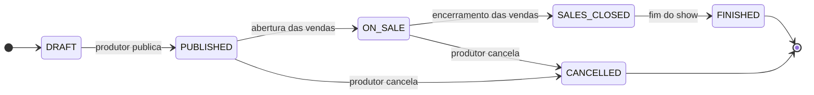
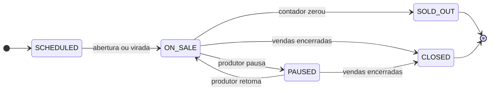
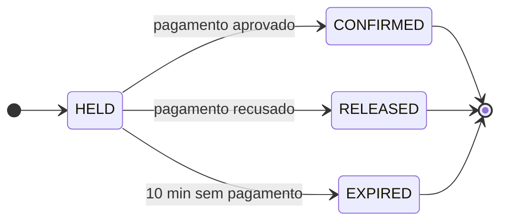
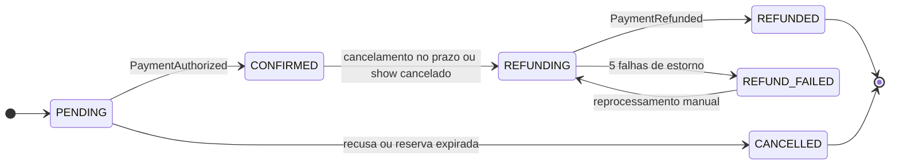
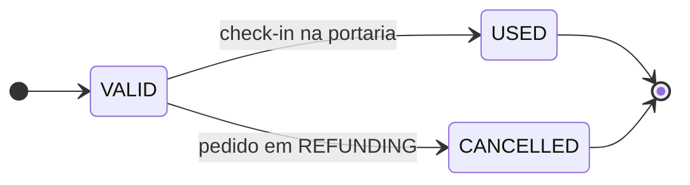
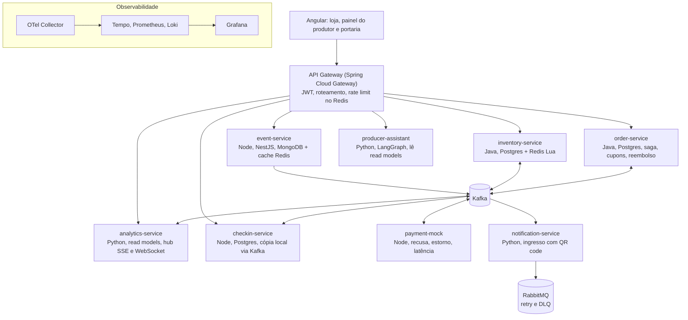
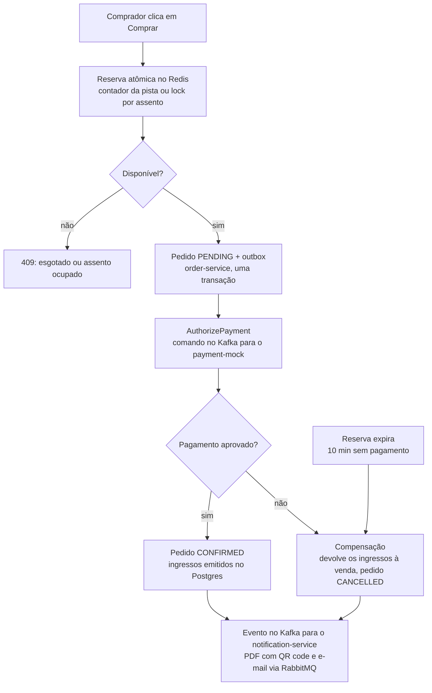

# Lotou: plataforma de venda de ingressos (projeto de portfólio)

Documento de produto e arquitetura. Atualizado em 26/11/2026.

## Visão geral

**Lotou.** É uma plataforma de venda de ingressos para shows, pensada como um produto completo. O produtor cria o show e acompanha as vendas; o comprador compra, recebe o ingresso e entra pela portaria com o QR code; a plataforma cuida de cupons, cancelamentos, reembolsos e do repasse ao produtor.

No dia a dia a venda é direta. Em shows marcados como **alta demanda**, a plataforma ativa a fila virtual, porque na abertura de vendas dezenas de milhares de pessoas disputam poucos milhares de ingressos no mesmo minuto. Nessa hora ela não pode vender além da capacidade, vender o mesmo assento duas vezes nem cair. A engenharia para isso é uma qualidade do produto, não o produto em si.

O projeto existe para provar, com evidência, que eu sei:

- desenhar um sistema distribuído orientado a eventos e justificar cada peça;
- lidar com concorrência e consistência: reserva atômica, saga, outbox e idempotência;
- aplicar padrões de cache e usar o Redis além do cache;
- operar o sistema com rastreamento ponta a ponta, métricas, logs, SLOs e alertas;
- integrar IA de forma útil e segura num produto.

**Público:** recrutadores e tech leads de startups e empresas de tecnologia brasileiras em crescimento. Eles dão poucos minutos ao README, então o projeto precisa se explicar com um diagrama, um vídeo curto e números de teste de carga.

**Por que esse domínio:** venda de ingressos é o exemplo clássico de pico de concorrência, e filas longas e sites fora do ar em vendas de grandes shows são um problema que qualquer recrutador conhece. A escala que a arquitetura assume é a escala real do domínio, então cada peça se justifica. O domínio ainda traz dois tipos de estoque, cada um com sua estratégia de reserva: **pista** (uma quantidade) e **cadeira numerada** (um item único).

## Escopo

O escopo cobre a jornada inteira do ingresso: o produtor cria o show, o comprador compra, recebe e usa o ingresso na portaria, e o produtor recebe o relatório financeiro. Pagamento real, meia-entrada e revenda ficam de fora.

### Requisitos funcionais

**Loja (comprador)**

- Buscar shows por artista, cidade e data
- Ver setores, lotes e preços de um show
- Comprar direto em shows comuns; em shows de alta demanda, entrar na fila virtual e acompanhar a posição em tempo real
- Escolher a quantidade na pista, ou os assentos no mapa nas cadeiras numeradas
- Aplicar cupom de desconto no checkout
- Comprar no máximo 4 ingressos por CPF em cada show
- Acompanhar o status do pedido ao vivo
- Receber o ingresso com QR code por e-mail e vê-lo em "Meus ingressos"
- Cancelar a compra dentro do prazo da política e receber o reembolso

**Painel (produtor)**

- Criar o show de ponta a ponta: rascunho, local, setores, mapa de assentos, lotes e publicação
- Marcar o show como alta demanda, o que liga a fila virtual na abertura de vendas
- Agendar a abertura de vendas e a virada de lotes
- Criar cupons com desconto, limite de uso e validade
- Acompanhar vendas e entradas na portaria num painel ao vivo
- Ver o relatório financeiro: vendas, cancelamentos, reembolsos, taxa da plataforma e valor a receber
- Conversar com o assistente de IA sobre vendas, ocupação e lotes

**Portaria (equipe do show)**

- Ler o QR code pela câmera do celular, direto no navegador
- Ver na hora se o ingresso é válido, já foi usado (quando e em qual portão) ou foi cancelado
- Funcionar com vários portões lendo ao mesmo tempo, sem liberar a mesma entrada duas vezes

### Requisitos não funcionais

Metas iniciais, a calibrar depois do primeiro teste de carga:

| Indicador | Meta inicial |
| --- | --- |
| Venda além da capacidade ou assento vendido duas vezes | zero, em qualquer teste |
| Mesmo ingresso liberando duas entradas | zero, em qualquer teste |
| Reserva de ingresso (p99) | < 50 ms |
| POST /orders (p99) | < 300 ms |
| Leitura do QR na portaria (p99) | < 200 ms |
| Leitura de show com cache (p95) | < 30 ms |
| Assento reservado aparece ocupado para os outros compradores | < 1 s |
| Evento até aparecer no painel do produtor | < 2 s |
| E-mail com ingresso após confirmação (p95) | < 60 s |
| Cenário de pico | 20 mil usuários virtuais disputando 2 mil ingressos de pista e 500 cadeiras |

Além disso: tudo sobe com um `docker compose up`, roda localmente e cada requisição gera um trace do navegador até o banco.

**Dados e demo:** um script de seed cria shows, locais, setores e compradores fictícios mas críveis, para o produto parecer vivo desde o primeiro acesso. Se possível, uma demo fica no ar.

### Fora de escopo

- Pagamento real: um `payment-mock` simula aprovação, recusa, estorno e latência
- Meia-entrada: obrigatória por lei num uso real (Lei 12.933/2013), fica de fora por ser regra legal e não técnica
- Revenda e transferência de ingresso entre pessoas, e festivais de vários dias (passaporte e áreas internas)
- App mobile nativo (a portaria e a loja funcionam no navegador do celular)
- Repasse real de dinheiro ao produtor (o relatório mostra o valor, sem transferência)
- Deploy em Kubernetes (extensão futura)

## Regras de negócio

As regras abaixo valem para o produto inteiro e viram validações no código. Os números são valores de referência, plausíveis para o mercado, e podem ser ajustados.

### Show e capacidade

- A capacidade pertence ao **setor**. O lote só define preço e quantidade à venda dentro do setor, e a soma dos lotes nunca passa da capacidade do setor.
- Um show só pode ser publicado com local, ao menos um setor e ao menos um lote configurados.
- Depois que as vendas abrem, o produtor não pode reduzir a capacidade de um setor abaixo do que já foi vendido.
- O produtor define o horário de abertura dos portões; o check-in só é aceito a partir dele.

### Compra

- Um pedido contém ingressos de um único show.
- Máximo de 4 ingressos por CPF em cada show, somando todos os pedidos. Pedidos cancelados ou reembolsados liberam a cota.
- Na cadeira numerada, o comprador escolhe até 4 assentos e a reserva é tudo ou nada.
- A reserva dura 10 minutos, não é renovável e o cronômetro aparece no checkout.
- O preço é o do lote no momento da reserva e fica congelado no pedido, mesmo que o lote vire durante o pagamento.

### Lotes

- Cada setor tem uma ordem de lotes. O próximo lote abre quando o atual esgota ou na data definida pelo produtor, o que vier primeiro.
- Ingressos devolvidos (reserva expirada, pagamento recusado ou reembolso) voltam para o **lote em venda** no setor, ao preço dele. Reabrir um lote mais barato confundiria o comprador.
- O produtor pode pausar e retomar um lote; um lote pausado não aceita reservas.

### Taxa de serviço

- A plataforma cobra 10% sobre o valor de cada ingresso, valor inspirado no que o mercado pratica.
- O produtor escolhe, por show, se repassa a taxa ao comprador ou se a absorve.
- Quando repassada, a taxa aparece separada no checkout, antes do pagamento.

### Cupons

- Desconto percentual ou em valor fixo, aplicado sobre o valor dos ingressos, nunca sobre a taxa.
- Um cupom por pedido. Cada cupom tem limite total de usos, validade e um show; pode ser restrito a setores.
- O desconto nunca deixa o ingresso abaixo de zero, e os centavos são arredondados para baixo, a favor do comprador.
- Cancelamento ou reembolso devolve o uso do cupom.

### Cancelamento e reembolso

- O comprador pode cancelar até 7 dias depois da compra, desde que faltem mais de 48 horas para o show.
- O cancelamento é sempre do pedido inteiro, e o reembolso é integral, incluindo a taxa de serviço.
- Ingresso já usado na portaria não pode ser cancelado.
- Se o produtor cancelar o show, todos os pedidos confirmados entram em reembolso automático. O reembolso em massa roda com controle de vazão, para não sobrecarregar o gateway de pagamento.

### Portaria

- Cada ingresso libera uma única entrada; não existe saída e reentrada.
- O leitor mostra três resultados: liberado (verde), já utilizado com horário e portão (amarelo) e inválido ou cancelado (vermelho).

### Fila virtual

- Só existe em shows marcados como alta demanda.
- A sala de espera abre 30 minutos antes das vendas. Na abertura, quem estava na sala recebe uma posição sorteada; quem chega depois entra no fim da fila. Assim, chegar 30 minutos antes não dá vantagem sobre quem chegou 1 minuto antes, e robôs que entram cedo perdem a vantagem.
- O token de admissão vale 5 minutos; quem não reserva nesse tempo perde a vez.

### Financeiro

- Valor a receber = vendas brutas − descontos de cupom − reembolsos − taxa de serviço (quando absorvida pelo produtor).
- O relatório é parcial durante as vendas e vira final quando o show termina.

## Estados

Cada entidade tem um conjunto fechado de estados e só passa de um para outro pelos gatilhos da tabela abaixo. Os nomes são os que vão para o código.


*Show*


*Lote*


*Reserva*


*Pedido*


*Ingresso*

Estados destacados são finais: nada sai deles. O pedido em REFUND\_FAILED não é final, porque pode ser reprocessado pelo painel.

### Transições

| Entidade | De | Para | Gatilho | Quem dispara |
| --- | --- | --- | --- | --- |
| Show | DRAFT | PUBLISHED | produtor publica (exige local, setor e lote) | produtor |
| Show | PUBLISHED | ON\_SALE | chega o horário de abertura das vendas | job de abertura |
| Show | ON\_SALE | SALES\_CLOSED | chega o horário de encerramento das vendas | job |
| Show | SALES\_CLOSED | FINISHED | fim do show; o relatório financeiro fica final | job |
| Show | PUBLISHED ou ON\_SALE | CANCELLED | produtor cancela; todos os pedidos confirmados vão para reembolso | produtor |
| Lote | SCHEDULED | ON\_SALE | abertura das vendas, virada do lote anterior ou data do lote | inventory |
| Lote | ON\_SALE | SOLD\_OUT | contador chega a zero (`LotSoldOut`) | inventory |
| Lote | ON\_SALE | PAUSED | produtor pausa | produtor |
| Lote | PAUSED | ON\_SALE | produtor retoma | produtor |
| Lote | ON\_SALE ou PAUSED | CLOSED | vendas do show encerradas | inventory |
| Reserva | HELD | CONFIRMED | pagamento aprovado (`ConfirmReservation`) | order |
| Reserva | HELD | RELEASED | pagamento recusado (`ReleaseReservation`) | order |
| Reserva | HELD | EXPIRED | 10 minutos sem pagamento | job de expiração |
| Pedido | PENDING | CONFIRMED | `PaymentAuthorized` | payment-mock |
| Pedido | PENDING | CANCELLED | `PaymentDeclined` ou reserva expirada | payment-mock ou inventory |
| Pedido | CONFIRMED | REFUNDING | comprador cancela no prazo, ou show cancelado | comprador ou produtor |
| Pedido | REFUNDING | REFUNDED | `PaymentRefunded` | payment-mock |
| Pedido | REFUNDING | REFUND\_FAILED | 5 falhas seguidas de estorno | order |
| Pedido | REFUND\_FAILED | REFUNDING | reprocessamento manual | produtor ou suporte |
| Ingresso | VALID | USED | check-in na portaria | checkin |
| Ingresso | VALID | CANCELLED | pedido entra em REFUNDING | order |

Ingresso em USED não volta a VALID nem vai para CANCELLED: por isso um pedido com algum ingresso já usado não pode ser cancelado.

## Convenções

Decisões pequenas que valem para todos os serviços e são caras de mudar depois do código escrito.

| Tema | Regra | Por quê |
| --- | --- | --- |
| Dinheiro | valores em centavos como inteiro (`BIGINT` no banco, `long` no Java, inteiro no JSON); moeda BRL | `float` acumula erro de arredondamento |
| Arredondamento | percentuais calculados em centavos e arredondados para baixo, numa única função por serviço, coberta por testes | cada serviço arredondando de um jeito gera diferenças no financeiro |
| Datas | gravar em UTC (`timestamptz`); cada local guarda seu fuso IANA (ex.: `America/Sao_Paulo`) e a tela exibe no fuso do show | abertura de vendas, virada de lote e prazo de cancelamento dependem do horário certo |
| IDs | UUID v7 em todas as entidades | ordenável por tempo (bom para índice) e não revela quantos pedidos existem |
| Dados pessoais (LGPD) | CPF e e-mail nunca aparecem em logs, traces ou chaves do Redis; o Collector mascara atributos sensíveis e as chaves usam um hash do CPF | evita vazamento pela própria observabilidade |
| Eventos | nomes no passado (`OrderConfirmed`), comandos no imperativo (`AuthorizePayment`), versão no envelope; mudança incompatível gera nova versão | consumidores antigos não quebram |
| API | REST, erros no formato Problem Details (RFC 9457), paginação por cursor e `Idempotency-Key` em todo POST que cria recurso | contrato previsível para o Angular e para os testes |
| Estados | transições validadas por uma tabela única por entidade; transição fora da tabela é recusada e registrada em log | evita estados impossíveis no meio de uma saga |
| Commits e ADRs | Conventional Commits; cada ADR escrito no momento da decisão | histórico legível e decisões com contexto |

## Arquitetura

Nove serviços em três linguagens, ligados por HTTP síncrono só no caminho do usuário e por eventos no resto. Java fica onde há concorrência e transação, Node no catálogo de shows, no mock e na portaria, e Python em dados, tempo real e IA.



Todos os serviços exportam traces, métricas e logs via OTLP para o OTel Collector.

O gateway também leva o SSE e o WebSocket até o analytics-service, que é o hub de tempo real, e as leituras de QR até o checkin-service. O producer-assistant não usa o Kafka: só lê os read models.

### Serviços

| Serviço | Stack | Responsabilidade | Dados |
| --- | --- | --- | --- |
| api-gateway | Java · Spring Cloud Gateway | roteamento, validação de JWT e rate limit | redis-core |
| event-service | Node · NestJS | shows, locais, setores, mapas de assentos, busca e cache | MongoDB, redis-cache |
| inventory-service | Java · Spring Boot | lotes, disponibilidade, fila virtual e reservas de pista e de assento | Postgres, redis-core |
| order-service | Java · Spring Boot | pedidos, cupons, emissão de ingressos, cancelamento, reembolso, saga e outbox | Postgres, redis-core |
| payment-mock | Node | simula um gateway de pagamento com recusa, estorno e latência configuráveis | Postgres |
| analytics-service | Python · FastAPI | métricas ao vivo, read models, relatório financeiro e hub de tempo real (SSE e WebSocket) | MongoDB, redis-core |
| notification-service | Python · FastAPI + workers | gera o PDF do ingresso com QR code e envia os e-mails (Mailpit em desenvolvimento) | RabbitMQ |
| checkin-service | Node · NestJS | valida o QR na portaria com uma cópia local dos ingressos válidos | Postgres, redis-core |
| producer-assistant | Python · FastAPI + LangGraph | agente de IA do produtor | MongoDB (leitura) |

**Infraestrutura no Compose:** Postgres, MongoDB, `redis-cache`, `redis-core`, Kafka em modo KRaft com Kafka UI, RabbitMQ com painel de management, Keycloak (configuração importada ao subir), Mailpit, OTel Collector, `grafana/otel-lgtm` e Toxiproxy para os testes de caos.

### Estrutura do repositório

```
lotou/
├── apps/web/                  # Angular (loja, painel e portaria)
├── services/
│   ├── api-gateway/           # Java
│   ├── event-service/         # Node
│   ├── inventory-service/     # Java
│   ├── order-service/         # Java
│   ├── payment-mock/          # Node
│   ├── analytics-service/     # Python
│   ├── notification-service/  # Python
│   ├── checkin-service/       # Node
│   └── producer-assistant/    # Python
├── contracts/                 # JSON Schema dos eventos
├── infra/
│   ├── docker-compose.yml
│   ├── otel-collector.yaml
│   └── grafana/dashboards/
├── seed/                      # shows, locais e compradores fictícios
├── load-tests/                # k6
├── chaos/                     # roteiros dos experimentos
└── docs/
    ├── adr/
    └── architecture.md
```

## Modelo de dados

O Postgres guarda o que precisa de transação, o MongoDB guarda documentos de formato variável e visões de leitura, e o Redis guarda o que é quente e efêmero. Cada serviço tem seu próprio banco e nenhum serviço lê o banco de outro.

### Postgres (um banco por serviço, mesma instância)

| Serviço | Tabela | Para quê |
| --- | --- | --- |
| inventory | `lots` | lotes por setor: preço, quantidade, ordem de virada e status |
| inventory | `seats` | uma linha por cadeira numerada, com status e versão |
| inventory | `reservations` | reservas persistidas a partir do Redis Stream, com status e `expires_at` |
| order | `orders`, `order_items` | pedido, status, cupom aplicado e `idempotency_key` única |
| order | `tickets` | ingresso emitido, status (VALID, USED ou CANCELLED) e código do QR; constraint única em (show, assento) como última defesa contra venda dupla |
| order | `coupons` | código, desconto, limite de uso, validade e show |
| order | `refunds` | pedido de reembolso, valor, status e tentativas |
| order | `outbox` | eventos a publicar no Kafka, gravados na mesma transação do pedido |
| order | `saga_state` | passo atual de cada saga (compra ou cancelamento), para retomar após falha |
| checkin | `valid_tickets` | cópia local dos ingressos válidos, alimentada por eventos do Kafka |
| checkin | `checkins` | entrada registrada, com portão e horário; constraint única em `ticket_id` |
| todos os consumidores | `processed_events` | `event_id` já processado, para idempotência |
| payment-mock | `payments` | tentativas e estornos por pedido, para responder igual a comandos repetidos |

### MongoDB

| Coleção | Conteúdo | Por que documento |
| --- | --- | --- |
| `events` | show, artista, data, local, setores, lotes, descrição e flag de alta demanda | campos variam por tipo de show e de local |
| `venues` | layout do local: setores, fileiras e assentos com coordenadas para desenhar o mapa | um estádio e um teatro têm estruturas bem diferentes |
| `sales_by_sector` | vendas, receita e ocupação por show, setor e hora | read model desnormalizado, montado a partir de eventos |
| `producer_statements` | por show: vendas brutas, descontos, cancelamentos, reembolsos, taxa da plataforma e valor a receber | read model financeiro, recalculável por replay |
| `order_view` | pedido completo para o painel e o agente | evita joins entre serviços na leitura |
| `agent_conversations` | histórico do chat e chamadas de ferramenta | estrutura aninhada e variável |
| `idempotency_keys` | `Idempotency-Key` já vista nos POSTs do event-service, com a resposta original; TTL de 24 h | o índice único do `_id` decide a corrida entre requisições iguais (ADR 22) |

### Redis

Duas instâncias com políticas diferentes: `redis-cache` pode perder dados (`allkeys-lru`, sem persistência) e `redis-core` não pode (`noeviction`, AOF a cada segundo).

| Chave | Tipo | TTL | Instância | Uso |
| --- | --- | --- | --- | --- |
| `cache:event:{id}` | string (JSON) | 10 min + jitter | cache | detalhe do show |
| `cache:events:{hash da consulta}` | string (JSON) | 60 s | cache | busca e listagens |
| `lot:{lotId}:stock` | inteiro | fim das vendas | core | ingressos restantes do lote de pista |
| `seat:{showId}:{seatId}` | string | 10 min | core | assento segurado; o valor é o id da reserva |
| `seatmap:{showId}:{sectorId}` | bitmap | fim das vendas | core | um bit por cadeira (livre ou ocupada), para desenhar o mapa sem ir ao banco |
| `res:{resId}` | hash | 10 min | core | reserva ativa |
| `limit:{showId}:{cpfHash}` | inteiro | fim das vendas | core | ingressos por CPF (máximo 4); a chave usa um hash do CPF, nunca o CPF |
| `coupon:{code}:uses` | inteiro | validade do cupom | core | usos do cupom, com limite checado de forma atômica |
| `queue:{showId}` | sorted set | fim da abertura | core | fila virtual (só em shows de alta demanda), score = hora de chegada |
| `admitted:{showId}:{userId}` | string | 5 min | core | token de admissão ao checkout |
| `checkin:{ticketId}` | string | até o fim do show | core | entrada já registrada; o valor guarda portão e horário |
| `idem:{chave}` | string | 24 h | core | Idempotency-Key do POST /orders |
| `rl:{userId}` | sorted set | janela | core | rate limit por janela deslizante |
| `lock:{nome}` | string | segundos | core | lock distribuído de jobs |
| `metrics:sectors:{showId}` | sorted set | 48 h | core | vendas por setor ao vivo |
| `stream:reservations` | stream | MAXLEN | core | reservas a persistir no Postgres |
| `stream:activity` | stream | MAXLEN \~1000 | core | feed de atividade do painel |

## Mensageria

A regra que guia tudo: **Kafka carrega fatos de domínio, RabbitMQ carrega tarefas e o Redis carrega tempo real efêmero.** Cada mensagem tem um dono claro, e o README explica essa divisão.

### Kafka (fatos de domínio e comandos da saga)

Todo evento usa o mesmo envelope: `eventId`, `type`, `version`, `occurredAt` e `payload`. O contexto de trace vai no header `traceparent`, os contratos ficam em JSON Schema na pasta `contracts/`, e a retenção é de 7 dias.

| Tópico | Chave | Mensagens | Produz | Consome |
| --- | --- | --- | --- | --- |
| `shows.catalog` (compactado) | showId | ShowPublished, ShowUpdated, LotPriceChanged | event | inventory, analytics |
| `order.events` | orderId | OrderCreated, OrderConfirmed, OrderCancelled, OrderRefunded, TicketsIssued, TicketsCancelled | order (via outbox) | analytics, notification, checkin |
| `payment.commands` | orderId | AuthorizePayment, RefundPayment | order | payment-mock |
| `payment.events` | orderId | PaymentAuthorized, PaymentDeclined, PaymentRefunded, RefundFailed | payment-mock | order |
| `inventory.commands` | orderId | ConfirmReservation, ReleaseReservation, ReturnTickets | order | inventory |
| `inventory.events` | showId | ReservationConfirmed, ReservationReleased, LotSoldOut, LotOpened | inventory | order, analytics, inventory (virada de lote) |
| `checkin.events` | showId | TicketCheckedIn, CheckinRejected | checkin | analytics |
| `*.dlt` | igual à origem | mensagens que falharam após os retries | consumidores | inspeção manual |

A chave define a partição: todos os eventos de um mesmo pedido ou show chegam em ordem ao consumidor, então `LotSoldOut` sempre vem antes do `LotOpened` do lote seguinte. O preço disso é a **partição quente**: um show grande concentra seus eventos numa partição só. Medir no teste de carga e, se virar gargalo, trocar a chave para show + setor; a decisão vira um ADR.

### RabbitMQ (tarefas com retry)

| Exchange | Tipo | Routing key | Fila | Comportamento |
| --- | --- | --- | --- | --- |
| `tickets` | direct | `render` | `tickets.render` | gera o PDF com QR code; tarefa pesada de CPU, vários workers, prefetch 1 |
| `notifications` | topic | `email.ticket.issued`, `email.order.cancelled`, `email.refund.completed` | `notifications.email` | prioridade (ingresso antes de marketing), prefetch 10, ack manual |
| `notifications.retry` | direct | `10s`, `1m`, `5m` | `notifications.retry.*` | TTL por fila + dead-letter de volta à fila principal |
| `notifications.dlx` | fanout | — | `notifications.email.dlq` | destino final após 4 tentativas |
| `reports` | direct | `statement.pdf` | `reports.generate` | gera o PDF do relatório financeiro do produtor sob demanda |

O `notification-service` consome `order.events` do Kafka. Ao ver um `OrderConfirmed`, enfileira a geração do ingresso; quando o PDF fica pronto, enfileira o e-mail. Assim o retry com backoff, a prioridade, a divisão de carga entre workers e a DLQ ficam onde o RabbitMQ é melhor.

### Redis Streams e pub/sub

| Canal | Tipo | Quem escreve | Quem lê | Por que esse tipo |
| --- | --- | --- | --- | --- |
| `stream:reservations` | Stream + consumer group | script Lua da reserva (na mesma operação atômica) | inventory, que grava no Postgres | não pode perder: usa `XACK`, `XPENDING` e `XCLAIM` para reprocessar |
| `seatmap.{showId}` | pub/sub | inventory, a cada assento segurado, liberado ou vendido | analytics, que repassa por SSE a quem está no mapa | quem conecta lê o bitmap atual e depois só recebe as mudanças; perder uma mensagem se corrige na próxima leitura do bitmap |
| `stream:activity` | Stream | analytics | WebSocket do painel | um painel que conecta lê os últimos 50 eventos com `XREVRANGE` |
| `dashboard.metrics` | pub/sub | analytics, 1 vez por segundo | WebSocket do painel | perder um tick não importa; o próximo chega em 1 s |

A comparação entre pub/sub (fire-and-forget), Streams (persistente, com consumer groups) e Kafka vira um ADR e um trecho do README.

## Fluxos críticos

Seis fluxos concentram a dificuldade do projeto: abrir as vendas, comprar sem vender além da capacidade, virar de lote, manter o cache coerente, validar a entrada na portaria e cancelar com reembolso.

### Fluxo A: abertura de vendas e fila virtual

A fila só é ativada em shows que o produtor marcou como alta demanda. Nos demais, o comprador vai direto ao checkout, sem token de admissão.

1. Antes da abertura, um job protegido por lock distribuído carrega no `redis-core` o estoque de cada lote de pista e o bitmap de assentos de cada setor.
2. O comprador entra na fila com `ZADD NX` e recebe a posição via `ZRANK`.
3. A cada segundo, `ZPOPMIN` admite um lote de N compradores; cada um recebe um token de admissão com TTL de 5 min. O N controla a carga no checkout.
4. O Angular recebe posição e admissão por SSE.
5. O rate limit do gateway barra robôs e cliques em excesso antes de chegarem ao serviço.

### Fluxo B: checkout e saga



A reserva é síncrona porque o comprador precisa saber na hora se garantiu o ingresso; o pagamento segue assíncrono pela saga.

- **Idempotência na entrada:** o POST /orders exige `Idempotency-Key`; um `SET NX` no Redis faz um clique duplo devolver o mesmo pedido.
- **Pista:** o script Lua confere o token (em shows de alta demanda), o limite do CPF e o estoque do lote, decrementa, cria a reserva com TTL e faz `XADD` em `stream:reservations`. Um consumer group do inventory grava a reserva no Postgres.
- **Cadeira numerada:** o comprador escolhe até 4 assentos e o script Lua tenta `SET NX` em todos de uma vez: segura todos ou nenhum. Em seguida marca os bits no bitmap e publica a mudança em `seatmap.{showId}`, e os outros compradores veem os assentos ficarem ocupados.
- **Cupom:** o order-service valida código, show e validade, e incrementa `coupon:{code}:uses` com um script que recusa acima do limite. Se o pedido for cancelado, o uso volta.
- **Última defesa:** a constraint única de (show, assento) na tabela `tickets` impede a venda dupla mesmo se o Redis falhar.
- **Outbox:** pedido e evento são gravados na mesma transação; um relay publica no Kafka e marca como publicado.
- **Consumidores idempotentes:** cada efeito é gravado junto com o `event_id` em `processed_events`; um evento repetido é ignorado.
- **Expiração confiável:** um job no inventory varre reservas vencidas no Postgres e dispara a compensação. Notificações de expiração de chave do Redis não têm garantia de entrega, então não são usadas como gatilho.

### Fluxo C: virada de lote

1. Quando o contador de um lote chega a zero, o inventory publica `LotSoldOut`.
2. O próprio inventory consome o evento, carrega no Redis o estoque do próximo lote do setor e publica `LotOpened`.
3. O event-service apaga o cache do show, porque o preço exibido mudou, e o analytics atualiza o painel do produtor.

### Fluxo D: atualização de show

1. O produtor edita o show; o event-service grava no MongoDB.
2. O serviço apaga `cache:event:{id}` e publica `ShowUpdated` em `shows.catalog`.
3. O inventory atualiza os dados de referência e o analytics atualiza os read models.
4. A próxima leitura recarrega o cache (cache-aside).

### Fluxo E: check-in na portaria

1. Quando o pedido é confirmado, o order-service publica `TicketsIssued` e o checkin-service grava os ingressos em `valid_tickets`. Um `TicketsCancelled` os remove.
2. O QR code carrega o id do ingresso e uma assinatura HMAC, então um QR falsificado é recusado sem consultar o banco.
3. No dia do show, o leitor da portaria envia o código, e o checkin-service confere a assinatura e se o ingresso está em `valid_tickets`.
4. Um `SET NX` em `checkin:{ticketId}` decide quem chega primeiro: o primeiro portão libera, e o segundo recebe "já utilizado às 20h31 no portão B".
5. A entrada é gravada em `checkins` (constraint única) e publicada como `TicketCheckedIn`, e o painel mostra a ocupação ao vivo.

Como a portaria tem sua própria cópia dos ingressos, ela continua funcionando mesmo com o order-service fora do ar.

### Fluxo F: cancelamento e reembolso

1. O comprador pede o cancelamento em "Meus ingressos", e o order-service confere o prazo da política.
2. Os ingressos passam a CANCELLED e `TicketsCancelled` sai pelo outbox; a portaria deixa de aceitá-los.
3. `RefundPayment` vai ao payment-mock; com `PaymentRefunded`, o pedido fica REFUNDED e o uso do cupom volta.
4. `ReturnTickets` devolve os ingressos à venda no inventory: o contador da pista sobe ou o assento é liberado no bitmap.
5. O notification-service envia o e-mail de reembolso concluído.

Se o estorno falhar, a saga tenta de novo com backoff. Depois de 5 falhas o pedido vai para REFUND\_FAILED, dispara um alerta e aparece no painel para tratamento manual.

## Estratégia de cache e Redis

Cada dado tem um padrão de cache escolhido pela tolerância a dado velho. Preço, ingressos restantes e status de assento nunca vêm de cache.

| Dado | Padrão | TTL | Invalidação |
| --- | --- | --- | --- |
| Detalhe do show | cache-aside | 10 min + jitter de 0 a 60 s | `DEL` na escrita, na virada de lote e via evento em `shows.catalog` |
| Busca e listagens | cache-aside | 60 s | só TTL; aceita até 1 min de atraso |
| Show inexistente | cache negativo | 30 s | só TTL |
| Show em abertura de vendas (hot key) | dois níveis: L1 em memória + L2 no Redis | L1 de 2 s | L1 expira sozinho; L2 como acima |
| Layout do local (mapa sem status) | cache-aside | 1 h | `DEL` quando o produtor edita o local |
| Status dos assentos | sem cache | — | bitmap no `redis-core` + mudanças via pub/sub |
| Ingressos restantes do lote | sem cache | — | lê o contador `lot:{lotId}:stock` direto |
| Preço no checkout | sem cache | — | sempre do inventory |

### Proteções a implementar

- **Stampede:** na abertura de vendas, milhares de pedidos chegam para o mesmo show. Quando a chave expira, só uma requisição recarrega (lock com `SET NX PX`); as outras esperam um instante e releem ou recebem o valor anterior.
- **Jitter no TTL:** evita que milhares de chaves expirem no mesmo segundo.
- **Apagar, não atualizar:** na escrita o cache é apagado, não reescrito, para evitar a corrida em que um valor velho sobrescreve um novo. Testar também o *delayed double delete*.
- **Instâncias separadas:** o `redis-cache` pode descartar chaves por LRU; o `redis-core` usa `noeviction`, porque descartar estoque, assento ou fila seria um bug.

### Outros usos do Redis

- **Rate limit:** o gateway usa o `RedisRateLimiter` do Spring Cloud Gateway (token bucket). No event-service, implementar uma janela deslizante própria com sorted set, para comparar os dois algoritmos.
- **Reserva atômica:** na pista, um contador; na cadeira numerada, `SET NX` em vários assentos com tudo ou nada. Os dois em script Lua, junto com a checagem do token, do limite do CPF e o `XADD` no stream.
- **Bitmap de assentos:** `SETBIT` e `GETRANGE` guardam o mapa de um setor com 5 mil cadeiras em cerca de 625 bytes, e o mapa inteiro sai numa leitura só.
- **Fila virtual:** sorted set com hora de chegada; `ZRANK` dá a posição e `ZPOPMIN` admite o próximo lote.
- **Cupons:** o limite de uso é checado e incrementado num script atômico; o cancelamento devolve o uso.
- **Check-in:** `SET NX` em `checkin:{ticketId}` garante que só o primeiro portão libera a entrada, mesmo com leituras simultâneas.
- **Idempotência:** `SET NX` da Idempotency-Key antes de criar o pedido; um clique duplo devolve o mesmo pedido.
- **Lock distribuído:** `SET NX PX` com token único e liberação via Lua, para que só uma instância rode jobs como a abertura de vendas. Documentar o limite: para correção forte, a garantia final fica numa constraint do Postgres.
- **Ranking ao vivo:** `ZINCRBY` em `metrics:sectors:{showId}` a cada venda.

### Métricas que provam que o cache funciona

Taxa de acerto por prefixo de chave, latência com e sem cache, evictions e memória usada. O teste de carga da página do show roda com o cache ligado e desligado e vira um gráfico no README.

## Observabilidade

O OpenTelemetry entra na fase 0, e a meta é um único trace do clique no Angular até o banco, atravessando o Kafka e o RabbitMQ. Os dados vão para a stack Grafana (Tempo, Prometheus e Loki); em desenvolvimento a imagem `grafana/otel-lgtm` sobe tudo num container.

### Instrumentação por componente

| Componente | Como instrumentar |
| --- | --- |
| Angular | OTel Web SDK (fetch, XHR, carregamento de página); propaga `traceparent` ao gateway |
| Serviços Spring | Java agent sem código + spans manuais na reserva e em cada passo da saga |
| Serviços Node | `@opentelemetry/auto-instrumentations-node` |
| Serviços Python | `opentelemetry-instrument` + spans GenAI no agente |
| Kafka e RabbitMQ | contexto nos headers; onde a biblioteca não propaga sozinha, injetar e extrair manualmente |
| Redis, Postgres, MongoDB | clientes auto-instrumentados + exporters de métricas (redis, postgres, mongodb, lag do Kafka, plugin Prometheus do RabbitMQ) |

**Pipeline:** serviços → OTel Collector (batch + tail sampling: 100% dos traces com erro ou acima de 500 ms, 10% do resto) → Tempo, Prometheus (com exemplars ligando métrica a trace) e Loki → Grafana. Logs em JSON com `trace_id` e `span_id`, para pular do log ao trace com um clique.

### Métricas de negócio

- `orders_total{status}` e `saga_duration_seconds{saga}` (compra ou cancelamento)
- `ticket_reservations_total{type, result}`: pista ou cadeira; reservado, esgotado, assento ocupado ou limite do CPF
- `seat_hold_conflicts_total`: duas pessoas tentando o mesmo assento
- `queue_length`, `queue_admitted_total` e `queue_wait_seconds`
- `lot_transitions_total`
- `coupon_redemptions_total{result}`
- `checkins_total{gate, result}`: liberado, já utilizado, cancelado ou inválido
- `refunds_total{status}`
- `cache_requests_total{prefix, result}`
- `ticket_render_duration_seconds` e `notifications_dlq_depth`
- `llm_tokens_total` e `llm_request_duration_seconds`

### Dashboards

1. **Abertura de vendas ao vivo:** fila, admissões, reservas por segundo, ingressos restantes por lote e setor, e conflitos de assento
2. **Portaria ao vivo:** entradas por minuto e por portão, ocupação do local e leituras recusadas
3. **Negócio:** vendas, cupons usados, cancelamentos e reembolsos por show
4. **RED por serviço:** taxa, erros e duração de cada endpoint
5. **Mensageria:** lag por consumer group, profundidade das filas, DLQ e DLT
6. **Redis e cache:** taxa de acerto, latência, memória e evictions
7. **IA:** tokens, custo estimado, latência por ferramenta e erros do agente

### Alertas

| Alerta | Condição | Por quê |
| --- | --- | --- |
| Venda além da capacidade | ingressos emitidos acima da capacidade de um setor, ou um assento com dois ingressos | é a invariante do sistema |
| Entrada dupla | dois check-ins para o mesmo ingresso | a outra invariante, agora na portaria |
| Burn rate do checkout | orçamento de erro consumido 14× mais rápido em 1 h (janelas múltiplas) | alerta sobre o SLO, não sobre ruído |
| Portaria lenta | p99 do check-in acima de 200 ms por 5 min | fila na porta do show |
| Consumer lag | lag de `order.events` acima de 1.000 por 2 min | consumidor não acompanha; na portaria, ingresso recém-comprado ainda não seria aceito |
| DLQ | qualquer mensagem em `notifications.email.dlq` | ingresso que não chegou ao comprador |
| Saga presa | pedido em PENDING há mais de 15 min | compensação falhou |
| Reembolso falhou | qualquer pedido em REFUND\_FAILED | dinheiro do comprador parado |

### E o Datadog?

Como a instrumentação é OpenTelemetry, trocar de backend é mudar o exporter do Collector. Na fase final, usar o trial de 14 dias do Datadog para mandar os mesmos dados para lá e registrar a comparação num ADR. Isso mostra a vantagem de ser vendor-neutral sem prender o projeto a um serviço pago.

## Agente de IA do produtor

O `producer-assistant` responde perguntas sobre vendas, ocupação e lotes usando ferramentas que leem dados reais, e prepara rascunhos de lote extra. Ele nunca executa uma ação sozinho. Stack: Python, FastAPI e LangGraph, com respostas em streaming via SSE.

### Ferramentas

| Ferramenta | O que faz | Fonte |
| --- | --- | --- |
| `get_sales_summary(showId, período)` | ingressos vendidos, receita e ocupação | `sales_by_sector` |
| `get_sector_performance(showId)` | ocupação e ritmo de venda por setor | `metrics:sectors` + `sales_by_sector` |
| `get_sellout_forecast(showId, setor)` | quando o setor esgota no ritmo atual | read models |
| `get_opening_report(showId)` | tamanho da fila, tempo de espera, conversão, desistências e reservas expiradas | analytics |
| `get_financial_statement(showId)` | vendas brutas, descontos, reembolsos, taxa da plataforma e valor a receber | `producer_statements` |
| `get_coupon_performance(showId)` | usos e receita gerada por cupom | read models |
| `get_checkin_status(showId)` | entradas por portão, ocupação e leituras recusadas | analytics |
| `compare_shows(showIds)` | compara aberturas de vendas de shows diferentes | read models |
| `draft_lot(showId, setor, preço, quantidade)` | cria um **rascunho** de lote extra | API do inventory |
| `draft_coupon(showId, desconto, limite, validade)` | cria um **rascunho** de cupom | API do order |

### Perguntas que ele deve responder

- "Qual setor está vendendo mais devagar?"
- "No ritmo atual, a pista esgota antes do dia do show?"
- "Como foi a abertura de vendas? Quantas pessoas desistiram na fila?"
- "Quanto vou receber deste show depois de taxas e reembolsos?"
- "O cupom de lançamento trouxe vendas ou só deu desconto para quem já ia comprar?"
- "Quantas pessoas já entraram e qual portão está com mais fila?"
- "Monte um lote extra para a cadeira superior com preço 10% menor."

### Segurança e qualidade

- Ferramentas são só de leitura, exceto `draft_lot` e `draft_coupon`, que pausam o grafo (interrupt do LangGraph) até o produtor aprovar no painel.
- Todo número da resposta vem de uma chamada de ferramenta; o prompt proíbe estimar valores.
- Nomes e descrições de show entram como dados, nunca como instruções, para mitigar prompt injection.
- Limite de tokens e de chamadas de ferramenta por conversa.

### Observabilidade e avaliação

- Spans seguindo as convenções GenAI do OpenTelemetry (`gen_ai.*`): modelo, tokens, latência e ferramenta chamada, no mesmo trace da requisição.
- Um conjunto de 20 a 30 perguntas com resposta esperada, calculada a partir dos dados de seed, roda no CI e falha se a taxa de acerto cair.

## Frontend Angular

Um único app Angular com duas áreas carregadas sob demanda: a loja e o painel do produtor. Usar o Angular moderno: standalone components, signals para estado, o novo control flow (`@if`, `@for`) e RxJS onde o dado é um fluxo (SSE e WebSocket).

| Área | Tela | O que mostra | Tempo real |
| --- | --- | --- | --- |
| Loja | Busca de shows | shows por artista, cidade e data | — |
| Loja | Página do show | setores, lotes, preços e contagem regressiva para a abertura | — |
| Loja | Fila virtual | posição, tempo estimado e aviso de admissão (só em alta demanda) | SSE |
| Loja | Mapa de assentos | cadeiras desenhadas em SVG, mudando de cor quando alguém segura ou compra | SSE |
| Loja | Checkout | reserva com cronômetro de 10 min e campo de cupom | — |
| Loja | Meus ingressos | status do pedido, QR code e botão de cancelar dentro do prazo | SSE |
| Produtor | Painel ao vivo | fila, vendas por setor, ingressos restantes, entradas na portaria e feed de atividade | WebSocket |
| Produtor | Shows e lotes | criar show, local, mapa e lotes; marcar alta demanda; agendar abertura; aprovar rascunhos do agente | — |
| Produtor | Cupons | criar, pausar e acompanhar cupons | — |
| Produtor | Financeiro | vendas, descontos, reembolsos, taxa da plataforma, valor a receber e PDF do relatório | — |
| Produtor | Assistente | chat com resposta em streaming | SSE |
| Portaria | Leitor de QR | câmera do celular no navegador; tela verde, vermelha ou amarela com o motivo | — |

**Mapa de assentos:** é a tela mais rica do projeto. Ela desenha o layout do local a partir do MongoDB, pinta o status a partir do bitmap e aplica as mudanças que chegam por SSE sem redesenhar tudo, um bom exercício de signals e performance de renderização.

**SSE ou WebSocket:** SSE onde o servidor só empurra dados ao cliente (fila, assentos, pedido, chat), porque é mais simples e passa pelo gateway como HTTP comum. WebSocket no painel, onde o cliente também envia mensagens (trocar filtros e assinaturas). Usar os dois é proposital e vira um ADR.

**Bibliotecas e testes:** Angular Material ou PrimeNG para componentes, ngx-echarts para gráficos, OTel Web SDK para tracing, testes unitários com o runner padrão da versão e Playwright para o fluxo de compra ponta a ponta.

## Decisões de arquitetura (ADRs)

Cada linha vira um arquivo em `docs/adr/` no formato contexto, decisão e consequências. É a parte que mais conversa com entrevista técnica, porque mostra o *porquê*.

| # | Decisão | Alternativa descartada | Motivo |
| --- | --- | --- | --- |
| 1 | Kafka para eventos de domínio | RabbitMQ para tudo | replay, vários consumidores independentes e ordem por chave |
| 2 | RabbitMQ para gerar ingressos e enviar e-mails | retry dentro do consumidor Kafka | divisão de carga entre workers, retry com backoff via TTL + DLX, prioridade e ack por mensagem |
| 3 | Reserva com script Lua no Redis: contador na pista, `SET NX` por assento na cadeira | `SELECT FOR UPDATE` no Postgres | linha quente vira gargalo sob disputa; os dois são implementados e medidos com k6 |
| 4 | Constraint única de (show, assento) no Postgres | confiar só no Redis | última defesa contra venda dupla se o Redis falhar ou perder dados |
| 5 | Bitmap no Redis para o status dos assentos | consultar o Postgres a cada abertura do mapa | um setor inteiro numa leitura de poucos bytes, sem carga no banco |
| 6 | Reserva síncrona, pagamento assíncrono | tudo síncrono ou tudo assíncrono | o comprador precisa saber na hora se garantiu o ingresso; o pagamento pode demorar |
| 7 | Sagas orquestradas pelo order-service (compra e cancelamento) | sagas coreografadas | estado de cada pedido num lugar só, fácil de rastrear e de explicar |
| 8 | Outbox transacional | gravar no banco e publicar no Kafka separadamente | sem outbox, uma queda entre as duas operações perde ou duplica eventos |
| 9 | MongoDB para shows, locais e read models | JSONB no Postgres | layouts de locais variam muito; JSONB resolveria, e o ADR admite que a escolha também é objetivo de aprendizado |
| 10 | Duas instâncias de Redis | uma instância só | cache pode ser descartado, estoque, assento e fila não; as políticas de memória são opostas |
| 11 | pub/sub para mapa e métricas, Streams para reservas e feed | Kafka para tudo que é tempo real | dado efêmero não precisa de log durável; reservas precisam de ack e reprocessamento |
| 12 | Chave de partição por show em `inventory.events` | chave por show + setor | garante a ordem da virada de lote; revisar se a partição quente virar gargalo |
| 13 | Fila virtual só em shows de alta demanda | fila sempre ligada | no dia a dia a compra direta é melhor; a fila é uma decisão de produto, não só técnica |
| 14 | checkin-service com cópia local dos ingressos | consultar o order-service a cada leitura | a portaria não pode parar se outro serviço cair no dia do show |
| 15 | QR code assinado com HMAC | QR só com o id do ingresso | um QR falsificado é recusado sem ir ao banco |
| 16 | OpenTelemetry + stack Grafana | SDK proprietário do Datadog | vendor-neutral, gratuito e trocável por configuração |
| 17 | SSE na loja, WebSocket no painel | WebSocket em tudo | SSE basta onde o fluxo é de mão única |
| 18 | Um banco por serviço | banco compartilhado | serviços só se acoplam por contratos de API e de eventos |
| 19 | Keycloak como provedor de identidade (OAuth2 e OpenID Connect), com papéis comprador, produtor e portaria | login e JWT feitos à mão | autenticação própria é código arriscado e fora do foco; o gateway só valida o JWT pela chave pública, e o Angular usa o fluxo com PKCE |
| 20 | Monorepo com pastas simples: ferramenta nativa por serviço, Makefile na raiz e filtros de caminho no CI | Nx | com três linguagens, o Nx acrescenta uma camada sem relação com os objetivos; cada serviço fica como seria numa empresa |
| 21 | Cada serviço revalida o JWT que o gateway já validou | confiar em cabeçalhos de identidade montados pelo gateway | defesa em profundidade: um serviço alcançado pela rede interna não aceita requisição sem token válido |
| 22 | `Idempotency-Key` do event-service guardada no MongoDB, com índice único e TTL de 24 h | `redis-core` (dependência nova só para isso) ou `redis-cache` (pode descartar a chave) | a idempotência fica na mesma base dos dados que protege; o `POST /orders` continua no Redis |

## Testes, carga e caos

Os testes de carga e caos são a vitrine: cada um gera um print do Grafana e um parágrafo no README.

### Testes automatizados

- **Unitários:** regras de domínio, script Lua (com Redis real) e passos da saga.
- **Integração com Testcontainers:** Kafka, Redis, Postgres, MongoDB e RabbitMQ reais em cada serviço.
- **Contratos de eventos:** produtor e consumidor validam contra o mesmo JSON Schema no CI.
- **Ponta a ponta:** Playwright faz a compra completa na loja Angular.
- **CI:** GitHub Actions roda tudo a cada push.

### Carga (k6)

| Cenário | O que prova |
| --- | --- |
| Abertura de vendas: 20 mil usuários virtuais, 2 mil ingressos de pista e 500 cadeiras | zero venda além da capacidade, p99 da reserva e fila estável |
| Disputa por assento: mil usuários tentando os mesmos 50 assentos | nenhum assento vendido duas vezes; conflitos contados na métrica |
| Mesma abertura com reserva no Postgres | comparação de throughput e p99 entre Lua e lock no banco (ADR 3) |
| Portaria: 30 mil check-ins em 10 portões, com 5% de leituras repetidas de propósito | nenhuma entrada dupla e p99 do check-in abaixo da meta |
| Cupom com limite de 100 usos disputado por mil compradores | exatamente 100 usos aceitos |
| Página do show com cache ligado e desligado | ganho real de latência e taxa de acerto |
| Pico de pedidos com consumidor lento | lag cresce e volta a zero sem perder eventos |
| Geração de ingressos com 1, 2 e 4 workers | a vazão da fila `tickets.render` cresce com os workers |

### Caos

| Experimento | Como provocar | Resultado esperado |
| --- | --- | --- |
| notification-service fora do ar por 5 min | `docker stop` | fila acumula, nenhum ingresso se perde, tudo sai ao voltar |
| payment-mock recusando 30% | variável de ambiente | sagas compensam e os ingressos voltam à venda |
| payment-mock falhando estornos | variável de ambiente | a saga tenta de novo; após 5 falhas o pedido vai para REFUND\_FAILED e o alerta dispara |
| order-service fora do ar no dia do show | `docker stop` | a portaria segue validando com a cópia local |
| Consumidor de `order.events` derrubado | `docker stop` | lag sobe; ao voltar processa sem duplicar efeitos |
| `redis-core` reiniciado no meio da abertura de vendas | `docker restart` | AOF recupera o estado; a reconciliação confere estoque e assentos com o Postgres |
| Postgres com 500 ms de latência | Toxiproxy | alerta de burn rate dispara e o trace aponta o gargalo |
| Mensagem malformada | publicar evento inválido | vai para a DLT e o consumidor segue |

## Roadmap

São oito fases, e cada uma termina com algo demonstrável. Parar no meio ainda deixa um projeto sólido no GitHub.

| Fase | Entregas | Pronta quando |
| --- | --- | --- |
| 0. Fundação | Compose, CI, OTel, gateway, shows e loja Angular | trace do clique no Angular até o MongoDB aparece no Tempo |
| 1. Pedidos e estoque | inventory e order no Postgres, reserva com lock no banco | checkout ponta a ponta coberto por testes com Testcontainers |
| 2. Redis e abertura de vendas | cache-aside, fila virtual, reserva Lua e mapa de assentos | k6: zero venda dupla; reserva Lua comparada ao lock no Postgres |
| 3. Kafka e saga | outbox, saga com payment-mock, analytics e read models | replay reconstrói os read models; saga compensa com 30% de recusa |
| 4. RabbitMQ e tempo real | ingresso com QR code, DLQ, painel ao vivo e Streams | DLQ demonstrada; evento chega ao painel em menos de 2 s |
| 5. Agente de IA | producer-assistant com LangGraph e ferramentas de leitura | conjunto de avaliação passa no CI; traces do LLM aparecem no Tempo |
| 6. Produto completo | check-in, cancelamento, cupons e relatório financeiro | portaria barra entrada dupla; reembolso devolve ingresso e cupom |
| 7. Vitrine | seed realista, caos, SLOs, ADRs, README e vídeo | docker compose up funciona numa máquina limpa |

As fases 0 a 3 são o núcleo técnico e já sustentam uma boa conversa de entrevista. A fase 6 fecha o ciclo do ingresso e dá ao projeto cara de produto. A fase 1 começa com a reserva no Postgres de propósito: ela vira a linha de base que a reserva no Redis precisa superar na fase 2.

### Primeiros passos (fase 0)

- [ ] Escrever os ADRs já decididos: Keycloak (19) e monorepo com pastas simples (20)
- [ ] Estrutura de pastas, README inicial e Makefile com `up`, `down`, `test` e `seed`
- [ ] Docker Compose com Postgres, MongoDB, `redis-cache`, `redis-core` e `grafana/otel-lgtm`
- [ ] OTel Collector configurado, já mascarando CPF e e-mail
- [ ] Keycloak com os papéis comprador, produtor e portaria, com a configuração importada automaticamente ao subir o Compose
- [ ] api-gateway roteando para o event-service e validando o JWT
- [ ] event-service com cadastro de shows e locais no MongoDB
- [ ] Seed com 3 a 5 shows e locais fictícios
- [ ] Angular com busca e página do show consumindo o gateway, instrumentado com o OTel Web SDK
- [ ] GitHub Actions rodando build e testes só das pastas alteradas
- [ ] Critério de pronto: um clique no Angular gera um trace que atravessa gateway e event-service até o MongoDB, visível no Tempo

## Questões em aberto

- [ ] Nome definido: Lotou. Falta conferir a marca no INPI e o domínio no Registro.br
- [ ] Política de cancelamento: confirmar como o direito de arrependimento do CDC se aplica a ingressos comprados online (a regra atual usa 7 dias e 48 horas como referência)
- [ ] Portaria sem internet: o leitor precisa funcionar offline e sincronizar depois?
- [ ] QR dinâmico, que muda a cada 30 segundos para impedir print e revenda, como fase extra?
- [ ] LLM: API paga (melhor qualidade, custo por uso) ou modelo local via Ollama (custo zero)?
- [ ] Outbox: polling publisher (simples) ou Debezium com CDC (fase extra)?
- [ ] Contratos: JSON Schema ou Avro com Schema Registry?
- [ ] Demo pública: só local, ou uma VPS barata para uma versão no ar?
- [ ] Busca com OpenSearch (autocomplete de artista) como fase extra?
- [ ] Memória: quantos containers rodam confortavelmente na máquina? Medir na fase 0 e, se preciso, criar um perfil "lite" no Compose
- [ ] Reconciliação após perda do Redis: definir o algoritmo exato para reconstruir o estoque dos lotes e o bitmap de assentos a partir do Postgres
