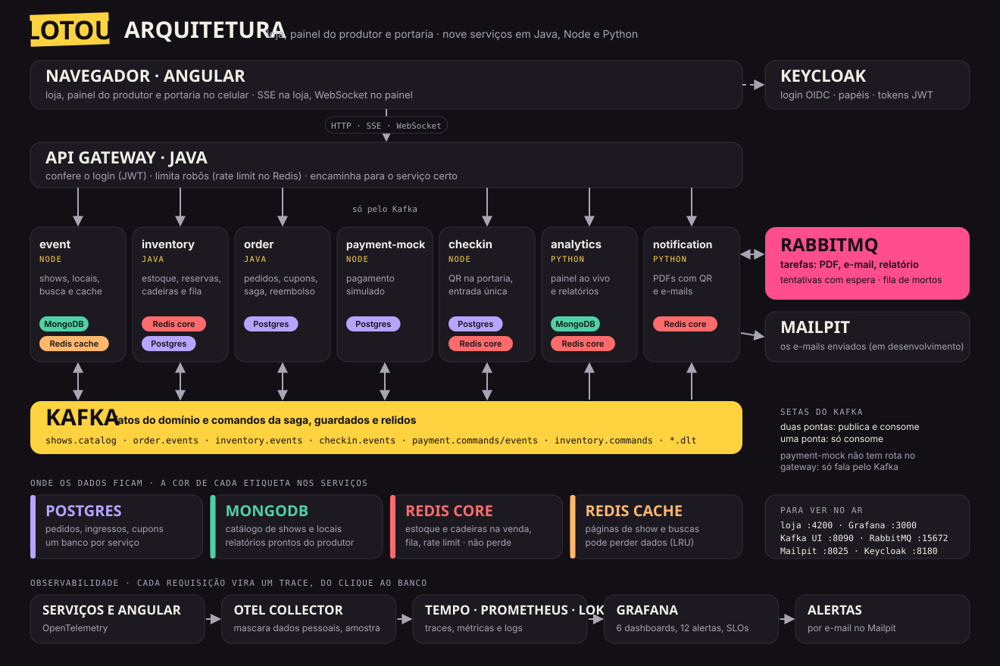
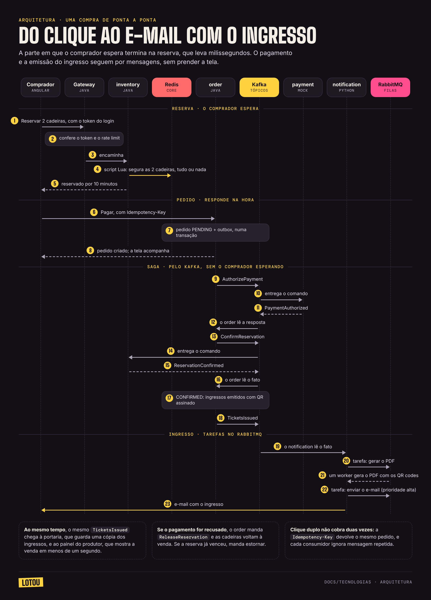

# As tecnologias do Lotou, explicadas

Esta pasta explica, com diagramas, o que cada tecnologia faz no Lotou, onde ela aparece no código e por que foi escolhida. É o caminho mais curto para entender o projeto sem ler o código inteiro. O documento completo, com todas as regras e tabelas, continua sendo o [`docs/projeto.md`](../projeto.md); as decisões ficam nos [ADRs](../adr/).

| Documento | O que explica |
| --- | --- |
| [Arquitetura](#o-mapa-do-sistema) (esta página) | os serviços, quem fala com quem e uma compra atravessando o sistema |
| [Kafka](kafka.md) | os fatos do domínio, a saga da compra, o outbox e o replay dos relatórios |
| [RabbitMQ](rabbitmq.md) | o ingresso em PDF, os e-mails, as tentativas com espera e a fila de mortos |
| [Redis](redis.md) | o estoque durante a venda, o mapa de cadeiras, a fila virtual, o cache e o rate limit |
| [MongoDB](mongodb.md) | o catálogo de shows e os relatórios do produtor |
| [Postgres](postgres.md) | pedidos, ingressos e dinheiro: o que precisa de transação |
| [Keycloak e segurança](keycloak-e-seguranca.md) | login, papéis, tokens, o QR assinado e o CPF que nunca aparece |
| [Observabilidade](observabilidade.md) | OpenTelemetry, Grafana, traces, métricas, logs, alertas e SLOs |

## O mapa do sistema

O Lotou vende ingressos para shows. São três telas (a loja, o painel do produtor e a portaria) num app Angular, um gateway na frente e oito serviços atrás, em Java, Node e Python. Cada serviço tem o seu banco; nenhum lê o banco de outro.

As etiquetas coloridas em cada serviço dizem onde ele guarda os dados, e as setas até o Kafka dizem se ele publica, consome ou faz os dois. O [documento do Redis](redis.md) mostra cada uso do `redis-core`, que aparece em quase todo serviço (estoque, idempotência, locks, deduplicação). A imagem é gerada por [`scripts/diagramas/arquitetura.py`](../../scripts/diagramas/arquitetura.py).

### Quem faz o quê

| Serviço | Linguagem | Faz | Guarda em |
| --- | --- | --- | --- |
| api-gateway | Java (Spring Cloud Gateway) | recebe tudo do navegador, confere o login, limita robôs e encaminha | Redis core (rate limit) |
| event-service | Node (NestJS) | shows, locais, setores, busca | MongoDB, Redis cache |
| inventory-service | Java (Spring Boot) | lotes, estoque, reservas, mapa de cadeiras, fila virtual | Redis core durante a venda, Postgres como cópia durável |
| order-service | Java (Spring Boot) | pedidos, cupons, ingressos, cancelamento, reembolso; comanda a saga | Postgres |
| payment-mock | Node (NestJS) | finge ser um gateway de pagamento: aprova, recusa, estorna, demora | Postgres |
| analytics-service | Python (FastAPI) | painel ao vivo e relatório financeiro, montados a partir dos eventos | MongoDB, Redis core |
| notification-service | Python (FastAPI) | PDF do ingresso com QR, relatório em PDF e e-mails | RabbitMQ, Redis core |
| checkin-service | Node (NestJS) | lê o QR na portaria e barra a segunda entrada | Postgres, Redis core |

O assistente de IA do produtor (`producer-assistant`, fase 5) ainda não existe; ele vai só ler os relatórios do MongoDB.

## Por que tantas tecnologias?

Cada uma resolve um problema que as outras resolvem mal:

| Tecnologia | Guarda ou carrega | Exemplo no Lotou | Característica que decide |
| --- | --- | --- | --- |
| **Kafka** | fatos do domínio | "o pedido 42 foi confirmado" | fica guardado; vários serviços leem; dá para reler do começo |
| **RabbitMQ** | tarefas | "gere o PDF do pedido 42 e mande por e-mail" | um worker faz; tenta de novo se falhar; fila de mortos |
| **Redis** | estado quente e efêmero | "restam 312 ingressos", "a cadeira F12 está segurada" | milhares de operações por segundo, em memória |
| **Postgres** | a verdade que envolve dinheiro | pedidos, ingressos, cupons, reembolsos | transação e constraints |
| **MongoDB** | documentos de formato variável | o show com seus setores, o relatório pronto | lê o documento inteiro de uma vez |

E mais duas peças de apoio: o **Keycloak**, para não escrever login à mão, e o **OpenTelemetry com o Grafana**, para ver uma requisição atravessar tudo isso.

## Uma compra, do clique ao e-mail

O caminho de uma compra mostra quase todas as peças juntas. A parte síncrona (o comprador esperando) termina na reserva; o pagamento segue por eventos.

## Como ver cada peça funcionando

Com o ambiente no ar (`make up seed`):

| Peça | Onde ver |
| --- | --- |
| Loja, painel e portaria | http://localhost:4200 (usuários `comprador`, `produtor` e `portaria`, senha `lotou123`) |
| Kafka | Kafka UI em http://localhost:8090 |
| RabbitMQ | painel em http://localhost:15672 (usuário e senha `lotou`) |
| Grafana (traces, métricas, logs, dashboards e alertas) | http://localhost:3000, pasta Lotou |
| E-mails enviados | Mailpit em http://localhost:8025 |
| Keycloak | http://localhost:8180 (administração com `admin`/`admin`) |
