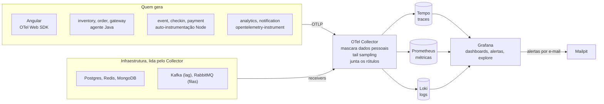
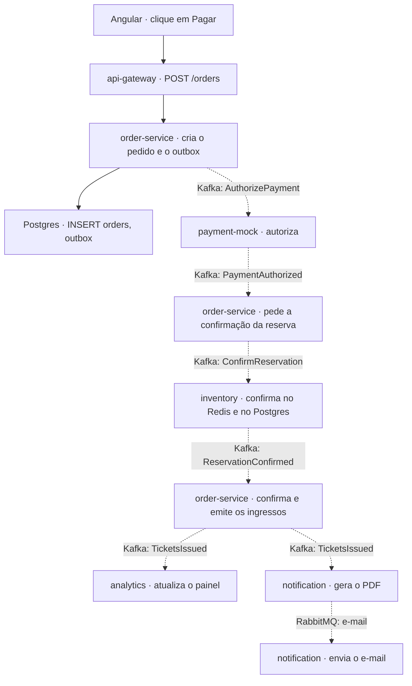
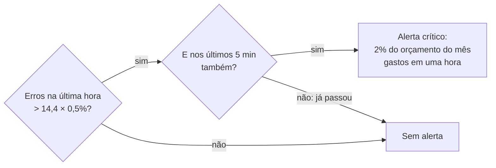

# Observabilidade no Lotou: OpenTelemetry e Grafana

Com nove serviços, três linguagens e três sistemas de mensagens, a pergunta "por que esta compra demorou 8 segundos?" não se responde lendo o log de um serviço só. O Lotou registra três tipos de sinal e os junta no Grafana:

| Sinal | Responde | Guardado no |
| --- | --- | --- |
| **Traces** | por onde esta requisição passou e quanto tempo levou em cada lugar? | Tempo |
| **Métricas** | quantas compras por segundo? quantos erros? qual o p99? | Prometheus |
| **Logs** | o que o serviço disse naquele momento? | Loki |

Tudo é coletado com **OpenTelemetry**, o padrão aberto de instrumentação. Nenhum serviço sabe que o destino é o Grafana: trocar de ferramenta (Datadog, por exemplo) é mudar só o exporter do Collector.

## O caminho dos dados

No Compose, Tempo, Prometheus, Loki e Grafana vêm juntos na imagem `grafana/otel-lgtm`.

## Um trace atravessando tudo

O cabeçalho `traceparent` carrega o id do trace de um serviço para o outro: no HTTP, nos cabeçalhos das mensagens do Kafka e do RabbitMQ. O resultado é uma árvore só, do clique no Angular ao banco:

As linhas cheias são chamadas na mesma requisição; as tracejadas atravessam o Kafka ou o RabbitMQ, e mesmo assim tudo aparece no mesmo trace.

No Grafana, em **Explore → Tempo**, um trace mostra cada etapa com o tempo dela. O `make smoke` imprime o id de um trace da compra para abrir direto.

Os logs são JSON com `trace_id` e `span_id`: do log de um erro, um clique leva ao trace; de um ponto num gráfico de latência, um *exemplar* leva a um trace daquele momento.

## Guardar o que importa: tail sampling

Guardar todos os traces de uma abertura de vendas sairia caro. O Collector espera o trace terminar e decide:

- **sempre guarda** traces com erro, traces acima de 500 ms e os do `make smoke` e dos testes ponta a ponta (reconhecidos pelo `User-Agent`);
- **guarda 10%** do resto (`TRACE_SAMPLE_PERCENT=100` guarda tudo, para depurar).

## Métricas de negócio

Além das métricas técnicas (requisições, erros e duração por rota; memória; conexões), os serviços publicam métricas do negócio:

| Métrica | Mostra |
| --- | --- |
| `ticket_reservations_total{type, result}` | reservas por tipo e resultado: reservado, esgotado, cadeira ocupada, limite do CPF |
| `seat_hold_conflicts_total` | duas pessoas disputando a mesma cadeira |
| `queue_length`, `queue_admitted_total`, `queue_wait_seconds` | a fila virtual |
| `orders_total{status}`, `saga_duration_seconds` | pedidos e quanto a saga leva |
| `coupon_redemptions_total{result}` | uso de cupons |
| `checkins_total{gate, result}` | entradas por portão: liberado, já utilizado, inválido |
| `refunds_total{status}` | reembolsos |
| `cache_requests_total{prefix, result}` | acertos e faltas do cache |
| `ticket_render_duration_seconds` | tempo para gerar o PDF do ingresso |

## Os dashboards

Gerados por código ([`infra/grafana/dashboards.py`](../../infra/grafana/dashboards.py)) e carregados na subida, na pasta **Lotou**:

| Dashboard | Para quê |
| --- | --- |
| Abertura de vendas ao vivo | fila, admissões, reservas por segundo, estoque por lote, conflitos de cadeira |
| Portaria ao vivo | entradas por minuto e por portão, ocupação, leituras recusadas |
| Negócio | vendas, cupons, cancelamentos e reembolsos por show |
| RED por serviço e SLO do checkout | taxa, erros e duração de cada rota; o orçamento de erro do checkout |
| Mensageria | lag de cada grupo do Kafka, profundidade das filas do RabbitMQ, DLQs e DLTs |
| Redis e cache | taxa de acerto, memória, evictions, latência |

Alguns painéis consultam os bancos diretamente, com um usuário só de leitura (`observer`): é assim que o dashboard mostra, por exemplo, ingressos emitidos contra a capacidade de cada setor.

## Alertas e SLOs

Os alertas ficam no próprio Grafana e chegam por e-mail no Mailpit (ADR 35).

**SLOs do checkout**, medidos no gateway nas rotas de reserva e de pedido, em 30 dias:

- disponibilidade: 99,5% das requisições sem erro 5xx;
- latência: 99% respondidas em menos de 1 s.

O alerta não dispara num pico de segundos: ele mede o **burn rate**, a velocidade com que o orçamento de erro do mês está sendo gasto, em duas janelas ao mesmo tempo.

A janela longa evita alarme falso; a curta faz o alerta parar logo que o problema acaba. Há também a versão lenta (6 vezes em 6 h e em 30 min).

| Alerta | Dispara quando |
| --- | --- |
| Venda além da capacidade | um setor com mais ingressos que lugares, ou uma cadeira com dois ingressos (consulta no Postgres) |
| Entrada dupla na portaria | um ingresso com duas entradas |
| Checkout: orçamento de erro ou de latência queimando rápido ou devagar | os quatro alertas de burn rate dos dois SLOs |
| Portaria lenta | p99 do check-in acima de 200 ms por 5 min |
| Consumidor atrasado em `order.events` | lag acima de 1.000 mensagens por 2 min |
| Mensagem na DLQ do RabbitMQ | qualquer mensagem numa fila de mortos |
| Mensagem nova numa DLT do Kafka | um consumidor desistiu de uma mensagem |
| Saga presa | pedido em PENDING há mais de 15 min |
| Reembolso falhou | pedido em REFUND_FAILED |

As invariantes ("nunca vender além da capacidade", "nunca deixar entrar duas vezes") são conferidas **no banco**, e não por uma métrica do próprio serviço: a métrica diria só o que o serviço acha que fez.

## Os experimentos de caos usam tudo isso

`make chaos EXP=<experimento>` provoca uma falha de propósito (Postgres lento, pagamento recusando 30% das compras, estornos falhando, order-service fora no dia do show, `redis-core` reiniciado no meio da abertura, uma mensagem ilegível no Kafka) e confere, pelos alertas, métricas e bancos, que o sistema se comportou como esperado. Foi um desses experimentos que mostrou a necessidade do SLO de latência: com o Postgres lento, os pedidos levavam 8 s e nenhum dava erro, e o SLO de disponibilidade sozinho não perceberia.

## Onde ver e onde está no código

- Grafana: http://localhost:3000, pasta **Lotou**; traces em **Explore → Tempo**; alertas em **Alerting**.
- E-mails dos alertas: http://localhost:8025.

| O quê | Onde |
| --- | --- |
| Collector (receivers, mascaramento, tail sampling) | [`infra/otel-collector.yaml`](../../infra/otel-collector.yaml) |
| Dashboards (gerador e JSON) | [`infra/grafana/dashboards.py`](../../infra/grafana/dashboards.py) e [`infra/grafana/dashboards/`](../../infra/grafana/dashboards/) |
| Alertas | [`infra/grafana/provisioning/alerting/lotou.yaml`](../../infra/grafana/provisioning/alerting/lotou.yaml) |
| Telemetria do Angular | [`apps/web/src/app/core/telemetry/`](../../apps/web/src/app/core/telemetry/) |
| Experimentos de caos | [`scripts/chaos.mjs`](../../scripts/chaos.mjs) |

Decisão relacionada: [ADR 35](../adr/0035-slos-burn-rate-e-alertas-no-grafana.md) (SLOs, burn rate e alertas).
