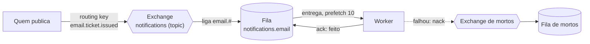
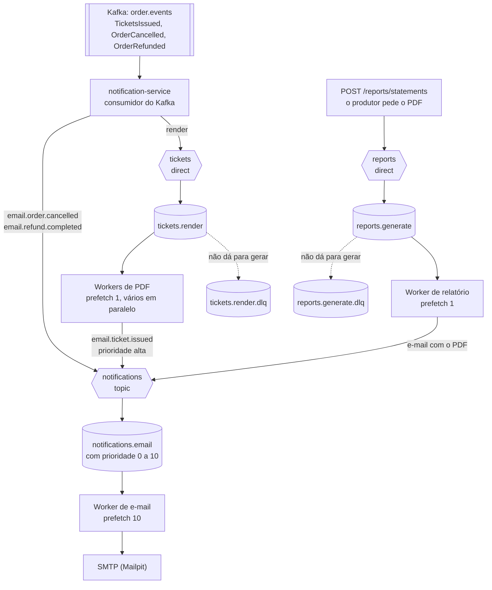
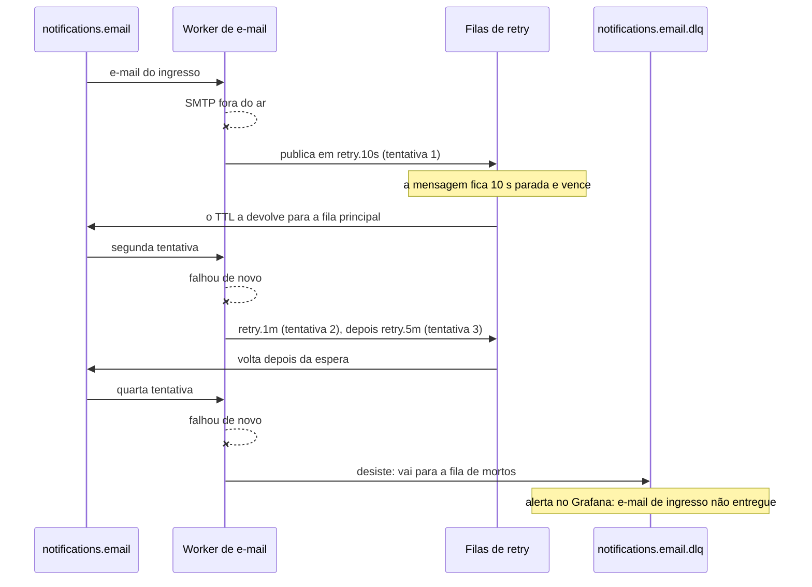

# RabbitMQ no Lotou

O RabbitMQ distribui **tarefas**: "gere o PDF deste ingresso", "mande este e-mail", "monte o relatório financeiro deste show". Uma tarefa é feita por um worker, uma vez; se falhar, é tentada de novo depois de uma espera; se nunca der certo, vai para uma fila de mortos para alguém olhar. É isso que o RabbitMQ faz melhor que o Kafka (ADR 2).

Todo o uso fica no `notification-service`, que recebe os fatos do Kafka e os transforma em tarefas.

## Os conceitos, em uma imagem

- **Exchange:** o carteiro. Recebe a mensagem e decide para quais filas ela vai, pela **routing key**. Um exchange `direct` entrega para a fila com a chave exata; um `topic` aceita padrões (`email.#` pega todo e-mail); um `fanout` entrega para todas as filas ligadas.
- **Fila:** onde as mensagens esperam um worker. Diferente do Kafka, a mensagem **sai da fila** quando o worker confirma.
- **Ack manual:** o worker só confirma (`ack`) depois de terminar. Se ele morrer no meio, a mensagem volta para a fila e outro worker a pega.
- **Prefetch:** quantas mensagens um worker pega de uma vez. O PDF usa 1 (é pesado; não adianta um worker segurar dez enquanto outros estão parados). O e-mail usa 10 (é leve e espera a rede).
- **Dead-letter exchange (DLX):** para onde vai a mensagem recusada ou vencida.
- **TTL:** quanto tempo a mensagem pode ficar parada na fila antes de vencer.

## A topologia do Lotou

| Fila | Tarefa | Detalhe |
| --- | --- | --- |
| `tickets.render` | gerar o PDF com o QR code de cada ingresso do pedido | pesada (CPU); vários workers, um PDF por vez cada |
| `notifications.email` | enviar um e-mail (ingresso, pedido cancelado, reembolso concluído, relatório) | prioridade: o ingresso passa na frente |
| `reports.generate` | gerar o PDF do relatório financeiro que o produtor pediu | lê os números do analytics com uma conta de serviço |
| `notifications.retry.10s`, `.1m`, `.5m` | esperar antes de tentar de novo | filas sem consumidor, só com TTL |
| `*.dlq` | o que não deu certo de jeito nenhum | ficam paradas até alguém olhar |

## Tentar de novo com espera crescente

Um servidor de e-mail fora do ar por um minuto não pode virar um e-mail perdido. Também não adianta tentar de novo na hora: ele ainda estará fora. O Lotou usa **filas de espera** com TTL:

Ninguém precisa de um agendador: a espera é feita pelo próprio RabbitMQ, com o TTL de cada fila e o dead-letter de volta para a fila principal. Erros que nunca vão dar certo (um show que não existe, uma tarefa ilegível) vão direto para a fila de mortos, sem as tentativas.

Corrigido o problema, `make requeue-notifications` devolve as mensagens das DLQs para as filas de origem.

## Prioridade

A fila de e-mail aceita prioridade de 0 a 10. O e-mail com o ingresso é o mais urgente (a pessoa acabou de pagar e quer ver o ingresso); o de reembolso concluído e o do relatório podem esperar alguns segundos. Num cancelamento em massa, com milhares de e-mails de reembolso na fila, quem acabou de comprar outro show recebe o ingresso primeiro.

## Garantias e cuidados

- **Nada se perde numa queda do broker:** filas duráveis e mensagens persistentes.
- **Nenhum e-mail sai duas vezes:** uma reentrega (o worker caiu depois de enviar e antes do `ack`) é barrada por uma marca no `redis-core` com o id da tarefa.
- **Nenhum e-mail no evento:** os eventos do Kafka não carregam e-mail. O worker busca o e-mail do comprador no Keycloak, pelo id dele, na hora de enviar.
- **Escala:** o número de workers de PDF é configurável (`RENDER_WORKERS`). O `make load-render` mede a vazão com 1, 2 e 4 workers.

## Por que RabbitMQ, e não o Kafka para isso também

| Precisa de | RabbitMQ | Kafka |
| --- | --- | --- |
| tentar uma mensagem de novo depois de 1 min sem travar as outras | TTL e dead-letter, nativo | a partição para até a mensagem passar, ou é preciso montar tópicos de espera à mão |
| prioridade | nativa | não existe |
| dividir tarefas pesadas entre workers, uma por vez | prefetch 1 | limitado ao número de partições |
| fila de mortos | nativa | por convenção (`.dlt`) |
| reler o histórico | não (a mensagem sai da fila) | sim |

Para os fatos do domínio, que vários serviços leem e que precisam ser relidos, o Kafka continua melhor ([Kafka](kafka.md)).

## Onde ver

- Painel do RabbitMQ: http://localhost:15672 (usuário e senha `lotou`): filas, taxa de mensagens, consumidores.
- Dashboard **Mensageria** no Grafana: profundidade das filas e das DLQs.
- Os e-mails enviados: Mailpit em http://localhost:8025.

## Onde está no código

| O quê | Onde |
| --- | --- |
| Topologia (exchanges, filas, TTLs) | [`services/notification-service/src/notification/rabbit/topology.py`](../../services/notification-service/src/notification/rabbit/topology.py) |
| Consumidor do Kafka que cria as tarefas | `services/notification-service/src/notification/kafka/consumer.py` |
| Workers (PDF, e-mail, relatório) | `services/notification-service/src/notification/workers/` |
| Geração do PDF com o QR | `services/notification-service/src/notification/render/` |
| Devolver as DLQs | `services/notification-service/src/notification/dlq/` e `make requeue-notifications` |

Decisão relacionada: [ADR 2](../adr/0002-rabbitmq-para-ingressos-e-e-mails.md).
