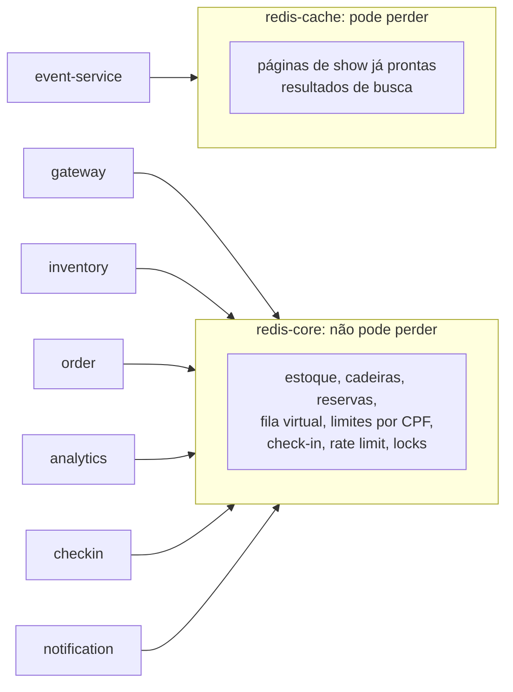
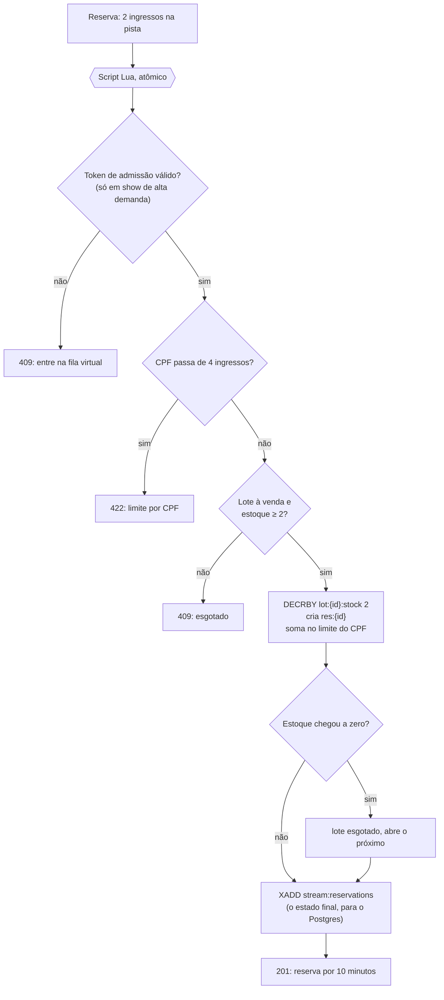
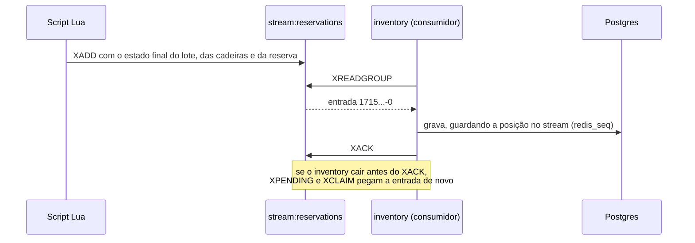
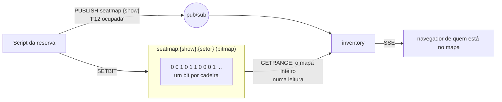
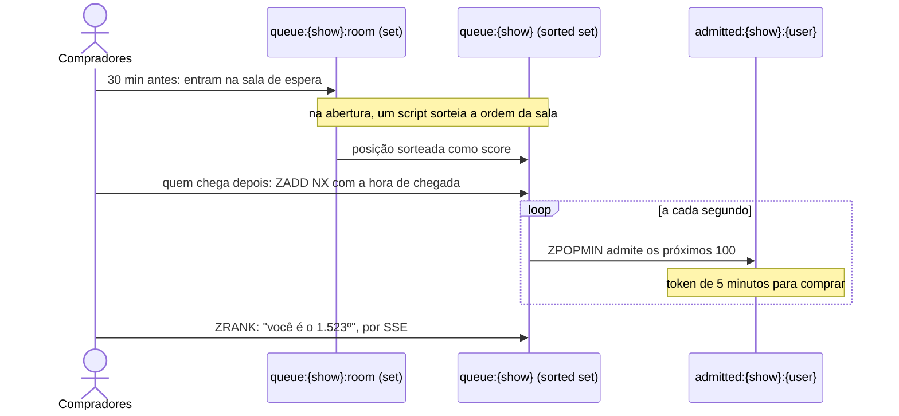
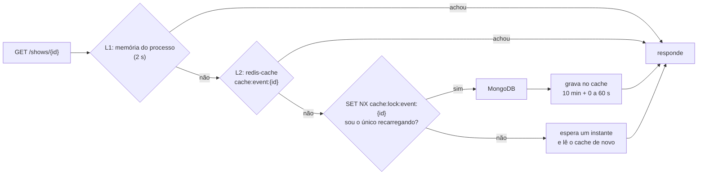
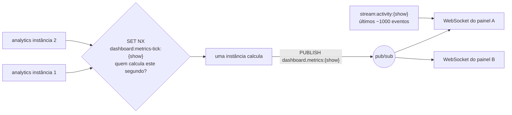

# Redis no Lotou

O Redis guarda dados em memória e responde em microssegundos. No Lotou ele é a peça que segura a **abertura das vendas**: quando dezenas de milhares de pessoas disputam poucos milhares de ingressos no mesmo minuto, o estoque, as cadeiras e a fila ficam no Redis, e não no banco.

## Duas instâncias, duas regras

| | `redis-cache` | `redis-core` |
| --- | --- | --- |
| Quando a memória acaba | apaga as chaves menos usadas (`allkeys-lru`) | recusa escrever (`noeviction`) |
| Persistência | nenhuma | AOF, gravado a cada segundo |
| Se perder tudo | a próxima leitura busca de novo no MongoDB | seria um bug: ingresso vendido duas vezes, fila perdida |

Misturar os dois numa instância só faria o cache, ao crescer, expulsar o estoque da memória. Por isso são duas (ADR 10).

## Os usos, um por um

### 1. O estoque durante a venda (a fonte da verdade)

Na abertura das vendas, um job carrega no `redis-core` tudo o que a venda precisa: o estoque de cada lote, os lotes seguintes de cada setor, o mapa de cadeiras. A partir daí, **o Redis é a fonte da verdade** do que está vendido, e o Postgres é a cópia durável (ADR 26).

Uma reserva é um **script Lua**: o Redis roda o script inteiro sem intercalar nenhum outro comando, então duas pessoas nunca pegam o último ingresso ao mesmo tempo (ADR 3).

Na cadeira numerada, o script tenta segurar todas as cadeiras escolhidas com `SET NX` (só grava se a chave não existe): segura todas ou nenhuma. Se a pessoa escolheu F12 e F13 e alguém já pegou a F13, nenhuma das duas fica presa.

O teste de carga compara esse script com a mesma reserva feita com lock no Postgres: o Redis é a linha que aguenta a abertura, e o Postgres é a base de comparação (`make load-opening ENGINE=redis|postgres`).

### 2. Do Redis para o Postgres, sem perder nada: Redis Streams

Toda reserva feita no script entra, na mesma operação, num **stream** (`stream:reservations`). Um grupo de consumidores do inventory lê o stream e grava no Postgres.

Cada entrada leva o **estado final** (o estoque que sobrou, não "menos 2"), e o consumidor nunca aplica uma entrada mais antiga por cima de uma mais nova. Por isso processar a mesma entrada duas vezes não estraga nada.

### 3. O mapa de cadeiras: bitmap + pub/sub

- Um setor com 5 mil cadeiras cabe em cerca de 625 bytes. Quem abre o mapa lê o bitmap inteiro numa leitura só (ADR 5).
- A cada cadeira segurada, liberada ou vendida, o script publica a mudança num canal **pub/sub**. O inventory repassa por SSE a todos que estão olhando o mapa, e a cadeira fica cinza na tela deles na hora.
- Pub/sub não guarda nada: quem estava desconectado perde a mensagem. Não tem problema, porque ao reconectar o navegador lê o bitmap de novo (ADR 11).

### 4. A fila virtual: sorted set

Só nos shows marcados como de alta demanda (ADR 13).

O sorteio impede que robôs ganhem vantagem chegando antes: todo mundo que estava na sala na hora da abertura tem a mesma chance. O ritmo de admissão (`QUEUE_ADMISSION_RATE`, 100 por segundo) controla quanta gente chega ao checkout ao mesmo tempo.

### 5. Cache da página do show (cache-aside)

- **Cache-aside:** o serviço olha o cache; se não tem, busca no MongoDB e guarda.
- **Contra a avalanche (stampede):** quando a chave de um show disputado vence, milhares de requisições querem recarregar ao mesmo tempo. O lock com `SET NX` deixa só uma ir ao banco.
- **Jitter:** cada chave vence num momento um pouco diferente (10 minutos mais 0 a 60 segundos), para não vencerem todas juntas.
- **Dois níveis:** uma cópia de 2 segundos na memória do próprio processo segura a "chave quente" do show que está abrindo as vendas.
- **Apagar, não atualizar:** quando o produtor edita o show ou um lote esgota, a chave é apagada, e a próxima leitura recarrega.
- **O que nunca vem do cache:** preço, ingressos restantes e cadeiras. Esses saem direto do inventory.

O `make load-show-page` mede a página com e sem cache.

### 6. Rate limit: dois algoritmos

| Onde | Algoritmo | Como funciona no Redis |
| --- | --- | --- |
| Gateway, nas rotas de compra | **token bucket** (`RedisRateLimiter` do Spring Cloud Gateway) | um balde por usuário e operação; reservar repõe 5 fichas por segundo, com balde de 10; entrar na fila e criar pedido, 2 por segundo |
| event-service, na API de catálogo | **janela deslizante** | um sorted set por usuário (ou IP, em hash) com o horário de cada requisição; conta as do último minuto |

Os dois existem de propósito, para comparar: o balde aceita rajadas curtas; a janela é mais justa e mais cara em memória.

### 7. Cada coisa uma vez só: `SET NX`

O mesmo comando resolve vários problemas de "só o primeiro ganha":

| Chave | Problema que resolve |
| --- | --- |
| `checkin:{ticketId}` | dois portões lendo o mesmo ingresso no mesmo segundo: só o primeiro libera; o segundo vê "já utilizado às 20h31 no portão B" |
| `idem:{chave}` e `idem:reservation:{hash}` | clique duplo no botão de pagar ou reservar: devolve o mesmo pedido em vez de criar dois |
| `lock:{nome}` | só uma instância roda jobs como a abertura das vendas (liberado por um script Lua que confere o dono) |
| marcas do notification-service | uma tarefa reentregue não manda o mesmo e-mail duas vezes |

Em todos esses casos o Redis é a primeira linha, não a última: uma constraint única no Postgres (`checkins.ticket_id`, ingresso único por cadeira) garante o resultado se o Redis falhar.

### 8. O painel ao vivo do produtor

- `dashboard:watched` (sorted set) diz quais shows têm alguém olhando o painel; só esses são calculados.
- Uma vez por segundo, uma única instância calcula os números de cada show (as outras perdem o `SET NX`) e publica por pub/sub. Perder um tick não importa: o próximo chega em 1 s.
- O feed de atividade é um stream curto: quem abre o painel lê os últimos 50 eventos de uma vez (ADR 32).

## O que não fica no Redis, de propósito

- **O uso dos cupons:** fica no Postgres, na mesma transação do pedido, para o pedido e o uso nunca divergirem (ADR 33).
- **O vencimento das reservas:** um job varre o Postgres. As notificações de chave vencida do Redis não garantem entrega e não servem de gatilho.
- **CPF:** nenhuma chave tem CPF; o limite por CPF usa um HMAC dele.

## Onde ver

- Dashboard **Redis e cache** no Grafana: taxa de acerto por prefixo, memória, evictions, comandos por segundo.
- `docker compose exec redis-core redis-cli` e, por exemplo, `KEYS lot:*`, `ZRANGE queue:<showId> 0 10 WITHSCORES`, `XLEN stream:reservations`.

## Onde está no código

| O quê | Onde |
| --- | --- |
| Scripts Lua da reserva, da devolução, da virada de lote e da fila | [`services/inventory-service/src/main/resources/redis/`](../../services/inventory-service/src/main/resources/redis/) (`reserve.lua`, `turn.lua`, `queue-draw.lua`...) |
| Consumidor do stream de reservas | `services/inventory-service/src/main/java/br/com/lotou/inventory/redis/ReservationProjection.java` |
| Cache da página do show (L1, L2 e lock) | [`services/event-service/src/shows/cache/`](../../services/event-service/src/shows/cache/) e [`src/cache/`](../../services/event-service/src/cache/) |
| Janela deslizante | [`services/event-service/src/rate-limit/sliding-window.limiter.ts`](../../services/event-service/src/rate-limit/sliding-window.limiter.ts) |
| Token bucket do gateway | `services/api-gateway/src/main/java/br/com/lotou/gateway/ratelimit/` |
| Check-in com `SET NX` | `services/checkin-service/src/checkin/` |
| Painel ao vivo | `services/analytics-service/src/analytics/` |

Decisões relacionadas: [ADR 3](../adr/0003-reserva-com-lua-no-redis.md) (reserva em Lua), [ADR 5](../adr/0005-bitmap-para-o-status-dos-assentos.md) (bitmap), [ADR 10](../adr/0010-duas-instancias-de-redis.md) (duas instâncias), [ADR 11](../adr/0011-pubsub-streams-e-kafka.md) (pub/sub, Streams e Kafka), [ADR 13](../adr/0013-fila-virtual-so-em-shows-de-alta-demanda.md) (fila virtual), [ADR 26](../adr/0026-redis-como-fonte-da-verdade-durante-a-venda.md) (Redis como fonte da verdade), [ADR 32](../adr/0032-painel-ao-vivo-com-varias-instancias.md) (painel com várias instâncias).
