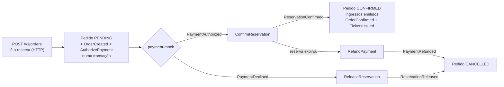

# order-service

Pedidos, emissão de ingressos e a saga de compra. Java 21, Spring Boot 4, Spring Data JPA, Spring Kafka e Postgres (Flyway).

## Como o checkout funciona

O comprador reserva os ingressos no inventory-service e depois fecha a compra aqui, com `POST /v1/orders`. A resposta volta na hora com o pedido `PENDING` ([ADR 6](../../docs/adr/0006-reserva-sincrona-pagamento-assincrono.md)); o resto é a **saga de compra**, orquestrada por este serviço pelo Kafka ([ADR 7](../../docs/adr/0007-saga-orquestrada-pelo-order-service.md)):



O que mantém cada pedido íntegro sem transação distribuída ([`PurchaseSaga`](src/main/java/br/com/lotou/order/saga/PurchaseSaga.java)):

- **Um passo por vez, com tabela de transições.** O passo atual de cada pedido fica em `saga_state` ([`SagaStep`](src/main/java/br/com/lotou/order/saga/SagaStep.java)); uma resposta que chega fora do passo em que faria sentido não muda nada.
- **Outbox.** O pedido, o passo da saga e as mensagens que eles geram são gravados na mesma transação; um relay publica no Kafka em ordem, uma instância por vez (advisory lock), continuando o trace de quem causou cada mensagem ([ADR 8](../../docs/adr/0008-outbox-transacional.md)).
- **Consumidor idempotente.** Cada resposta processada entra em `processed_events` na mesma transação do efeito; uma mensagem repetida é ignorada. A que falha depois das tentativas vai para `<tópico>.dlt`.
- **O inventory publica fatos, não respostas.** A saga reage a `ReservationConfirmed` e `ReservationReleased` em qualquer passo: se a reserva expira enquanto o pagamento é autorizado, o pagamento aprovado é estornado.
- **Prazos.** Se a resposta de um passo não chega (15 s, dobrando a cada tentativa até 8 vezes), o [`SagaDeadlineJob`](src/main/java/br/com/lotou/order/saga/SagaDeadlineJob.java) repete o comando ou consulta a reserva no inventory e age pelo estado dela.
- **Última defesa no banco.** Um índice único parcial em `(show, setor, cadeira)` nos ingressos impede dois ingressos ativos para a mesma cadeira ([ADR 4](../../docs/adr/0004-constraint-unica-de-show-e-assento.md)); se ele barra a emissão, o pagamento é estornado e o pedido cancelado.

## Mensagens

| Publica | Tópico | Quando |
| --- | --- | --- |
| `OrderCreated`, `OrderConfirmed`, `OrderCancelled`, `TicketsIssued` | `order.events` | pedido criado, pago, cancelado; ingressos emitidos |
| `AuthorizePayment`, `RefundPayment` | `payment.commands` | início da saga; reserva perdida depois do pagamento |
| `ConfirmReservation`, `ReleaseReservation` | `inventory.commands` | pagamento aprovado; pagamento recusado |

Consome `payment.events` e `inventory.events` no consumer group `order-service`. Os contratos estão em [`contracts/`](../../contracts/).

## API

Atrás do gateway, as rotas ganham o prefixo `/api`.

| Método | Rota | Quem | O que faz |
| --- | --- | --- | --- |
| `POST` | `/v1/orders` | comprador | fecha a compra de uma reserva (exige `Idempotency-Key`) |
| `GET` | `/v1/orders/{id}` | dono | o pedido, com itens e ingressos |
| `GET` | `/v1/orders` | comprador | meus pedidos, do mais novo ao mais antigo, por cursor |

Com a mesma `Idempotency-Key`, ou para a mesma reserva, o `POST` devolve o pedido que já existe (cabeçalho `Idempotent-Replayed: true`).

Erros em Problem Details (RFC 9457), com `type` em `urn:lotou:problem:<tipo>`:

| Tipo | Status | Quando |
| --- | --- | --- |
| `validation-error` | 400 | corpo inválido ou `Idempotency-Key` ausente |
| `not-found` | 404 | pedido ou reserva inexistente, ou de outra pessoa |
| `reservation-not-held` | 409 | a reserva expirou ou foi liberada |
| `idempotency-key-reused` | 422 | mesma `Idempotency-Key` com outra reserva |
| `upstream-unavailable` | 503 | o inventory não respondeu ao ler a reserva |

O `GET /v1/orders/{id}` mostra o pedido como a saga o deixou: `PENDING` enquanto o pagamento e a confirmação acontecem (em geral menos de um segundo), depois `CONFIRMED` com os ingressos ou `CANCELLED` com o motivo (`PAYMENT_DECLINED`, `RESERVATION_EXPIRED` ou `TICKET_CONFLICT`).

## Estrutura

```
src/main/java/br/com/lotou/order/
├── order/        # pedido, itens, ingressos, tabela de estados e checkout
├── saga/         # saga de compra: passos, estado, consumidor e prazos
├── messaging/    # outbox, relay, mensagens processadas e DLT
├── inventory/    # leitura da reserva na API interna
├── shared/       # Problem Details, segurança e UUID v7
└── config/
src/main/resources/db/migration/   # esquema (Flyway)
```

## Comandos

```bash
make test-order-service   # na raiz: constrói a imagem do inventory e roda os testes
./mvnw test               # direto, se a imagem lotou-inventory-service:latest já existe
```

Dois conjuntos de testes de integração, com Postgres e Kafka reais via Testcontainers:

- [`PurchaseSagaTests`](src/test/java/br/com/lotou/order/saga/PurchaseSagaTests.java): a saga passo a passo, com dublês do payment-mock e do inventory falando pelo Kafka. Cobre recusa, reserva que expira em cada passo, conflito de cadeira, mensagens repetidas e malformadas e prazos vencidos. Cada mensagem trocada é conferida contra o JSON Schema de `contracts/`.
- [`CheckoutEndToEndTests`](src/test/java/br/com/lotou/order/order/CheckoutEndToEndTests.java): o order-service contra o **inventory-service de verdade** (a imagem Docker dele) pelo Kafka, com um dublê do pagamento. Inclui o critério da fase 3: com 30% dos pagamentos recusados, todo pedido termina pago ou compensado, e os ingressos dos recusados voltam à venda.

## Variáveis de ambiente

| Variável | Padrão | Para quê |
| --- | --- | --- |
| `PORT` | `8083` | porta HTTP |
| `DATABASE_URL`, `DATABASE_USERNAME`, `DATABASE_PASSWORD` | banco `orders` local | conexão com o Postgres |
| `INVENTORY_SERVICE_URL` | `http://localhost:8082` | endereço do inventory-service |
| `AUTH_ISSUER`, `AUTH_JWKS_URI`, `AUTH_AUDIENCE` | realm local | validação do JWT |
| `AUTH_TOKEN_URI`, `SERVICE_CLIENT_ID`, `SERVICE_CLIENT_SECRET` | realm local | token da conta de serviço |
| `KAFKA_BROKERS` | `localhost:9094` | o Kafka |
| `SAGA_STEP_TIMEOUT` | `15s` | quanto a saga espera a resposta de um passo antes de repetir |
| `OUTBOX_INTERVAL`, `SAGA_DEADLINE_INTERVAL` | `100ms`, `2s` | ritmo do relay do outbox e do job de prazos |
| `JOBS_ENABLED` | `true` | liga o relay e o job de prazos |
