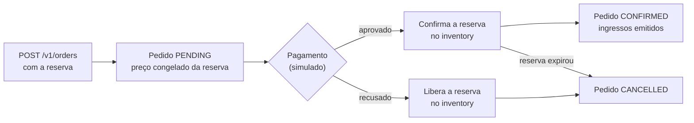

# order-service

Pedidos, emissão de ingressos e orquestração do checkout. Java 21, Spring Boot 4, Spring Data JPA e Postgres (Flyway).

## Como o checkout funciona

O comprador reserva os ingressos no inventory-service e depois fecha a compra aqui, com `POST /v1/orders`:



Os passos conversam com outros serviços, então não cabem numa transação só. O que mantém o pedido íntegro ([`CheckoutService`](src/main/java/br/com/lotou/order/order/CheckoutService.java)):

- **Cada passo grava o que decidiu** antes do passo seguinte, em transações curtas. O resultado do pagamento, por exemplo, é gravado antes de confirmar a reserva.
- **Cada passo é idempotente**, do lado de cá e do lado do inventory.
- **Um pedido pendente é retomado.** Se o serviço cai no meio, ou o inventory não responde, o pedido fica `PENDING` e um job o conclui depois, de onde parou, sem cobrar de novo. Vários jobs podem rodar juntos: cada pedido é assumido com um update condicional.
- **Última defesa no banco.** Um índice único parcial em `(show, setor, cadeira)` nos ingressos impede dois ingressos ativos para a mesma cadeira, aconteça o que acontecer com a reserva ([ADR 4](../../docs/adr/0004-constraint-unica-de-show-e-assento.md)).

Na fase 1 isso tudo é síncrono e o pagamento é simulado dentro do serviço. Na fase 3 vira a saga de compra, com Kafka e o payment-mock ([ADR 23](../../docs/adr/0023-fase-1-sem-broker-integracao-sincrona.md)). O contrato do `POST /v1/orders` já prevê isso: a resposta traz o pedido no estado em que ficou, e o cliente lê o `status`.

## API

Atrás do gateway, as rotas ganham o prefixo `/api`.

| Método | Rota | Quem | O que faz |
| --- | --- | --- | --- |
| `POST` | `/v1/orders` | comprador | fecha a compra de uma reserva (exige `Idempotency-Key`) |
| `GET` | `/v1/orders/{id}` | dono | o pedido, com itens e ingressos |
| `GET` | `/v1/orders` | comprador | meus pedidos, do mais novo ao mais antigo, por cursor |

Com a mesma `Idempotency-Key`, ou para a mesma reserva, o `POST` devolve o pedido que já existe (cabeçalho `Idempotent-Replayed: true`).

Erros em Problem Details (RFC 9457), com `type` em `urn:lotou:problem:<tipo>`:

| Tipo | Status | Quando |
| --- | --- | --- |
| `validation-error` | 400 | corpo inválido ou `Idempotency-Key` ausente |
| `not-found` | 404 | pedido ou reserva inexistente, ou de outra pessoa |
| `reservation-not-held` | 409 | a reserva expirou ou foi liberada |
| `idempotency-key-reused` | 422 | mesma `Idempotency-Key` com outra reserva |
| `upstream-unavailable` | 503 | o inventory não respondeu ao ler a reserva |

## Estrutura

```
src/main/java/br/com/lotou/order/
├── order/        # pedido, itens, ingressos, tabelas de estado, checkout e recuperação
├── inventory/    # cliente da API interna de reservas
├── payment/      # porta do pagamento e o simulador da fase 1
├── shared/       # Problem Details, segurança e UUID v7
└── config/
src/main/resources/db/migration/   # esquema (Flyway)
```

## Comandos

```bash
make test-order-service   # na raiz: constrói a imagem do inventory e roda os testes
./mvnw test               # direto, se a imagem lotou-inventory-service:latest já existe
```

Os testes de integração ([`CheckoutEndToEndTests`](src/test/java/br/com/lotou/order/order/CheckoutEndToEndTests.java)) rodam o order-service contra o **inventory-service de verdade** (a imagem Docker dele) e um Postgres real, via Testcontainers. Os tokens são assinados por um emissor de teste e validados de verdade pelos dois serviços. As falhas (inventory fora do ar, resposta perdida, reserva que expira no meio) são provocadas com um inventory de teste em [`CheckoutRecoveryTests`](src/test/java/br/com/lotou/order/order/CheckoutRecoveryTests.java).

## Variáveis de ambiente

| Variável | Padrão | Para quê |
| --- | --- | --- |
| `PORT` | `8083` | porta HTTP |
| `DATABASE_URL`, `DATABASE_USERNAME`, `DATABASE_PASSWORD` | banco `orders` local | conexão com o Postgres |
| `INVENTORY_SERVICE_URL` | `http://localhost:8082` | endereço do inventory-service |
| `AUTH_ISSUER`, `AUTH_JWKS_URI`, `AUTH_AUDIENCE` | realm local | validação do JWT |
| `AUTH_TOKEN_URI`, `SERVICE_CLIENT_ID`, `SERVICE_CLIENT_SECRET` | realm local | token da conta de serviço |
| `PAYMENT_DECLINE_RATE` | `0` | porcentagem de pagamentos recusados pelo simulador |
| `ORDER_PROCESSING_LEASE` | `30s` | prazo de quem processa um pedido pendente, antes de o job assumir |
| `JOBS_ENABLED` | `true` | liga o job de recuperação |
