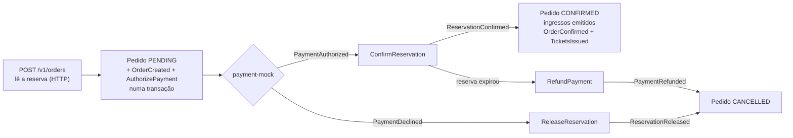
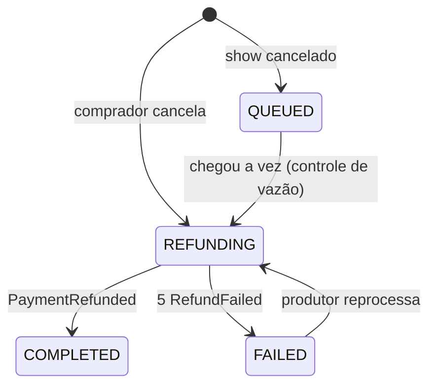

# order-service

Pedidos, emissão de ingressos, a saga de compra, taxa de serviço, cupons e a saga de reembolso. Java 21, Spring Boot 4, Spring Data JPA, Spring Kafka e Postgres (Flyway).

## Como o checkout funciona

O comprador reserva os ingressos no inventory-service e depois fecha a compra aqui, com `POST /v1/orders`. A resposta volta na hora com o pedido `PENDING` ([ADR 6](../../docs/adr/0006-reserva-sincrona-pagamento-assincrono.md)); o resto é a **saga de compra**, orquestrada por este serviço pelo Kafka ([ADR 7](../../docs/adr/0007-saga-orquestrada-pelo-order-service.md)):



O que mantém cada pedido íntegro sem transação distribuída ([`PurchaseSaga`](src/main/java/br/com/lotou/order/saga/PurchaseSaga.java)):

- **Um passo por vez, com tabela de transições.** O passo atual de cada pedido fica em `saga_state` ([`SagaStep`](src/main/java/br/com/lotou/order/saga/SagaStep.java)); uma resposta que chega fora do passo em que faria sentido não muda nada.
- **Outbox.** O pedido, o passo da saga e as mensagens que eles geram são gravados na mesma transação; um relay publica no Kafka em ordem, uma instância por vez (advisory lock), continuando o trace de quem causou cada mensagem ([ADR 8](../../docs/adr/0008-outbox-transacional.md)).
- **Consumidor idempotente.** Cada resposta processada entra em `processed_events` na mesma transação do efeito; uma mensagem repetida é ignorada. A que falha depois das tentativas vai para `<tópico>.dlt`.
- **O inventory publica fatos, não respostas.** A saga reage a `ReservationConfirmed` e `ReservationReleased` em qualquer passo: se a reserva expira enquanto o pagamento é autorizado, o pagamento aprovado é estornado.
- **Prazos.** Se a resposta de um passo não chega (15 s, dobrando a cada tentativa até 8 vezes), o [`SagaDeadlineJob`](src/main/java/br/com/lotou/order/saga/SagaDeadlineJob.java) repete o comando ou consulta a reserva no inventory e age pelo estado dela.
- **Última defesa no banco.** Um índice único parcial em `(show, setor, cadeira)` nos ingressos impede dois ingressos ativos para a mesma cadeira ([ADR 4](../../docs/adr/0004-constraint-unica-de-show-e-assento.md)); se ele barra a emissão, o pagamento é estornado e o pedido cancelado.

## Taxa, cupons e cotação

- **Taxa de serviço:** 10% de cada ingresso (antes do desconto), arredondada para o centavo mais próximo, ingresso a ingresso. Quem paga vem do show (`serviceFeePaidBy`, da cópia local do catálogo): `BUYER` soma ao total cobrado; `PRODUCER` sai do valor a receber dele. As contas estão em [`Pricing`](src/main/java/br/com/lotou/order/pricing/Pricing.java), só com inteiros.
- **Cupons:** percentual (centavos arredondados para baixo, a favor do comprador) ou valor fixo por pedido, nunca sobre a taxa e nunca abaixo de zero. Limite de usos, validade e setores opcionais. O uso é contado no Postgres, na transação que cria o pedido, com um `UPDATE` condicional (`uses < max_uses`): o limite nunca é ultrapassado, nem sob disputa ([ADR 33](../../docs/adr/0033-uso-do-cupom-contado-no-postgres.md)). O uso volta quando o pedido é cancelado pela saga de compra ou reembolsado.
- **Cotação:** `POST /v1/orders/quote` mostra subtotal, desconto, taxa e total antes do pagamento, sem criar nada.
- **Cópia local do catálogo:** a tabela `shows` guarda o que o serviço precisa de cada show (produtor, data, status, quem paga a taxa), lida de `shows.catalog` e atualizada só por versão mais nova. Se um show ainda não chegou, o checkout responde 503.

## Cancelamento e reembolso

O comprador cancela o pedido inteiro, com reembolso integral (taxa incluída), se: o pedido está `CONFIRMED`, faz no máximo 7 dias da confirmação, faltam mais de 48 h para o show e nenhum ingresso foi usado ([`CancellationPolicy`](src/main/java/br/com/lotou/order/refund/CancellationPolicy.java)). O `GET` do pedido traz a decisão em `cancellation: {allowed, reason, deadline}`.

A **saga de reembolso** ([`RefundService`](src/main/java/br/com/lotou/order/refund/RefundService.java)) guarda o passo em `refunds`:



- Ao entrar em `REFUNDING`, numa transação: pedido `REFUNDING`, ingressos válidos `CANCELLED`, e no outbox `TicketsCancelled` (a portaria passa a barrar), `RefundPayment` e, se foi o comprador quem cancelou, `ReturnTickets` (o inventory devolve os ingressos à venda).
- `PaymentRefunded` fecha o pedido em `REFUNDED`, devolve o uso do cupom e publica `OrderRefunded`. Cada `RefundFailed` agenda nova tentativa com espera crescente; na quinta falha o pedido vai para `REFUND_FAILED` (`OrderRefundFailed`) e o produtor reprocessa pela API. Sem resposta no prazo, o estorno é pedido de novo.
- **Show cancelado:** o `ShowUpdated` com `CANCELLED` põe na fila todos os pedidos confirmados do show. O [`RefundJob`](src/main/java/br/com/lotou/order/refund/RefundJob.java) começa `REFUND_RATE` reembolsos por segundo (controle de vazão sobre o gateway de pagamento) e confere a cada rodada se algum pedido de show cancelado ficou de fora (um pedido que estava no meio da saga de compra só confirma depois). Os ingressos de show cancelado não voltam à venda.
- **Portaria:** `TicketCheckedIn` (de `checkin.events`) marca o ingresso como `USED`, com hora e portão. Quem barra a entrada dupla é o checkin-service; aqui o ingresso usado impede o cancelamento.

## Mensagens

| Publica | Tópico | Quando |
| --- | --- | --- |
| `OrderCreated`, `OrderConfirmed`, `OrderCancelled`, `TicketsIssued` | `order.events` | pedido criado, pago, cancelado; ingressos emitidos |
| `TicketsCancelled`, `OrderRefunded`, `OrderRefundFailed` | `order.events` | reembolso começou; estornado; falhou cinco vezes |
| `AuthorizePayment`, `RefundPayment` | `payment.commands` | início da saga; reserva perdida depois do pagamento ou reembolso |
| `ConfirmReservation`, `ReleaseReservation`, `ReturnTickets` | `inventory.commands` | pagamento aprovado; pagamento recusado; comprador cancelou |

Consome `payment.events` e `inventory.events` no consumer group `order-service`, `shows.catalog` em `order-service-catalog` e `checkin.events` em `order-service-checkins`, todos com `read_committed`. Os contratos estão em [`contracts/`](../../contracts/).

## API

Atrás do gateway, as rotas ganham o prefixo `/api`.

| Método | Rota | Quem | O que faz |
| --- | --- | --- | --- |
| `POST` | `/v1/orders/quote` | comprador | `{reservationId, couponCode?}`: subtotal, desconto, taxa e total, sem criar nada |
| `POST` | `/v1/orders` | comprador | fecha a compra de uma reserva, com cupom opcional (exige `Idempotency-Key`) |
| `GET` | `/v1/orders/{id}` | dono | o pedido, com valores, itens, ingressos e se pode ser cancelado |
| `GET` | `/v1/orders` | comprador | meus pedidos, do mais novo ao mais antigo, por cursor |
| `POST` | `/v1/orders/{id}/cancel` | dono | cancela com reembolso integral: `202` com o pedido em `REFUNDING`; repetir é seguro |
| `POST` | `/v1/orders/{id}/refund/retry` | produtor dono do show | pedido em `REFUND_FAILED` volta a `REFUNDING` |
| `GET` | `/v1/orders/refund-failed?showId=` | produtor dono do show | pedidos com estorno que falhou |
| `POST` | `/v1/coupons` | produtor dono do show | cria um cupom (exige `Idempotency-Key`) |
| `GET` | `/v1/coupons?showId=` | produtor dono do show | cupons do show, com usos e desconto dado, por cursor |
| `POST` | `/v1/coupons/{id}/pause`, `/resume` | produtor dono do show | pausa e retoma |

Com a mesma `Idempotency-Key`, ou para a mesma reserva, o `POST` devolve o pedido que já existe (cabeçalho `Idempotent-Replayed: true`).

Erros em Problem Details (RFC 9457), com `type` em `urn:lotou:problem:<tipo>`:

| Tipo | Status | Quando |
| --- | --- | --- |
| `validation-error` | 400 | corpo inválido ou `Idempotency-Key` ausente |
| `not-found` | 404 | pedido ou reserva inexistente, ou de outra pessoa |
| `reservation-not-held` | 409 | a reserva expirou ou foi liberada |
| `idempotency-key-reused` | 422 | mesma `Idempotency-Key` com outra reserva |
| `coupon-invalid` | 422 | cupom não serve, com `reason`: `NOT_FOUND`, `EXPIRED`, `PAUSED`, `EXHAUSTED`, `WRONG_SHOW`, `WRONG_SECTOR` |
| `coupon-code-taken` | 409 | já existe um cupom com o código no show |
| `cancellation-not-allowed` | 409 | fora das regras, com `reason`: `NOT_CONFIRMED`, `WINDOW_EXPIRED`, `TOO_CLOSE_TO_SHOW`, `TICKET_USED` |
| `invalid-state-transition` | 409 | reprocessar um estorno que não falhou |
| `upstream-unavailable` | 503 | o inventory não respondeu ao ler a reserva, ou o show ainda não chegou ao catálogo local |

O `GET /v1/orders/{id}` mostra o pedido como a saga o deixou: `PENDING` enquanto o pagamento e a confirmação acontecem (em geral menos de um segundo), depois `CONFIRMED` com os ingressos ou `CANCELLED` com o motivo (`PAYMENT_DECLINED`, `RESERVATION_EXPIRED` ou `TICKET_CONFLICT`). Um pedido confirmado pode passar por `REFUNDING` até `REFUNDED` (ou `REFUND_FAILED`); um ingresso pode ser `VALID`, `USED` (com `usedAt` e `gate`) ou `CANCELLED`.

## Estrutura

```
src/main/java/br/com/lotou/order/
├── order/        # pedido, itens, ingressos, tabela de estados e checkout
├── saga/         # saga de compra: passos, estado, consumidor e prazos
├── refund/       # cancelamento, saga de reembolso e fila de show cancelado
├── coupon/       # cupons do produtor
├── pricing/      # taxa de serviço e desconto
├── catalog/      # cópia local do catálogo (shows.catalog)
├── messaging/    # outbox, relay, mensagens processadas e DLT
├── inventory/    # leitura da reserva na API interna
├── shared/       # Problem Details, segurança e UUID v7
└── config/
src/main/resources/db/migration/   # esquema (Flyway)
```

## Comandos

```bash
make test-order-service   # na raiz: constrói a imagem do inventory e roda os testes
./mvnw test               # direto, se a imagem lotou-inventory-service:latest já existe
```

Três conjuntos de testes de integração, com Postgres e Kafka reais via Testcontainers:

- [`PurchaseSagaTests`](src/test/java/br/com/lotou/order/saga/PurchaseSagaTests.java): a saga passo a passo, com dublês do payment-mock e do inventory falando pelo Kafka. Cobre recusa, reserva que expira em cada passo, conflito de cadeira, mensagens repetidas e malformadas e prazos vencidos. Cada mensagem trocada é conferida contra o JSON Schema de `contracts/`.
- [`RefundAndCouponTests`](src/test/java/br/com/lotou/order/refund/RefundAndCouponTests.java): taxa, cupons (12 compradores simultâneos disputam um cupom de 3 usos: exatamente 3 levam), cancelamento dentro e fora das regras, ingresso usado na portaria, estorno que falha cinco vezes e é reprocessado, e o show cancelado com reembolso em massa sob controle de vazão.
- [`CheckoutEndToEndTests`](src/test/java/br/com/lotou/order/order/CheckoutEndToEndTests.java): o order-service contra o **inventory-service de verdade** (a imagem Docker dele) pelo Kafka, com um dublê do pagamento. Inclui o critério da fase 3 (com 30% dos pagamentos recusados, todo pedido termina pago ou compensado, e os ingressos dos recusados voltam à venda) e o da fase 6: o comprador cancela, o pagamento é estornado e o inventory devolve os ingressos à venda.

## Variáveis de ambiente

| Variável | Padrão | Para quê |
| --- | --- | --- |
| `PORT` | `8083` | porta HTTP |
| `DATABASE_URL`, `DATABASE_USERNAME`, `DATABASE_PASSWORD` | banco `orders` local | conexão com o Postgres |
| `INVENTORY_SERVICE_URL` | `http://localhost:8082` | endereço do inventory-service |
| `AUTH_ISSUER`, `AUTH_JWKS_URI`, `AUTH_AUDIENCE` | realm local | validação do JWT |
| `AUTH_TOKEN_URI`, `SERVICE_CLIENT_ID`, `SERVICE_CLIENT_SECRET` | realm local | token da conta de serviço |
| `KAFKA_BROKERS` | `localhost:9094` | o Kafka |
| `SAGA_STEP_TIMEOUT` | `15s` | quanto a saga espera a resposta de um passo antes de repetir |
| `OUTBOX_INTERVAL`, `SAGA_DEADLINE_INTERVAL` | `100ms`, `2s` | ritmo do relay do outbox e do job de prazos |
| `REFUND_RATE`, `REFUND_INTERVAL` | `20`, `1s` | reembolsos de show cancelado que começam por rodada, e o ritmo das rodadas |
| `JOBS_ENABLED` | `true` | liga o relay, o job de prazos e o de reembolsos |
